# 移动计算发展史（7）：从Netbook到Chromebook，上网本终到网上

> 来源:https://api.zhihu.com/articles/2047542826511098268  
> 日期:2026-06-16 · 赞同:22 · 文章

在[移动计算发展史（4）：手包与口袋中的Subnotebook](https://zhuanlan.zhihu.com/p/75390176)中我们提到，这类产品在式微之后，市场走向了两个截然不同的极端。如果说超移动电脑（UMPC）是为了将全功能 PC 塞入掌心而不计成本的硬核狂想，那么它的另一条分支——上网本（Netbook），则是为了普及网络和极致廉价，向性能彻底妥协的平民革命。

它们配置孱弱、材质廉价，却在 2007 到 2010 年间席卷全球，创造了数千万台的销量神话，甚至一度让传统的 PC 巨头们感到恐慌。

然而，这条看似美好的廉价普及之路，却因为本地算力的瓶颈和商业博弈，经历了一场从爆红到暴毙，最终在云端重生的曲折演进。

## 一、 开启潘多拉魔盒的华硕 Eee PC

上网本的理念最早可以追溯到 2005 年由尼古拉斯·尼葛洛庞帝发起的 OLPC（One Laptop per Child，每个孩子一台笔记本）计划。该计划旨在制造出 100 美元左右的廉价电脑，分发给发展中国家的儿童。虽然 OLPC 的 XO-1 最终没有真正在商业上大获成功，但它证明了一件事：人们对廉价、极简的便携计算设备有着庞大的潜在需求。

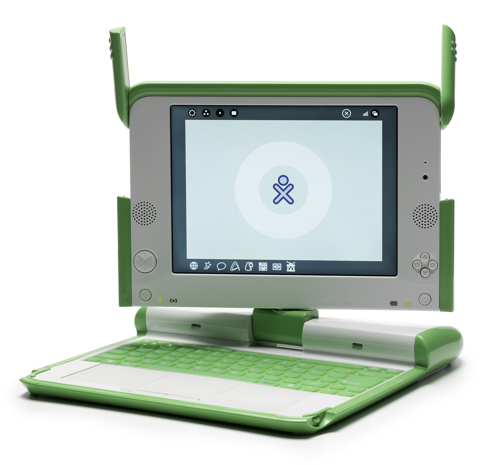

真正将这个概念推向主流商业市场的，是台湾厂商华硕。2007 年底，华硕推出了第一代 Eee PC 701（也称 Eee PC 4G）。它的出现，正式定义了“上网本”这一品类。

Eee PC 701 的三围只有 225 × 165 × 35 mm，重量仅为 0.92 kg，非常容易塞进背包。它的硬件配置极其“复古”：为了控制成本和散热，华硕使用了一颗陈旧的 Intel Celeron M 353 处理器，并将其标准频率从 900 MHz 降频至 630 MHz；内存仅有 512 MB，存储则是一块小得可怜的 4 GB 固态硬盘（SSD）。由于屏幕只有 7 英寸（分辨率 800 × 480），屏幕边框宽得能停航母，两侧甚至还塞下了扬声器。

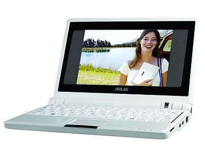

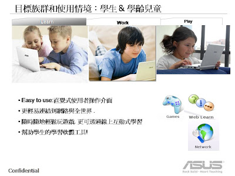

为了规避微软高昂的系统授权费，Eee PC 701 最初搭载的是基于 Linux 定制的 Xandros 操作系统，但很多消费者和零售商会自行安装盗版Windows。它不能运行大型游戏，甚至处理复杂的 Office 文档都吃力，但它能完美胜任当时最核心的需求：连接 Wi-Fi、打开浏览器上网、聊 MSN 和 Skype。由于上市售价仅为 399 美元（低配版甚至更低），它在欧美和亚洲市场瞬间脱销，几个月内就卖出了几十万台。

很快，华硕顺应发达国家消费者对预装 Windows 的依赖，推出了搭载 Windows XP Home 系统的版本，进一步引爆了市场。

7 英寸、分辨率仅为 800 × 480 的屏幕在浏览网页和处理文档时当然是捉襟见肘的。为了解决这个痛点，华硕在 2008 年初迅速推出了Eee PC 900。这台机器的三围微调到了 225 × 170 × 34 mm，重约 0.99 千克。它最大的贡献是将屏幕扩大到了 8.9 英寸，分辨率提升至 1024 × 600，彻底终结了“窗口显示不全、找不到确定按钮”的噩梦。549美元的售价也仍然称得上相当低廉。

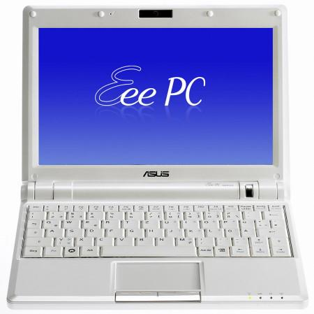

## 二、 Intel Atom 的加持与大厂的涌入

看到 Eee PC 赚得盆满钵满，整个 PC 业界都坐不住了。但第一代上网本普遍面临发热量大、续航短的问题（降频的赛扬处理器依然不够省电）。

2008 年，Intel 针对这一细分市场，推出了划时代的 Atom（凌动） 处理器系列，最著名的便是 Atom N270（单核 1.6 GHz）。这颗芯片功耗极低（TDP 仅 2.5W），且成本低廉，直接催生了 2008-2009 年的上网本“黄金时代”。同时期的上网本也普遍将屏幕升级到了 8.9 英寸，视野终于不再那么局促。

宏碁 Aspire One是这一时期的销量王者之一。发布于 2008 年中，它采用了 8.9 英寸（1024 × 600 分辨率）的镜面屏，三围是 249 × 170 × 29 mm，重量不足 1 kg（配备 3 芯电池时）。它搭载了标准的 Atom N270 1.6 GHz 处理器，1 GB 内存，并将存储换成了容量更大的 120 GB 机械硬盘（HDD）。系统自然是当时上网本的标配：Windows XP Home。它的外观设计比初代的 Eee PC 圆润漂亮得多，起价 399 美元。

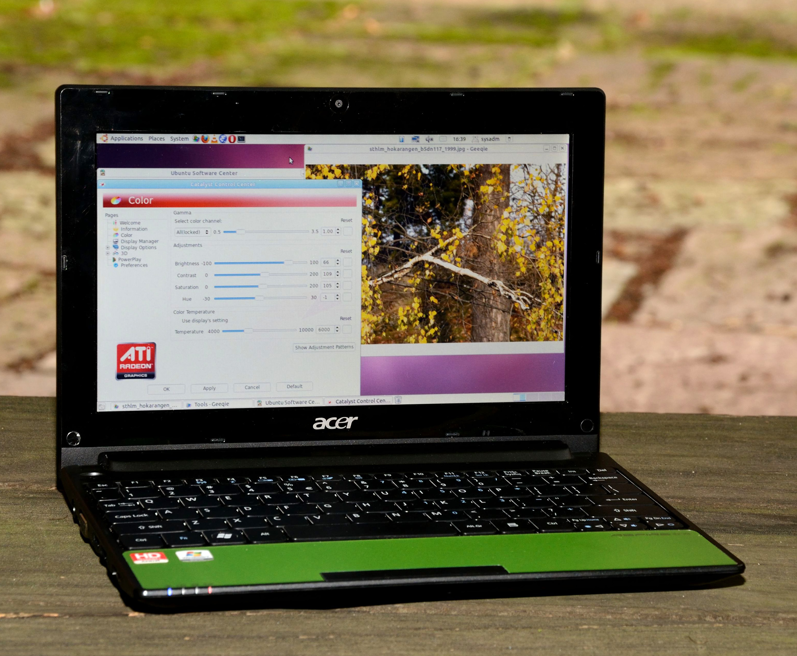

华硕在2008年年中推出了使用1.6 GHz Intel Atom CPU的Eee PC 1000H（H 代表机械硬盘 Hard Drive）。为了解决续航和存储痛点，华硕为它塞进了 80GB 或 160GB 的大容量机械硬盘，以及一块体积庞大的 6 芯大电池，使其硬生生跑出了 5 到 7 小时的续航。但这台机器的重量也随之飙升到了约 1.45 千克，比当时许多高端 12 英寸常规轻薄本还要重。699美元的售价也算不上实惠。

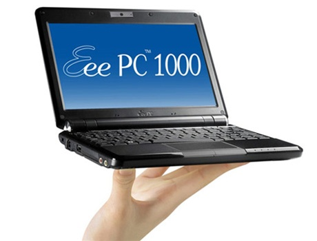

很快，所有叫的上名字的厂商都推出了自己的上网本。

微星也在2008年5月推出了 MSI Wind U100。这款产品将屏幕尺寸进一步推向了 10 英寸（1024 × 600），使得键盘尺寸达到了全尺寸键盘的 92%，大大改善了打字手感。它的三围是 260 × 180 × 19-31.5 mm，重 1.2 kg（含 6 芯电池）。同样是 Atom N270 1.6 GHz 处理器，1 GB 内存 和 80 GB 或 160 GB 的机械硬盘，运行 Windows XP 系统。Wind U100 以其出色的屏幕和键盘手感，成为了很多文字工作者的出差首选。Linux入门版仅售399美元。

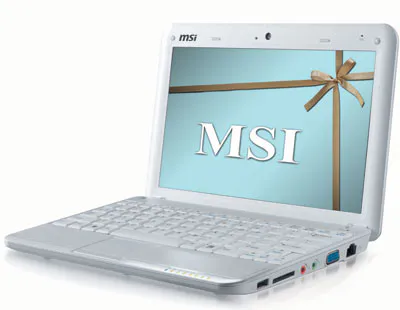

戴尔在2008年9月推出了 Inspiron Mini 9。为了极致防震，它依然采用 8GB 或 16GB 的小容量纯固态硬盘，但戴尔为它设计了极其罕见的无风扇被动散热系统。这台零噪音的小机器在当年意外爆红，因为其主板架构与 Mac OS 兼容性极高，成为了无数手头拮据的极客和学生折腾“黑苹果（Hackintosh）”的首选神机

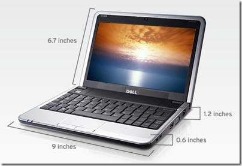

联想在 2008 年底推出了 IdeaPad S10。它的尺寸为 250 × 183 × 27.5 mm，重量 1.2 kg，上市售价399美元。搭载 10.2 英寸 LED 背光屏幕，核心配置依然是雷打不动的 Atom N270 1.6 GHz，1 GB 内存，160 GB 机械硬盘，预装 Windows XP。联想为它加入了当时流行的一键恢复功能和支持多点触控的触摸板。

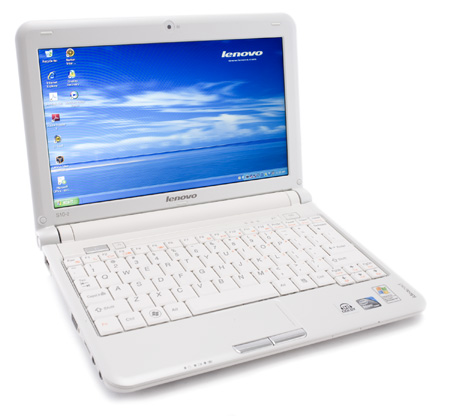

当然，除了 Atom芯片，市场上也有一些不同的声音。比如 2008 年惠普推出的 HP Mini-Note 2133。与当时满大街的塑料外壳不同，它采用了极具商务感的一体化铝合金外壳，质感极佳。它的三围是 255 × 165 × 27 mm，重 1.19 kg。它配备了一块 8.9 英寸的高分屏（1280 × 768），处理器则另辟蹊径，采用了威盛电子的 VIA C7-M（频率有 1.2 GHz 或 1.6 GHz 可选），最高可配 2 GB 内存 和 120 GB 硬盘。操作系统甚至预装了更为庞大的 Windows Vista Basic。起售价499美元。不过，VIA 处理器的性能短板和 Vista 系统的臃肿，使得 2133 虽然好看，但运行起来往往卡顿不堪，发热量也极大。

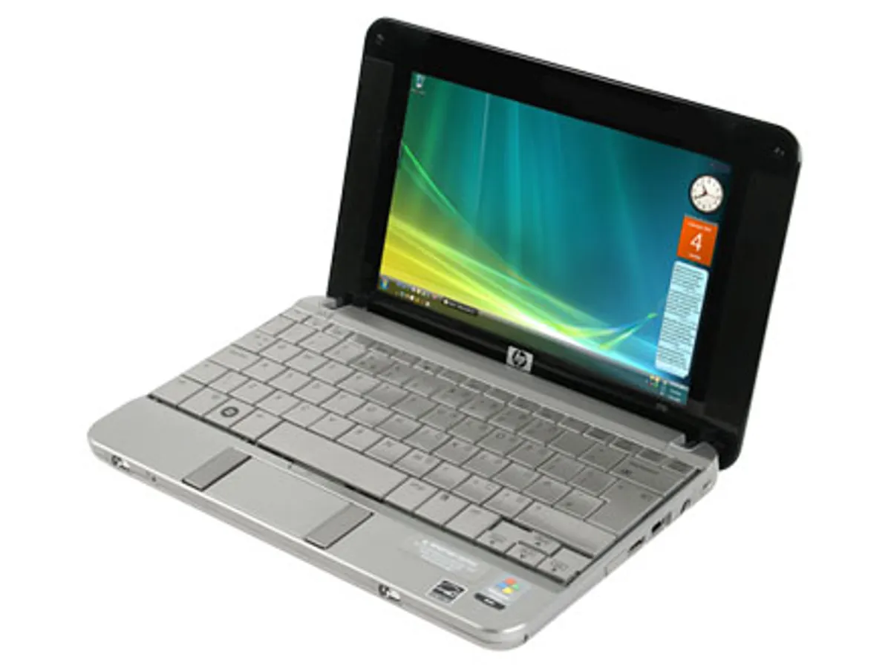

到了 2009 年，随着上游面板的成熟，10.1 英寸成为了上网本的标准尺寸，8.9英寸成为非主流，而7 英寸被彻底抛弃。

宏碁推出了风靡一时的 Aspire One D250。这款 10.1 英寸的机器一改早期上网本的厚重感，将机身厚度成功压缩到了惊人的 1 英寸（约 25.4 mm）以内，标配 3 芯电池下重量仅约 1.1 千克。它搭载 Atom N270/N280 处理器和 160GB 机械硬盘，售价却只有298美元，凭借极其轻薄的时尚外观和高性价比，迅速成为 2009 年市场上的绝对爆款。

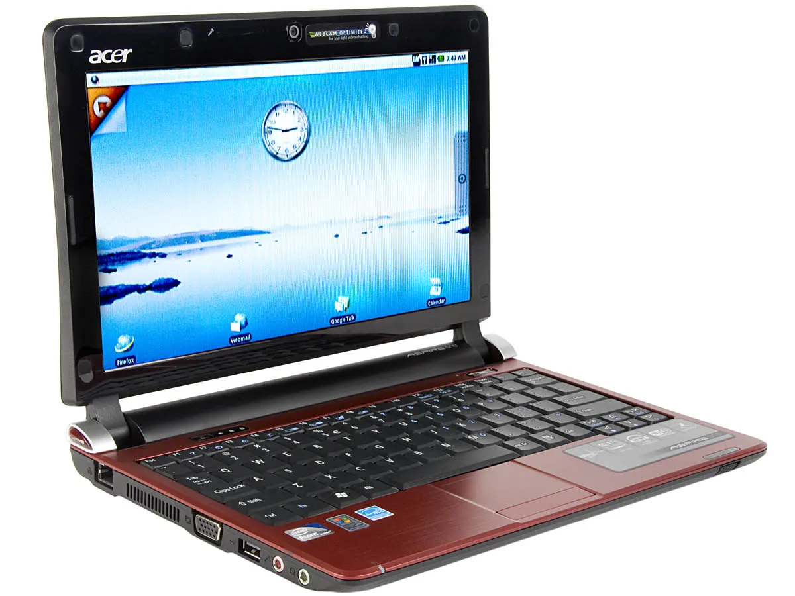

戴尔在2009年底用Inspiron Mini 10 迅速取代了 Mini 9，全系标配 160GB 或 250GB 机械硬盘，重1.2kg，售价399美元。Mini 10 将键盘扩大到了全尺寸的 92%，高配版甚至引入了无边框玻璃屏幕和在上网本中极其罕见的 HDMI 接口，试图将其打造成连接客厅电视的影音终端。

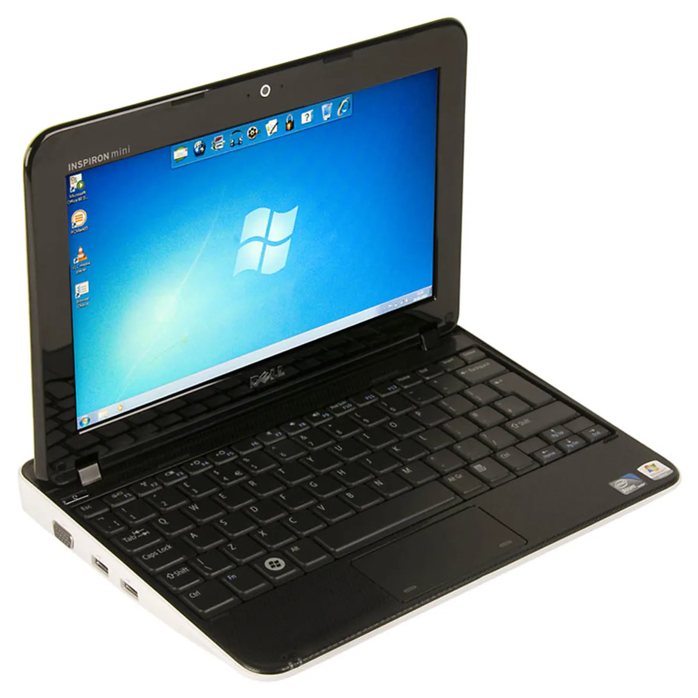

2009 年，上网本迎来了巅峰，全球销量突破 3000 万台，几乎占了当时整个笔记本电脑市场的一大块蛋糕。很多消费者买它并不是为了“第二台电脑”，而是因为便宜，将其作为唯一的个人电脑使用。

## 三、 绚烂之后的极速陨落

2010 年 1 月 27 日，第一代 iPad发布。如果说上网本的初衷是“主要用于上网和内容消费”，那么拥有 9.7 英寸全彩触控屏、长达 10 小时续航、重量仅 680 克、且拥有海量触控 App 的 iPad，无疑在“轻度娱乐和上网”这个维度上，对上网本实现了降维打击。

与此同时，Intel 开始联合 PC 厂商力推轻薄且性能强大的 Ultrabook超极本，普通主流笔记本的重量也逐渐降到了 1.5 kg 左右，价格更是不断下探。

2011年9月，第一款超级本宏碁Aspire S3发布，它采用了铝镁合金的顶盖，机身最薄处仅 13 毫米，整机重量仅 1.33 kg。它搭载英特尔第二代酷睿低电压双核处理器（如 Core i5-2467M），内置 Intel HD Graphics 3000 核显，性能要比上网本强大得多，但售价也高不少，基础款为899 美元。

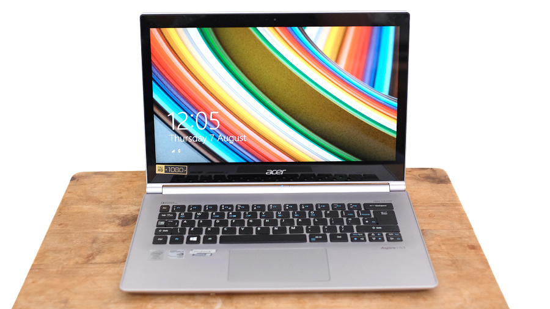

此外，大量上网本长期依靠盗版Windows系统降低售价，最多使用低廉老旧的Windows XP的行为也伤害了微软的利益。Windows XP的上网本特供版在2010年10月开始停止授权，从而为Windows 7系统让路。而微软强制要求上网本只能预装功能被严重阉割、连更换桌面壁纸都不允许的 Windows 7 Starter，也给上网本加上了紧箍咒。

前有 iPad 抢占内容消费市场，后有低价全尺寸轻薄本和超极本抢占生产力市场，夹在中间、性能低下、体验糟糕的上网本迅速失去了生存空间。2011年底，戴尔率先停产Mini系列，宣告将转向Ultrabook和Chromebook。第二年，微星的Wind系列也停产，宏碁和华硕则都在2013年终止了上网本生产线。

上网本从诞生到消亡，前后不到6年时间，虽红极一时，却十分短命。

## 四、 云端重生：Chromebook 让廉价便携终成现实

传统上网本死于羸弱的本地算力与臃肿系统的矛盾，但大众对“低价、轻便”电脑的需求却从未消失。就在传统 PC 厂商纷纷停产上网本的 2011 年，谷歌带着一个颠覆性的思路入局了：既然低端硬件跑不动本地的复杂系统和软件，那为什么不把一切都搬到云端呢？

基于这个理念，谷歌推出了搭载 Chrome OS 的 Chromebook。这个系统本质上就是一个极度轻量化的 Linux 内核套上一个 Chrome 浏览器。通过将大量的计算任务转移到云端计算，并将文件存放于云端存储，Chromebook 极大地降低了对本地处理器和内存的配置要求，不仅彻底解决了低端芯片发热卡顿的顽疾，还带来了近乎“秒开机”的极速体验和全天候的续航。

2011 年中旬，三星推出了世界上首款商用 Chromebook——Series 5。它摆脱了早期上网本局促的尺寸，采用了一块 12.1 英寸（1280 × 800）的屏幕，三围达到了 294 × 219 × 20 mm，重量为 1.48 千克。作为一款常规尺寸的笔记本，它售价只有429美元，与上网本在同一级别。它搭载了主频 1.5 GHz 的双核 Atom N570 处理器，拥有 2 GB 内存，而本地存储仅仅是一块 16 GB 的固态硬盘。由于 Chrome OS 极其轻量，这台机器不仅运行网页如丝般顺滑，续航时间更是达到了在当时 PC 阵营里傲视群雄的 8.5 小时。

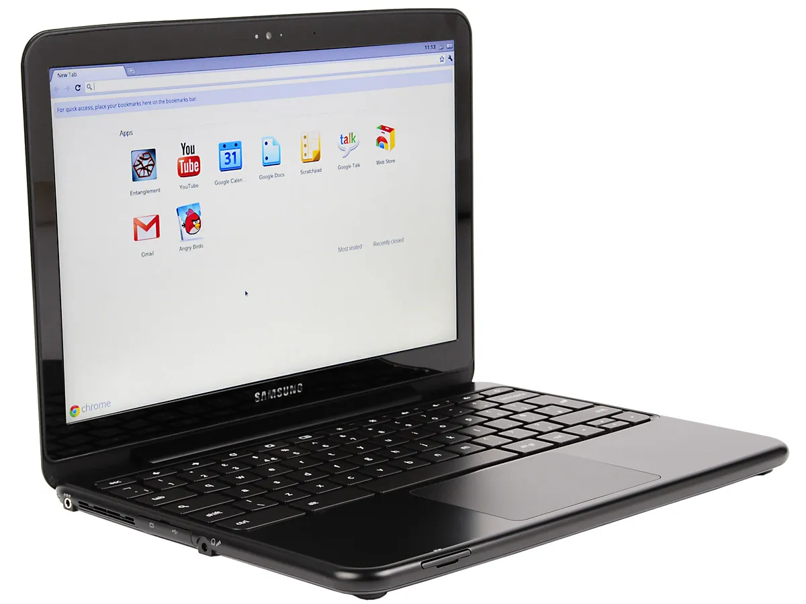

随着技术的演进，Chromebook 的优势在教育市场和轻度办公领域被无限放大。

2013 年，宏碁推出了堪称一代神机的 Acer C720。这款机器将尺寸收缩到了极为平衡的 11.6 英寸，三围是 288 × 204 × 19 mm，重 1.25 千克。它抛弃了 Atom，换装了拥有全新 Haswell 架构、主频 1.4 GHz 的英特尔 Celeron 2955U 处理器，搭配 2 GB 内存和 16 GB 固态硬盘。在 Chrome OS 的调度下，它的流畅度完全不输当年的主流 Windows 轻薄本，电池续航也能轻松突破 8.5 小时，而它的起售价，竟然只有令人咋舌的 199 美元。凭借着低廉的价格、极简的云端后台管理系统和不怕病毒的特性，C720 及其后续机型迅速横扫了北美的 K-12 教育市场。

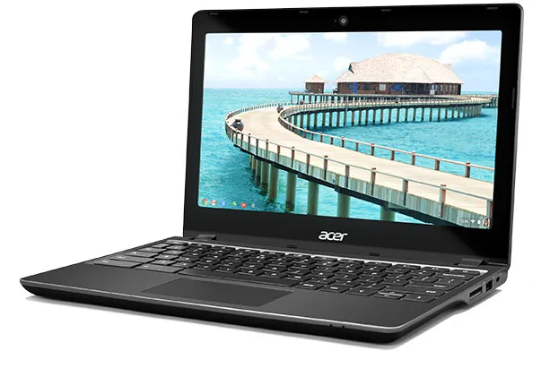

从 Netbook 时代的“小马拉大车”导致全线溃败，到 Chromebook 时代利用云端计算完成的华丽逆袭，低价轻便笔记本的梦想到此才算真正得以实现。华硕 Eee PC 打开了廉价移动计算的潘多拉魔盒，而最终在云时代将其打磨成实用兵器的，则是打破了常规系统枷锁的 Chromebook。

系列文章：
