# 移动计算发展史（6）：塞进掌心的全功能电脑——UMPC

> 来源:https://api.zhihu.com/articles/2047544728514719993  
> 日期:2026-06-12 · 赞同:49 · 文章

在之前[移动计算发展史（4）：手包与口袋中的Subnotebook](https://zhuanlan.zhihu.com/p/75390176)的结尾，我们提到，随着技术的进步和全尺寸轻薄本重量的下降，Subnotebook 在2006年以后走向了式微，并向两个截然不同的方向演化：一个是追求极致便携和未来形态的 UMPC（超移动电脑），另一个则是为了教育市场和轻度上网需求而诞生的廉价产品——上网本（Netbook）。

与掌上电脑（PDA）或后来的智能手机不同，UMPC 的核心信仰是“绝不妥协的完整 PC 兼容性”。它们运行着全功能的 Windows 桌面系统，搭载着 x86 架构的处理器，力图让商务人士和极客们能在手掌上运行完整的 Office、Photoshop 甚至是 PC 游戏。

## 一、 “折纸计划”与先驱者的野望

早在 UMPC 这个词汇被微软正式提出之前，市场上就已经有了极其激进的探索者。最著名的当属由几位前苹果工程师创立的 OQO 公司在 2004 年推出的 OQO Model 01。

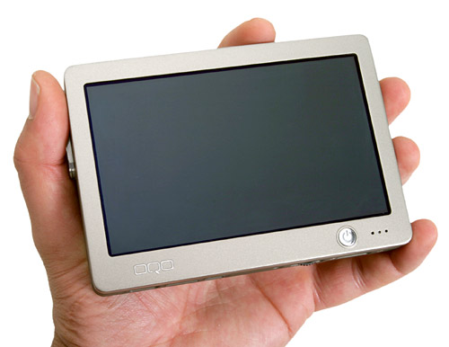

这款机器简直是那个年代的科幻造物。它的三围仅有 124 × 86 × 23 mm，重量轻至 397 g，拥有一块 5 英寸的屏幕。当你把屏幕向上滑开时，下方会露出一个拇指全键盘。

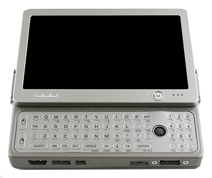

为了在这么小的体积内运行完整的 Windows XP Professional 操作系统，它搭载了全美达（Transmeta）的 Crusoe TM5800 处理器，主频为 1 GHz，配备了 256 MB 内存和一块 20 GB 的微型硬盘。

虽然它的发热量巨大，续航也仅有两三个小时，且上市售价高达 1999 美元，但它向世界证明了“口袋里的全功能 PC”并非天方夜谭。

真正将这类设备推向风口浪尖的，是 2006 年德国 CeBIT 展会上，微软与英特尔、三星联合发布的“折纸计划”（Project Origami）。后来，微软为这种设备正式定名为 UMPC，并给出了初步规范：屏幕在 5 到 7 英寸之间，重量在 900 克以下，支持触控输入，运行 Tablet版Windows 系统。

作为“折纸计划”的首发护航作，三星在 2006 年推出了Q1。它看起来就像一个略显厚重的游戏掌机或早期的平板，三围是 227 × 139 × 26 mm，重量为 779 g。正面是一块 7 英寸（800 × 480）的触摸屏。核心配置上，它采用了英特尔 Celeron M ULV 353 处理器，主频为 900 MHz，搭配 512 MB 内存和 40 GB 硬盘。

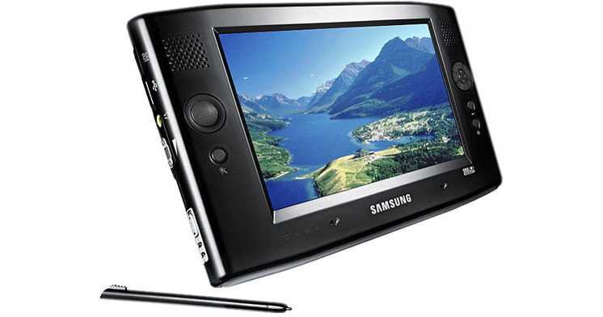

为了适配无键盘操作，它预装了带有“Origami 体验包”的 Windows XP Tablet PC Edition。不过，1099 美元的价格和仅有两个半小时的续航，让它的市场反响平平。

紧随其后的华硕也推出了 ASUS R2H。它的尺寸为 234 × 133 × 28 mm，重 830 g。配置与 Q1 类似，同样搭载主频 900 MHz 的英特尔 Celeron M 处理器，256 MB 或 512 MB 内存，运行 Windows XP Tablet PC Edition。售价在1000-1200 美元，仍然相当高昂。

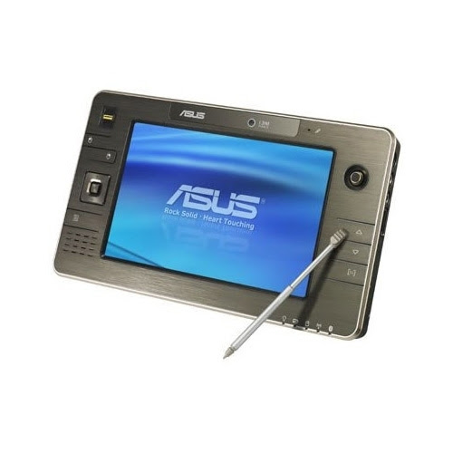

华硕为它加入了 GPS 模块和指纹识别，试图主打高端车载和外勤商务，但在羸弱的性能面前，这些功能显得有些华而不实。

同期响应折纸计划的还有台湾企业 AMtek （粮德精密）推出的 AMtek T700，这款 7 英寸的机器三围大约是 228 × 146 × 25 mm，重 850 g，核心配置同样是主频 1.0 GHz 的英特尔 Celeron M 处理器和 512 MB 内存，运行 Windows XP Tablet PC Edition，也是第一代标准 UMPC 的典型设计，起价900美元。

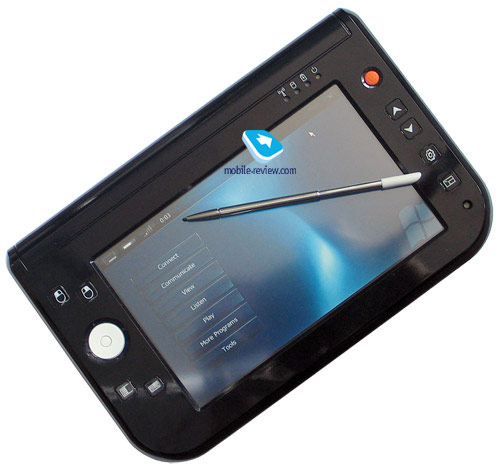

## 二、 工业设计的巅峰：滑盖与分体的艺术

第一波基于“折纸计划”的 UMPC 虽然赚足了眼球，但纯平板的造型在输入文字时极其痛苦。于是，厂商们开始在键盘的机械结构上大做文章。

索尼在 2006 年中旬交出了一份令人惊艳的滑盖答卷——VAIO UX 系列。

UX50抛弃了 7 寸的大体型，采用了一块 4.5 英寸（1024 × 600）的高分屏，三围缩小到了极致的 150 × 95 × 32 mm，重量仅为 520 g。它采用了极为炫酷的屏幕上滑盖设计，滑开后是一个带有蓝色背光的 QWERTY 键盘。

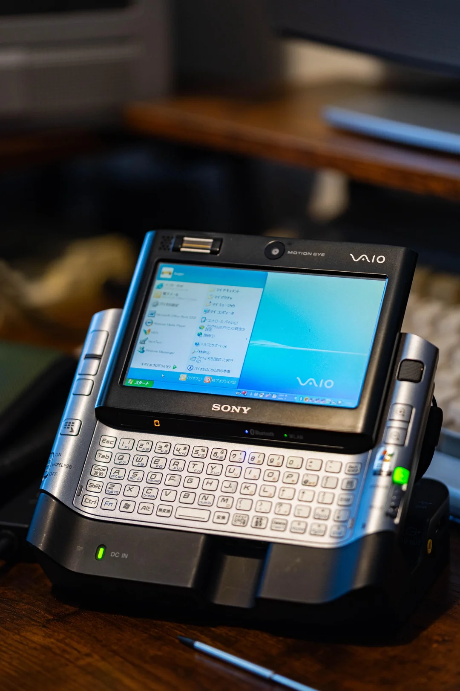

配置方面，它甚至塞入了一颗英特尔 Core Solo U1300 处理器，主频高达 1.06 GHz，配备 512 MB 内存和 30 GB 硬盘，运行完整的 Windows XP Professional。 但是续航只有1.5小时左右，甚至比OQO Model 01和三星Q1还短。

VAIO UX 的设计实在太过超前和科幻，以至于被包括《终结者2018》、《007：大破量子危机》在内的多部好莱坞大片选为极客装备。当然，它的售价也同样高冷，通常在 1800 到 2500 美元之间。

先驱者 OQO 也在 2007 年推出了进化版的 OQO Model 02。它依然保持了精巧的滑盖设计，三围为 142 × 84 × 26 mm，重 454 g。由于全美达处理器的退场，它换用了威盛（VIA）的 C7-M 处理器，频率可选 1.2 GHz 或 1.5 GHz，内存提升至 1 GB，操作系统也支持了 Windows Vista（或降级 XP）。

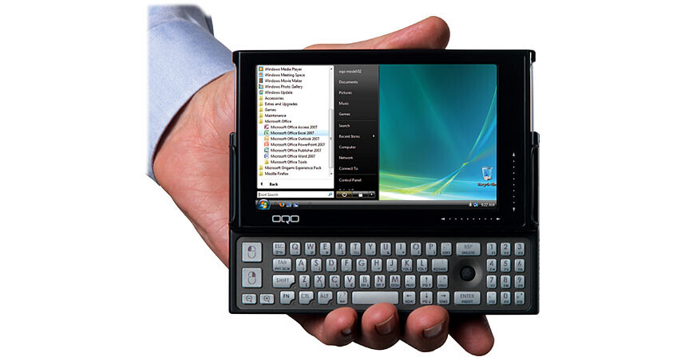

Model 02 的全铝合金机身和极佳的键盘手感让它在极客圈备受推崇，但威盛处理器的孱弱性能却让它在运行 Vista 时几乎像在放幻灯片。

三星也意识到了这个痛点。他们在 2007 年推出了 Q1 的进化版——Samsung Q1 Ultra。为了解决输入难题，三星巧妙地在 7 英寸（分辨率升级为 1024 × 600）屏幕的左右两侧边框上，直接增加了一套分体式 QWERTY 键盘。用户可以像握持游戏手柄一样，用两只大拇指进行打字。这套分体键盘极大改善了站立或移动状态下的文字输入体验，但起价增加到1200美元。

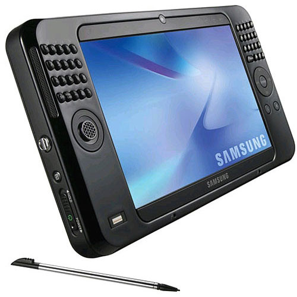

它的三围略微优化到 227.5 × 123.9 × 22.9 mm，重量减轻至 690 g。配置方面，它换装了主频为 800 MHz 的英特尔 A110 处理器，拥有 1 GB 内存 和 60 GB 硬盘，操作系统则顺应时代预装了 Windows Vista。

韩国厂商 Wibrain 在同一年推出的 Wibrain B1 也采用了类似的两侧左右分体键盘设计，且更为袖珍，其 4.8 英寸机身的三围仅有 192 × 82 × 28 mm，重 526 g，它采用了主频 1.2 GHz 或 1.6 GHz 的 VIA C7-M 处理器和 512 MB 或 1 GB 内存，运行 Windows XP。它650美元的起价是当时少有的相对亲民的选择，但续航还是只有2-2.5小时。

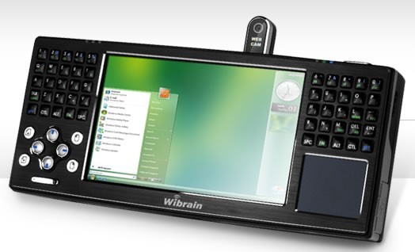

## 三、 挣脱续航泥沼： Atom 和双系统奇招

在 UMPC 发展的早期，强悍的 x86 桌面处理器虽然带来了完整的 PC 体验，但也同时带来了发热和耗电的灾难。2 到 3 小时的糟糕续航几乎是所有早期产品的通病。直到 2008 年后 Intel Atom（凌动）处理器的全面普及，UMPC 才真正迎来了续航的破局时代。低功耗架构的引入，让这类口袋设备终于敢于标榜长效续航。

富士通在 2007 年推出了采用LifeBook U810。这台机器的三围是 171 × 133 × 32 mm，重约 700 g。像系列其他机型一样，它配备了一块 5.6 英寸的可旋转触控屏，屏幕翻转后即可变为一台厚实的平板。为了在性能和续航间寻找平衡，它搭载了英特尔当时专门为 UMPC 研发的、功耗稍低的 800MHz的Atom A110 处理器，配备 1 GB 内存，运行 Windows XP 或 Vista 操作系统。得益于这颗处理器和日系优秀的电源管理技术，它的实际办公续航勉强达到了 4 到 5 个小时，在当时已属难得。不过1000美元的起价同样比较昂贵。

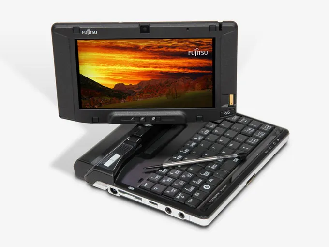

另一家入局的手机巨头 HTC，则在 2008 年推出了脑洞大开的变种机型——HTC Shift (X9500)。这台三围 207 × 129 × 25 mm、重 800 g 的 7 英寸设备，采用了曾在自家掌上电脑上大获成功的“滑盖+倾斜”双轴铰链结构。为了对付 x86 架构续航不足的“绝症”，HTC 祭出了物理外挂：它不仅同样搭载了A110 处理器和 1 GB 内存来运行 Windows Vista，竟然还在主板上额外内置了一套高通芯片组。用户能在待机时一键切换到一个名为 SnapVUE 的简易 Windows Mobile 系统，专用于在极低功耗下收发邮件，试图以此“曲线救国”。虽然x86模式只能用2-3小时，但Windows Mobile+ARM待机可以有2-3天。但售价高达1500美元。

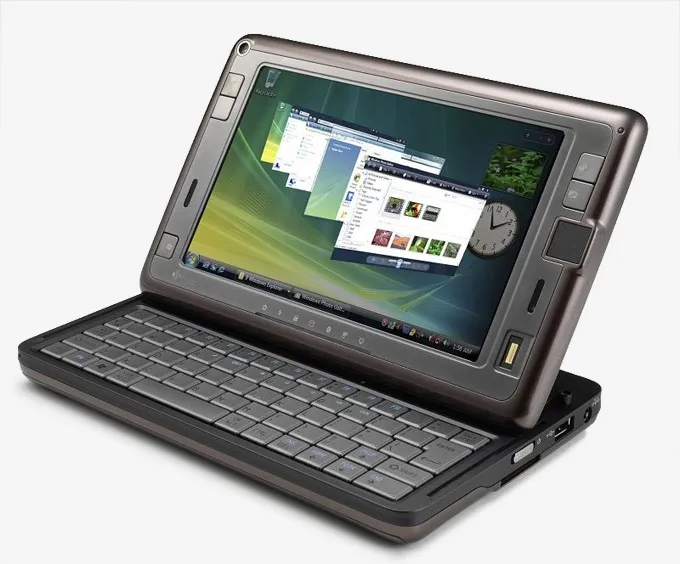

松下也在 2008 年入局，推出超坚固型 UMPC——Toughbook U1。它配备 5.6 英寸屏幕，为了防摔防水，三围达到惊人的 184 × 150 × 57 mm，重 1.06 kg。它内置了主频 1.33 GHz 的 Intel Atom Z520 处理器和 1 GB 内存，运行 Windows XP 或 Vista。不仅有低功耗处理器的加持，松下还为它设计了两块支持热插拔的电池，这种简单粗暴的供电设计让它的续航达到了惊人的 9 个小时，一举成为了极端恶劣环境下的首选移动终端。但售价也高达2500美元。

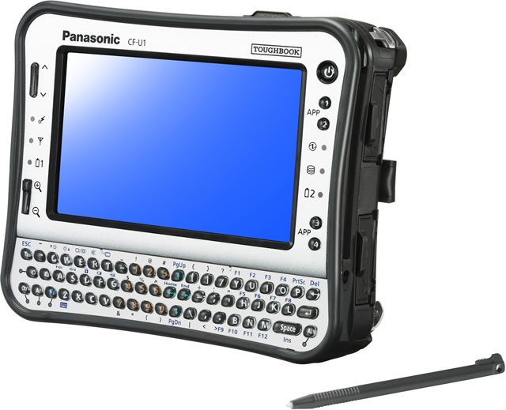

到了 2009 年，吃到 Atom 处理器低功耗红利的还有异军突起的韩国品牌 Viliv。

比如主打纯触控平板形态的 Viliv S5。它拥有一块 4.8 英寸屏幕，三围极其小巧，仅为 154 × 84 × 24 mm，重量只有 385 g。凭借主频 1.33 GHz 的 Intel Atom Z520 处理器、1 GB 内存，以及省去了复杂机械键盘后换来的充裕电池空间，S5 实现了高达 6 个小时的实际续航，使得它可以兼职成为多媒体播放器。

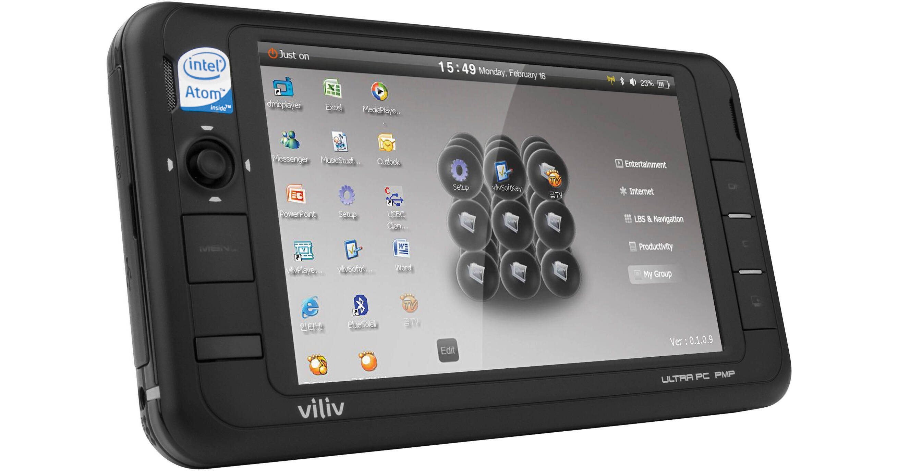

与 S5 同期亮相的同门师兄 Viliv X70 则是放大版的 7 英寸机型，三围 210 × 117 × 22 mm，重 660 g，同样搭载了这套 Atom 核心配置，续航表现同样出众。

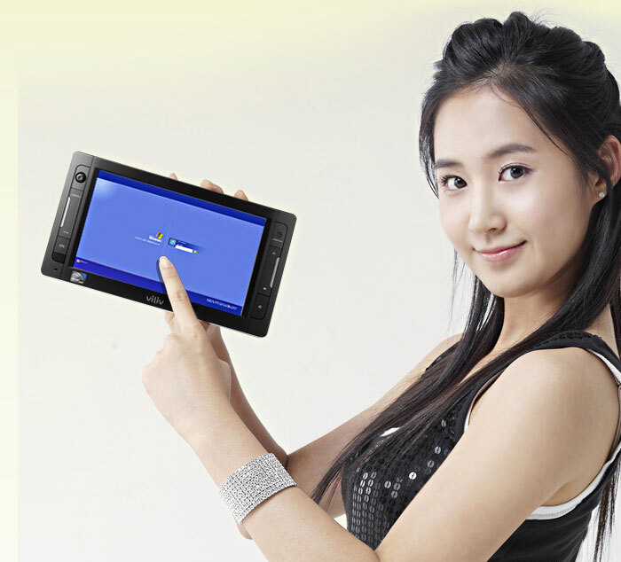

到了 2010 年，Viliv 又推出了采用传统翻盖全键盘设计、形态更类似早期 Handheld PC 的 Viliv N5。这款机器将 4.8 英寸屏幕装入了 172 × 86 × 25 mm、重 388 g 的蛤蟆口机身中，系统也顺应时代升级到了 Windows 7 Starter。根据配置的不同，它的售价在 649 美元到 799 美元之间。

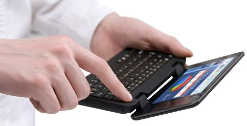

同样试图在 Atom 时代寻找破局点的，还有同样来自韩国的 Ocosmos OCS1。这款在 2011 年惊艳亮相的设备配备了 4.8 英寸屏幕，三围约 135 × 73 × 14 mm，重约 400 g。它别出心裁地采用了侧滑式游戏手柄设计，内置了主频 1.5 GHz 的 Intel Atom Z670 处理器和 2 GB 内存，运行 Windows 7，续航为3-4小时，起价600美元。

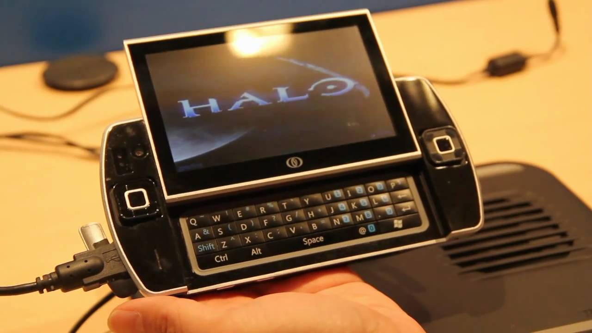

尽管它最终未能在市场上大规模铺开，但这种将低功耗 x86 架构与 PC 游戏掌机结合的思路极其超前，在那个 UMPC 逐渐没落的年代，提前奏响了现代 Windows 掌机时代的先声。

### 四、 辉煌的落幕与现代的余音：PC游戏复兴背景下的游戏向UMPC

从 2006 到 2010年，UMPC 展现了人类在微型化 PC 上能做到的极致。但这些动辄 1500 美元以上的设备，最终却没能走向大众。

原因非常现实：微软的桌面级操作系统完全没有为这种微型触摸屏做好准备，而移动办公场景下两个拇指手持打字的速度也完全无法与正常笔记本十指同时运作的效率相比。最后，当拥有多点触控和长达 10 小时续航的 iPad 问世时，大众消费者突然明白：在移动中，我们不需要“全功能 PC”，而是一套专属于移动时代的交互逻辑。于是，传统的 UMPC 在 2010 年前后迅速衰落，国际大厂纷纷砍掉产品线。

不过，UMPC 并没有真正死亡。

随着Steam游戏引领PC游戏的复兴，以中国的GPD为代表的厂商又掀起了一次UMPC新潮流。游戏用途需要的按键较少，手持操作完全可以接受，而Steam极其庞大的游戏库又是任何专用主机很难比拟的。因此在手持尺寸下塞进去一台全功能电脑，又再次具备了价值。

2016 年推出的 GPD WIN，开创性地将 QWERTY 全键盘与游戏手柄的摇杆、按键完美融合在一台 5.5 英寸的机器中。它的三围仅为 155 × 96 × 23.5 mm，重 365 g。凭借1.6 -2.4GHz的 Intel Atom x7-Z8700 处理器和 4 GB 内存，它可以运行完整的 Windows 10 桌面系统和早期的 PC 游戏大作。虽然玩大型游戏如《上古卷轴5：天际》时它的续航仍然只有2小时左右，但普通轻办公和浏览网页的续航增加到6-8小时，加上售价只有650美元和不错的游戏操控，可以说是第一款被更广泛消费者接受的UMPC。这种跨界形态的成功，不仅为 UMPC 找到了一批极度硬核的受众，也从某种程度上启发了后来爆火的 Valve Steam Deck。

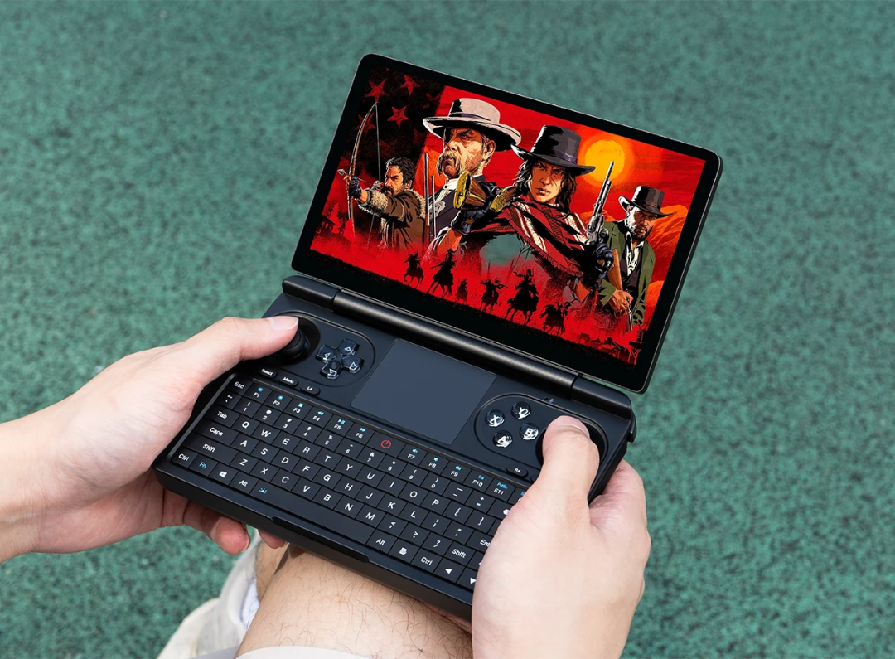

这个翻盖+游戏摇杆和专用按键的设计后来变成WIN Max系列。

GPD 随后在 2017 年又推出了更倾向于移动办公的 GPD Pocket。它使用铝合金 CNC 外壳，采用 7 英寸屏幕，三围控制在了 180 × 106 × 18.5 mm，重 480 g。在如此袖珍的机身内，它搭载了主频 1.6 GHz-2.56 GHz的 Atom X7-Z8750 处理器和 8 GB 内存，顺畅运行 Windows 10。为了在局促的 C 面节省空间，它甚至舍弃了触控板，改用类似 ThinkPad 的小红点指点杆，极大得增强了办公实用性。5-6小时的续航不算低，售价还只有400美元

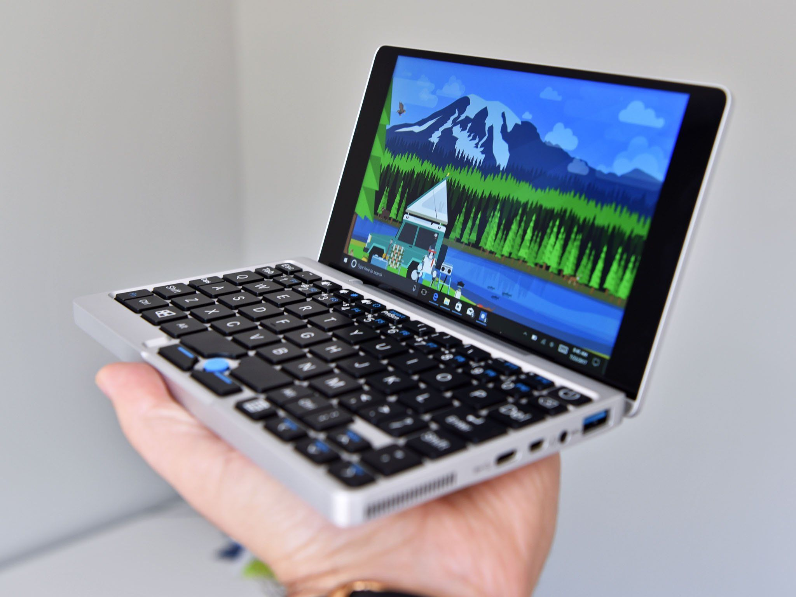

两年后的 2019 年，GPD 又将目光投向了更为硬核的工业应用，推出了目标客户直指网络运维工程师的 GPD MicroPC。它的尺寸进一步缩小至 153 × 113 × 23.5 mm，使用6英寸屏幕，重 440 g。它也开始采用了类似当年富士通 U810 的翻转变形设计。虽然搭载的仅仅是 1.1-2.4 GHz的英特尔 Celeron N4100 处理器和 8 GB 内存，但背部却极其罕见地提供了一个原生 RS-232 串口和完整的 RJ45 网口。它有6-8小时的续航，售价还只有2000元人民币。

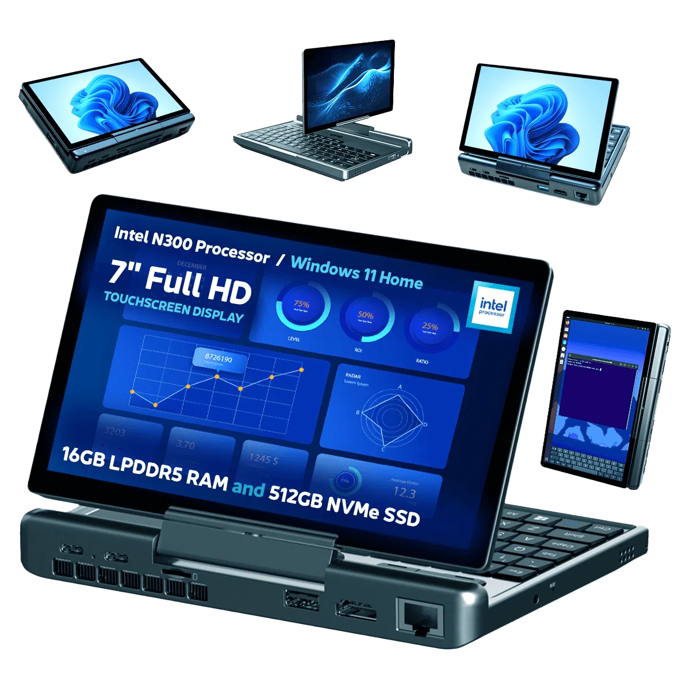

到了 2021 年，GPD 更是推出了一款向早期 UMPC 黄金时代致敬的设备——GPD WIN 3。它复刻了当年索尼 VAIO UX 和 OQO 的经典滑盖设计，当把屏幕向上滑开时，下方会露出一块隐藏式的带有震动反馈的触摸全键盘，但同时屏幕两侧增加了完整的游戏手柄按键。它的三围是 198 × 92 × 27 mm，拥有 5.5 英寸屏幕，重量为 560 g，使用11代酷睿 Core i7-1165G7 处理器，搭配 16 GB 内存。众筹价4800元。

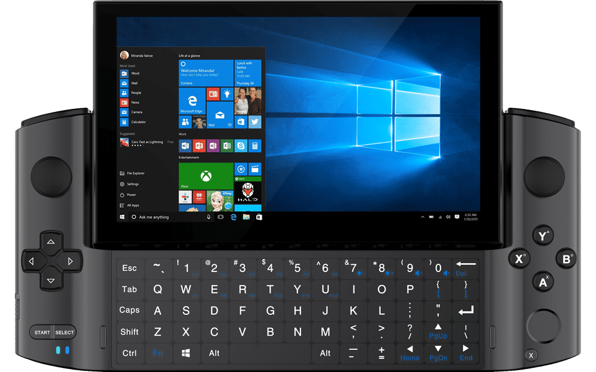

回顾 UMPC 的发展史，它实际上是一段“在错误的时间追求正确目标”的妥协史。在那个半导体能效比极度脱节的年代，厂商们用尽了各种奇巧滑盖和机械变形，也无法掩盖它生来就烫手、卡顿且续航孱弱的物理硬伤。

而今天，当半导体工业的制程终于追赶上人类的想象力时，这些口袋里的 PC 虽然注定依然只是少数人的玩物，无法成为大众的主流，但它们终于在极客、工程师与特定玩家的掌心里，安稳地找到了属于自己的一席之地。当年那个“把完整电脑塞进口袋”的硬核旧梦，如今总算可以踏踏实实地变为了现实。

系列文章：
