# 移动计算发展史（8）：从Pocket Computer到Palmtop PC——基于键盘的早期手持电脑

> 来源:https://api.zhihu.com/articles/2055478371547608968  
> 日期:2026-07-02 · 赞同:36 · 文章

在个人电脑向便携化演进的早期，除了在保持全功能的前提下将电脑尽量缩小的膝上电脑和笔记本电脑，还有另一条追求极致小巧的发展脉络，即将电脑缩小到可以完全放进口袋的尺寸，但允许功能在一定程度上的缩水。

在触控屏和图形用户界面（GUI）尚未在移动设备上普及的年代，这类设备主要依赖实体键盘输入和字符显示。这个发展过程主要分为两个阶段：1980年代基于BASIC语言的Pocket Computer（口袋计算机），以及1980年代末到1990年代初基于MS-DOS系统和x86架构的Palmtop PC（掌上电脑）。

## 一、可编程的科学计算器——Pocket Computer

早期的口袋计算机更多是在科学计算器的基础上增加了QWERTY键盘和可编程能力。

在口袋计算机出现之前，惠普曾在1974年推出过世界上第一款支持磁卡存储的掌上可编程计算器 HP-65。但 HP-65 仅配备数字按键和只能显示数字的红色LED屏幕，且采用基于按键序列记录的底层指令。而真正的“口袋计算机”则跨越了这一阶段，通过引入全字母键盘和高级语言解释器，获得了处理文本与复杂逻辑的能力。

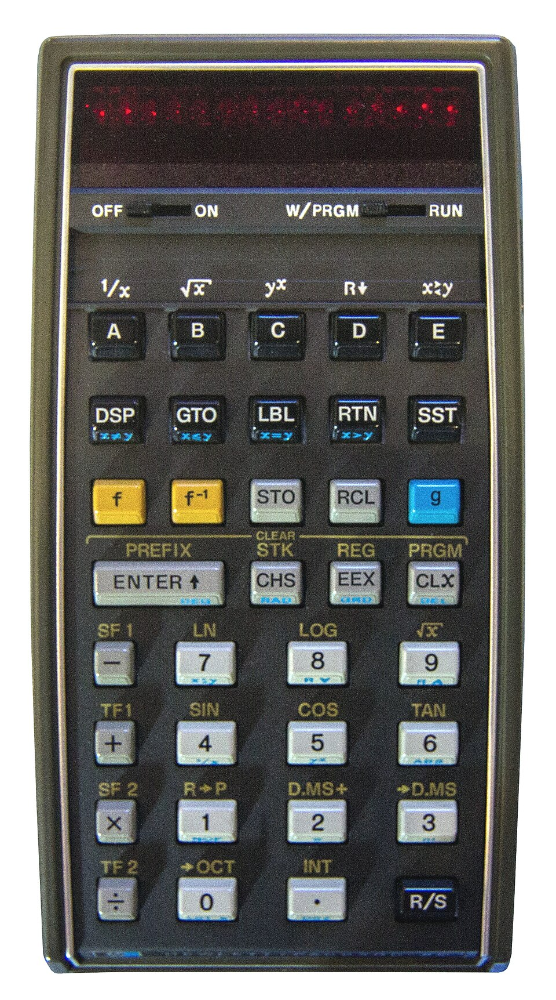

1980年，夏普推出了世界上第一款商业上取得成功的口袋计算机——PC-1211。它的三围仅为175 × 70 × 15 mm，重量170g，可以放入衬衫口袋。与 HP-65 纯数字的交互不同，PC-1211 增加了一套全字母键盘（QWERTY布局），并配备了一块能够显示英文字母和符号的单行24字符单色液晶屏。该设备搭载两颗4位处理器，拥有1.4KB的RAM，上市售价175美元。最核心的区别在于，它不再依赖按键记录，而是内置了 BASIC 语言解释器。这使得工程师和学生能够使用高级语言编写处理字符串和复杂跳转逻辑的简单程序，从而真正划清了计算器与计算机的界限。同时，它还支持外接打印机和磁带存储器，

早期的配套微型打印机+磁带存储器CE-122，可以一起放到一个很小巧的盒子内旅行使用。

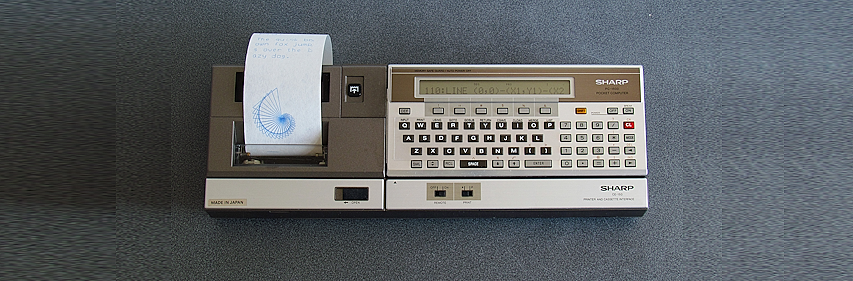

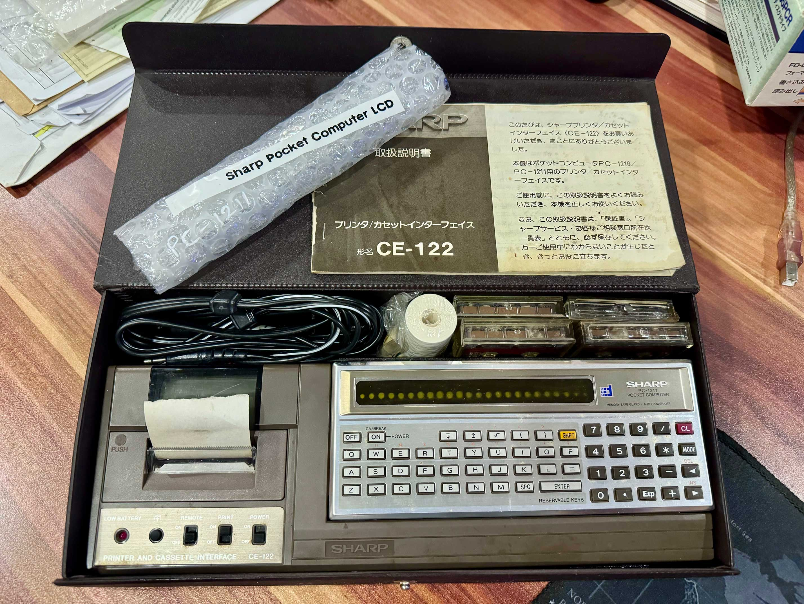

后期的配套微型打印机+磁带存储器CE-125。

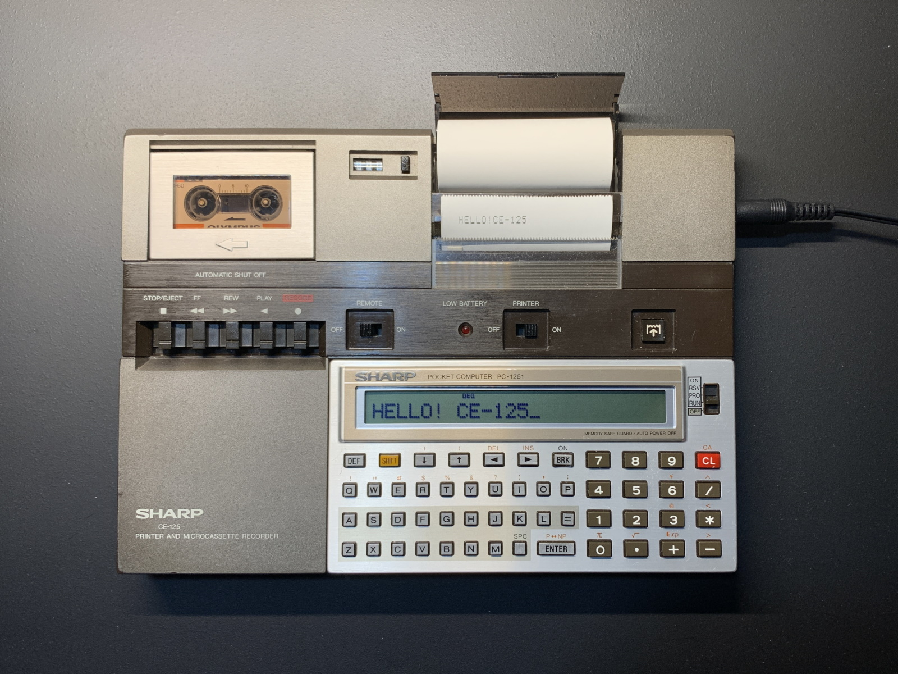

PC-1211在北美由Tandy贴牌为TRS-80 Pocket Computer发售

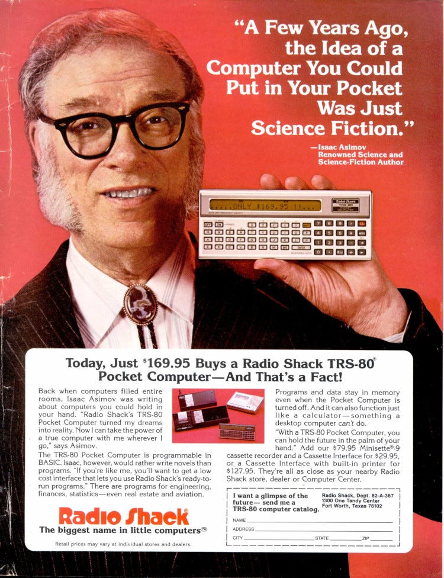

CE121磁带适配器的美版，可以外接各种磁带机。

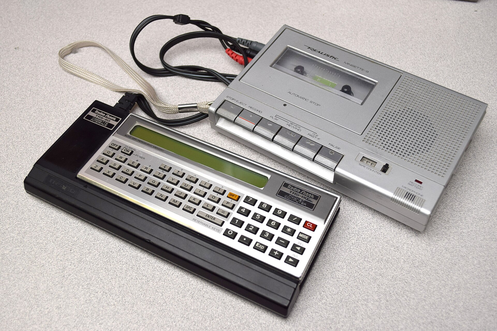

也有专用的磁带存储器。

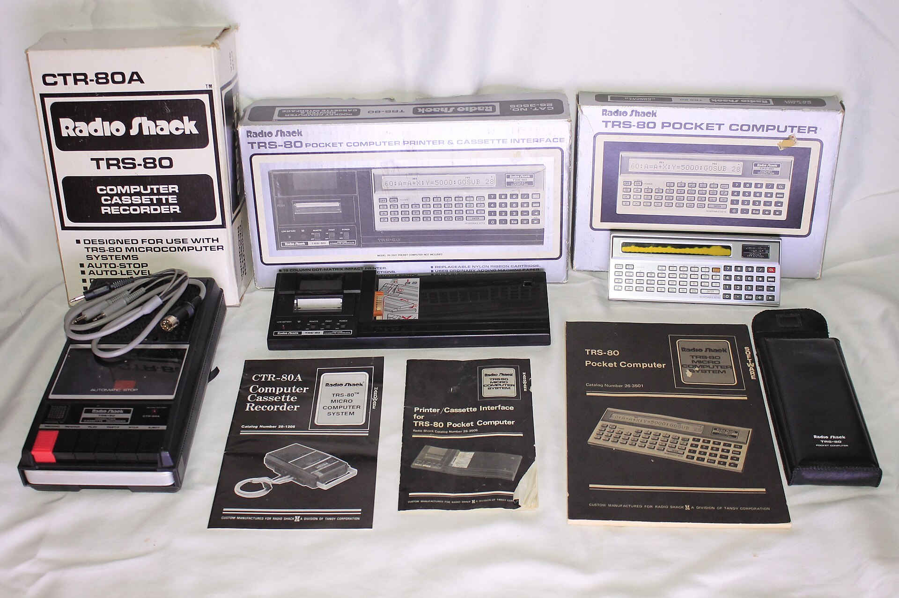

随后，其他厂商也迅速跟进。卡西欧在1981年推出了Casio FX-702P，尺寸为165 × 82 × 17 mm，重176g，拥有1.68KB RAM和一行20个字符的显示屏，售价约200美元。

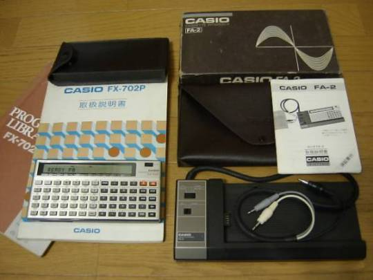

1982年，夏普进一步推出了升级版PC-1500，三围达到195 × 86 × 25 mm，重量增加到375g，配备了8位CPU和3.5KB RAM（可扩展），使用156 × 7 像素的全点阵屏幕，而非早期Pocket computer常见的20-24 字符的定制屏幕，还增加了一个压电蜂鸣器，并支持外接四色微型绘图打印机，可以说多媒体性能大幅增强。上市售价约300美元。

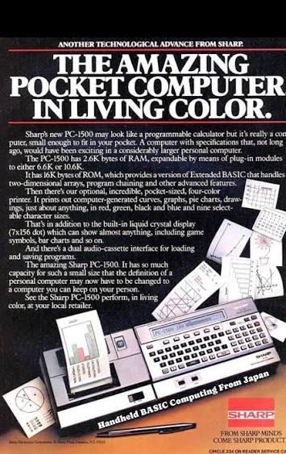

配套的CE-150打印机和存储卡带

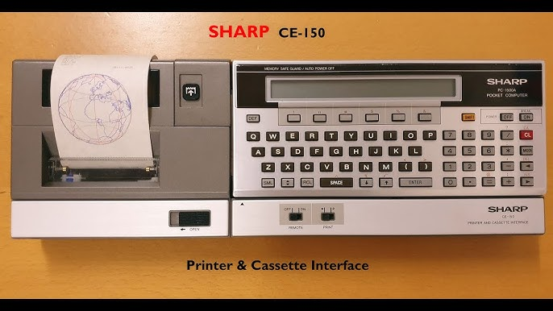

尽管早期的口袋计算机通过 BASIC 语言解决了复杂程序的编写问题，但在面对简单的日常科学计算时，纯字符输入的交互方式反而显得繁琐。例如，计算一个三角函数需要敲击多个字母输入 `PRINT SIN(30)`，这显然不如传统科学计算器上的独立按键直观高效。

为了解决这一问题，夏普在1983年推出了兼具两种设备特性的混合型产品——PC-1401。这款设备的尺寸为 170 × 72 × 9.5 mm，重量进一步缩减至 150g。它搭载了8位的 SC61860 处理器，配备 4.2KB 的 RAM 和一块单行16字符的液晶屏。

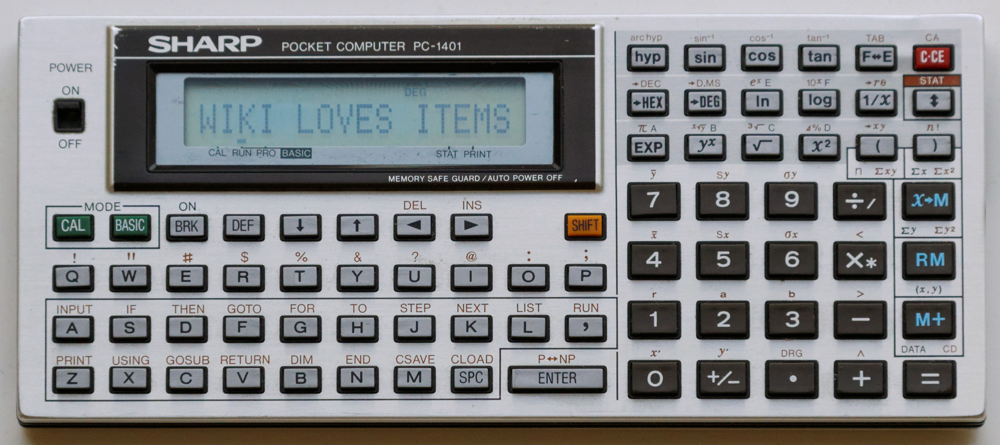

PC-1401 最大的物理特征，是在左侧的 QWERTY 键盘之外，在右侧保留了完整的传统科学计算器独立按键（包含三角函数、对数、指数等）。在软件层面上，它提供了模式切换功能：在“CAL（计算）”模式下，它就是一台支持复杂函数的顶级科学计算器；而在“PRO（编程）”或“RUN（运行）”模式下，它则是一台标准的 BASIC 口袋计算机。这种将即时计算的便捷性与高级语言的编程能力结合在一起的实用设计，使其上市后迅速获得了工程技术人员和理工科学生的青睐，也为后续十几年间的高端工程计算器确立了标准的产品形态。

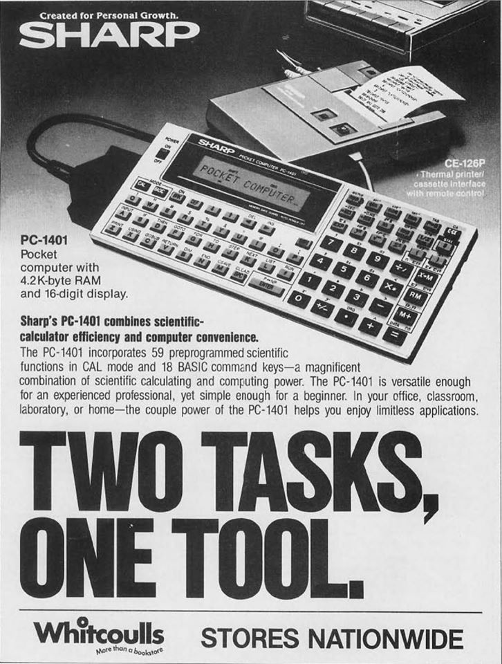

这些早期的Pocket Computer在工程计算领域获得了成功，但受限于单行显示屏和极小的内存容量，它们无法处理复杂的长文档或运行桌面级的应用软件。

### 二、口袋里的x86——Palmtop PC

随着半导体技术的发展，到了1980年代末，厂商开始尝试将完整的桌面PC架构缩小到掌上尺寸。为了容纳更大的屏幕和更接近PC布局的键盘，设备形态普遍转向了翻盖设计。

1989年，Atari发布了Portfolio。这款设备合上时的尺寸为197 × 104 × 29 mm，重505g。它搭载了主频4.91 MHz的80C88处理器，配备128KB RAM，以及一块可以显示40列×8行字符（分辨率240 × 64）的液晶屏。它的售价控制在了较为亲民的399美元，但它运行的是与MS-DOS高度兼容的DIP DOS系统，能够运行一部分轻量级的DOS软件，使其具备了基础的文字处理和电子表格能力。甚至还可以运行简单的游戏。

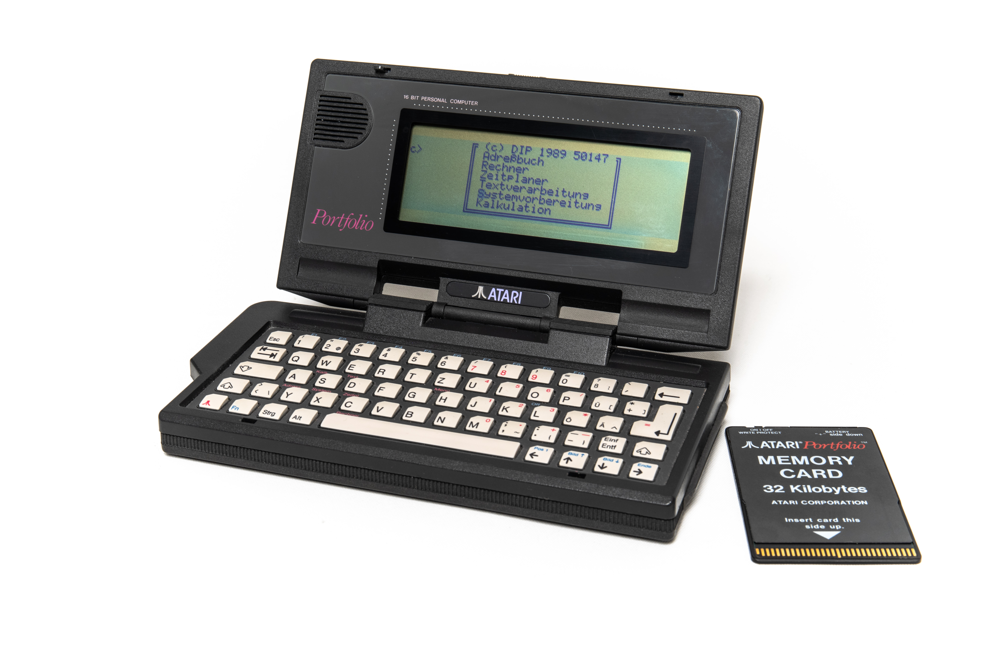

Portfolio的主要存储设备是MSX系列电脑也使用的Bee Card，即作为可写数据存储，并可以通过读卡器在PC上读取卡片中的内容，同时也用Bee Card作为软件和游戏的发行媒介。

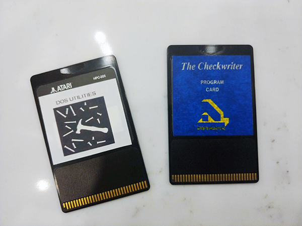

甚至还可以连接调制解调器上网

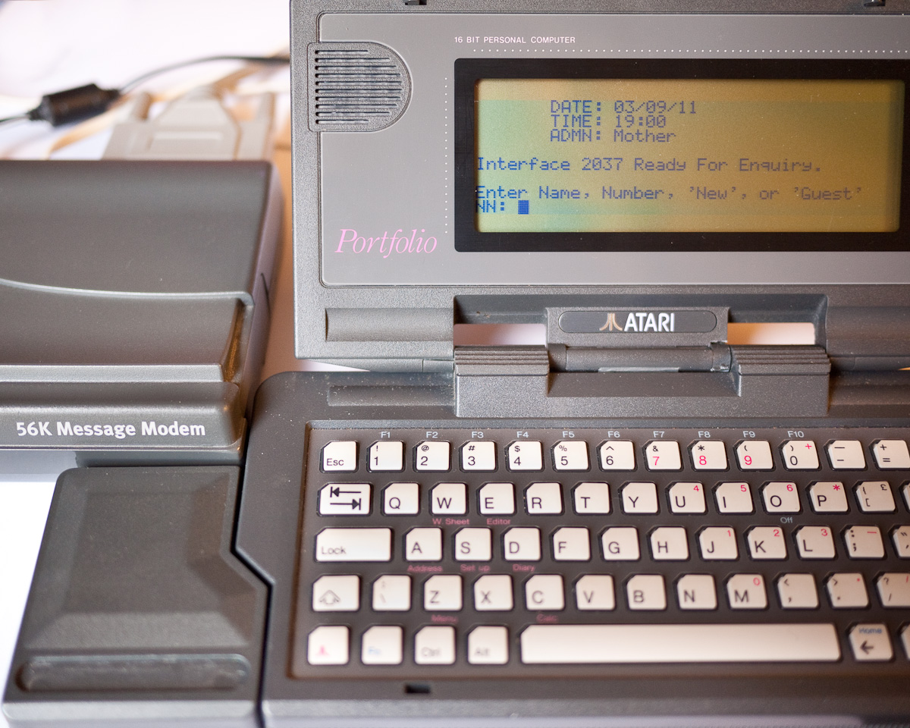

甚至是通过调制解调器连接移动电台，进行最早的移动数据包收发，当然带宽很小，只能传输简单的文字信息。

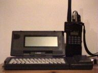

同年，Poqet Computer Corporation推出了一款规格更高的产品——Poqet PC。它的尺寸为220 × 110 × 24 mm，重540g，搭载7 MHz的80C88处理器和512KB RAM，并且配备了一块分辨率达到640 × 200、能够显示标准80列×25行字符的无背光屏幕。更重要的是，它运行的是完整的MS-DOS 3.3系统，能够直接运行绝大多数PC软件。不过，其1995美元的高昂售价限制了它的市场普及率。

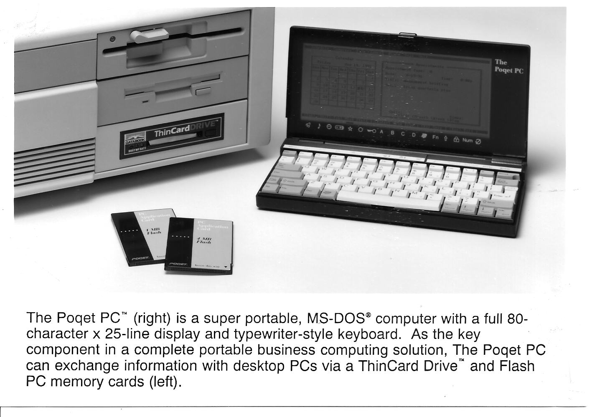

到了1991年前后，厂商们开始将“完整的PC兼容性”和“标准的屏幕显示比例”作为掌上电脑的标配。

同年，夏普与此前开发Atari Portfolio的DIP公司合作，推出了 PC-3000。这款设备的尺寸为 224 × 110 × 25 mm，重590g。它搭载了 8 MHz 的 80C88 兼容处理器和 1MB RAM，并配备了 640 × 200 分辨率的液晶屏，能够完整显示标准 DOS 的 80列 × 25行字符。它同样运行 MS-DOS 3.3 系统，并内置了文本编辑和通信软件，但上市售价只有1000美元。

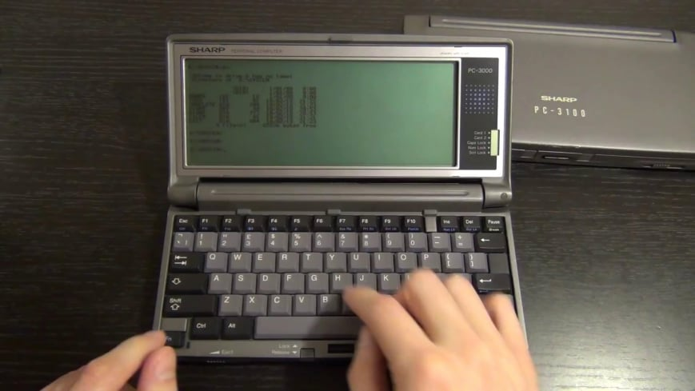

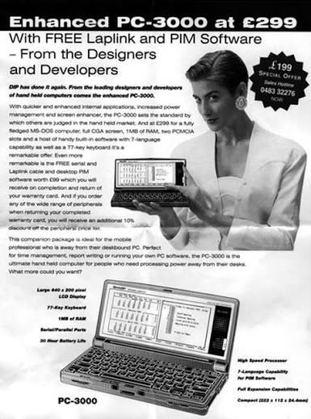

在同一时期，为了解决掌上电脑机身过小导致键盘难以双手打字的问题，美国的个人电脑直销品牌 Zeos 在1992年推出了一款机身更宽的设备——Zeos Pocket PC。它的三围拉长到了 247 × 114 × 25 mm，重量约为 590g。

得益于更宽的机身，Zeos Pocket PC 容纳了一块键距更宽的键盘，使其在早期的掌上电脑中具备了难得的双手录入体验。配置方面，它搭载了 7.15 MHz 的 NEC V30 处理器（兼容 Intel 8086）和 1MB RAM，同样采用 640 × 200 分辨率的屏幕。为了提升开箱即用性，它将 MS-DOS 5.0 和微软的 Microsoft Works 集成办公套件直接固化在了 ROM 中。它的上市售价仅为 595 美元，凭借较高的性价比和实用的键盘手感，获得了部分注重文字录入的商务用户的青睐。

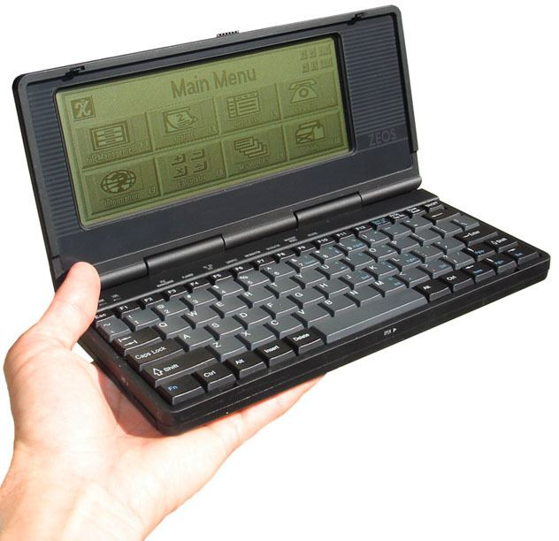

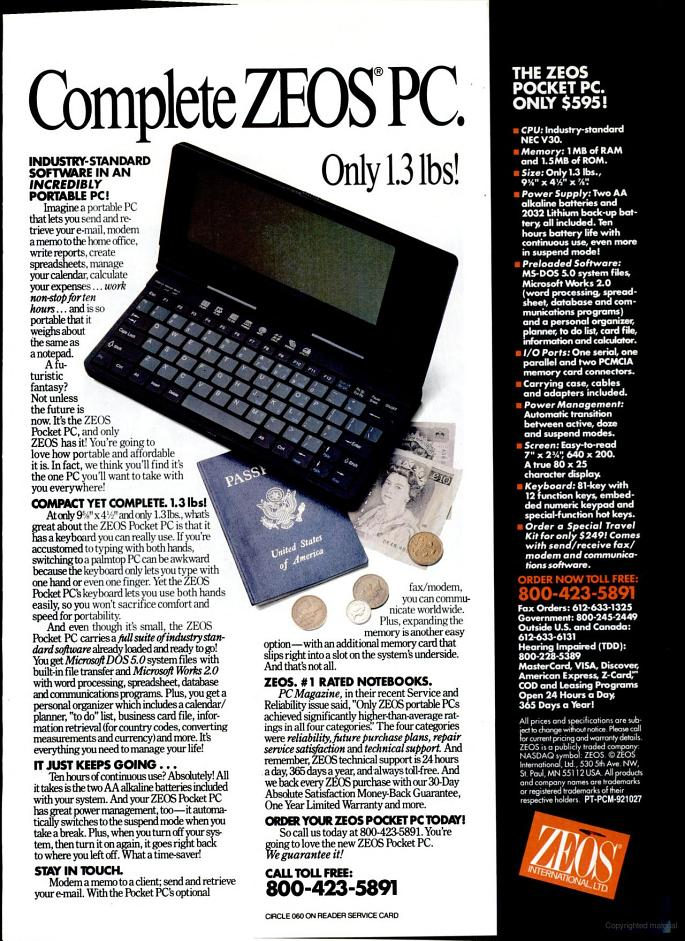

尽管市场上出现了这些优秀的竞争者，但真正将 Palmtop PC 推向商业成功并确立行业绝对统治地位的，依然是惠普（HP）。

1991年，惠普推出了HP 95LX。其三围为160 × 85 × 26 mm，重量仅310g，搭载5.37 MHz的NEC V20处理器（兼容Intel 8088）和512KB RAM，屏幕支持40列×16行显示。为了提升移动办公的实用性，惠普将当时PC端最主流的制表软件Lotus 1-2-3直接固化在只读存储器（ROM）中。该机器上市售价699美元，凭借合理的定价和精准的商务定位获得了市场的认可。

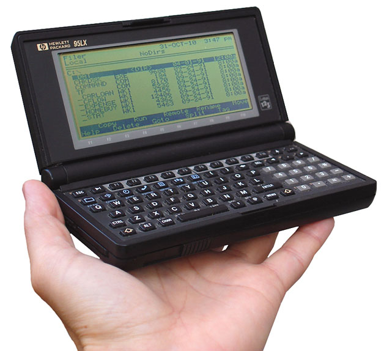

1993年，惠普推出了大幅升级的HP 100LX，处理器升级为7.91 MHz的80186兼容芯片，屏幕提升至桌面标准的80列×25行（640 × 200分辨率），并运行MS-DOS 5.0，起售价约749美元。

这时的Palmtop PC甚至可以通过手机拨号上网，算是最早的移动热点。

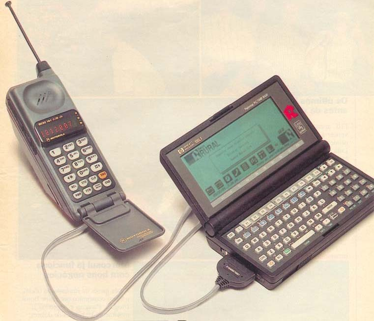

1994年，惠普推出了该系列形态最为成熟的HP 200LX。它的尺寸维持在160 × 85 × 25 mm，重量312g。除了标配1MB到4MB不等的RAM和DOS 5.0系统外，它还在ROM中内置了Pocket Quicken财务软件、Lotus 1-2-3以及包含日历、记事本的个人信息管理（PIM）套件。200LX的优势在于其优秀的键盘手感，以及仅需两节普通的5号（AA）电池即可提供数十小时的长效续航。该机型起售价为699美元，成为了当时许多商务人士和IT技术人员的随身工具。

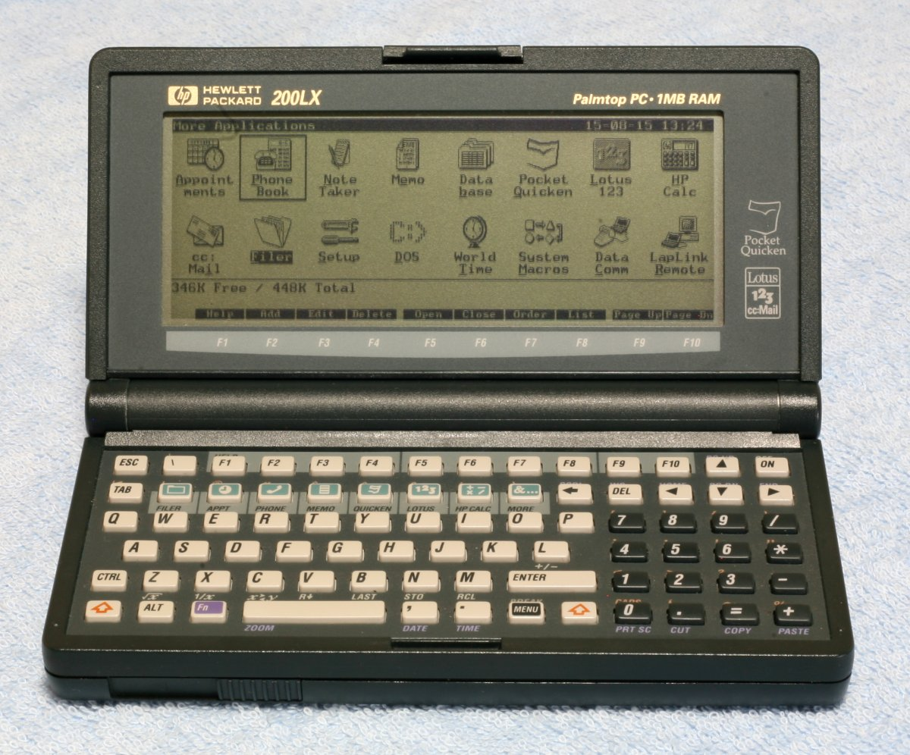

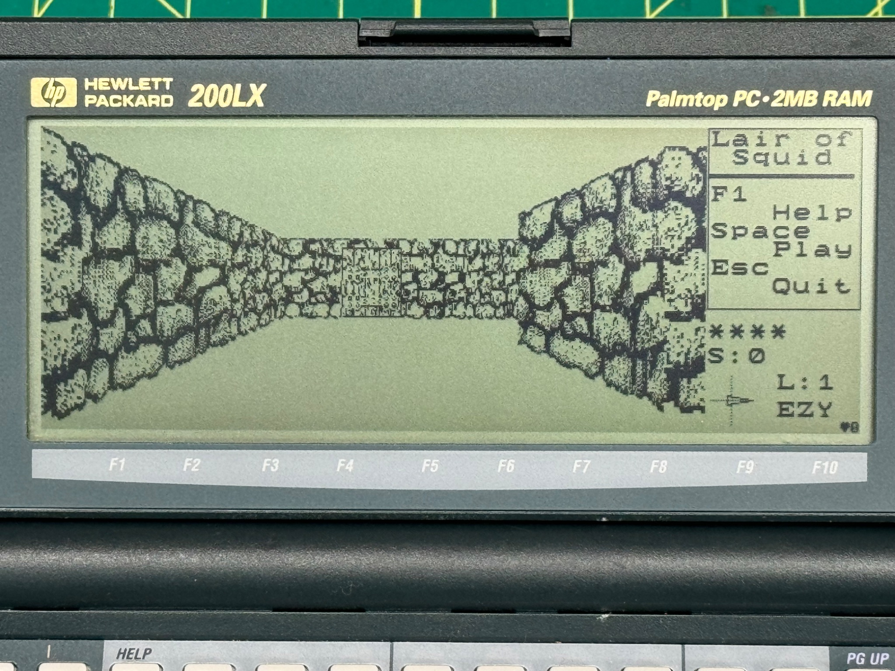

在触屏PDA和图形操作系统全面接管移动设备之前，以HP 200LX为代表的Palmtop PC代表了纯键盘时代掌上计算设备的成熟形态，它们成功地将一台具备完整功能的DOS系统桌面电脑，压缩在了一个重量约300克的掌上设备中。

系列文章：
