# 移动计算发展史（10）：PDA的兴衰——从Newton、Palm Pilot到Pocket PC

> 来源:https://zhuanlan.zhihu.com/p/2095412056480543916  
> 日期:2026-10-20 · 赞同:19 · 文章

接上期：

[移动计算发展史（8）：从Pocket Computer到Palmtop PC——基于键盘的早期手持电脑](https://zhuanlan.zhihu.com/p/2055478371547608968)

[移动计算发展史（9）：Handheld PC——微缩图形桌面与触控笔的早期尝试](https://zhuanlan.zhihu.com/p/2055930510447219969)

前两期讲的Palmtop PC和Handheld PC，虽然越做越小，但仍然保留了键盘，本质上还是缩小的个人电脑。而另一条支流则彻底放弃键盘，只用触摸屏和触控笔操作，这就是PDA（Personal Digital Assistant，个人数字助理），在中文里也叫掌上电脑。

PDA的定位和之前的产品不同：它不追求运行完整的PC软件，而是做成一本电子记事本，管理通讯录、日程、备忘录和待办事项，再通过数据线与PC同步数据。

没有键盘，就要解决文字输入的问题，这也是早期PDA成败的关键。

## 一、 超前的先驱：Apple Newton 与早期手写探索

“PDA”这一概念，最早由苹果公司时任 CEO 约翰·斯卡利（John Sculley）在 1992 年的芝加哥 CES 展会上提出，用来定义苹果耗时多年研发的全新移动设备——Newton。1993 年 8 月，第一款量产机型 Apple Newton MessagePad（型号 H1000）正式上市，起售价为 699 美元。

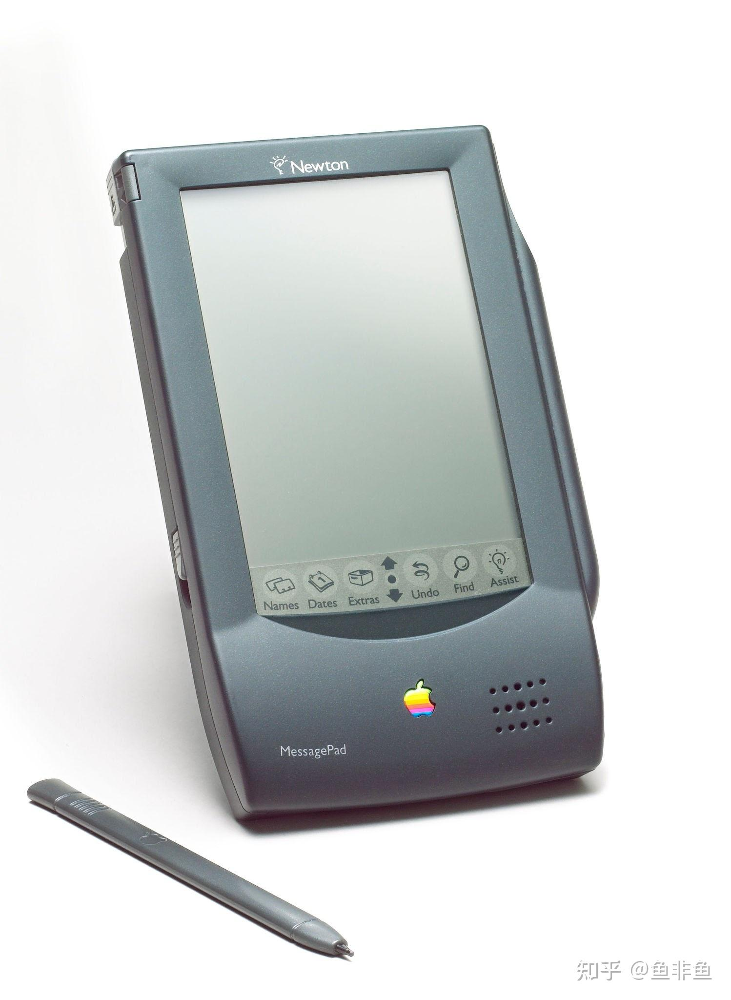

MessagePad 的尺寸为 184.75 × 114.3 × 19.05 mm，重约 410 克，由 4 节 7 号（AAA）电池供电。为了在极小的功耗下实现图形处理，苹果投资了英国的 Acorn 公司共同开发处理器（ARM 公司也由此诞生），因此 MessagePad 搭载了主频为 20 MHz 的 ARM 610 RISC 处理器，配备 640 KB RAM 和 4 MB ROM，正面是一块 336 × 240 分辨率的黑白反射式液晶屏。

苹果对 Newton 寄予厚望，不仅为其设计了面向对象特性的 Newton OS，还将自然手写识别作为核心卖点。它采用俄罗斯 Paragraph 公司开发的 Calligrapher 识别引擎，允许用户直接在屏幕任意位置书写印刷体或连笔英文。然而，受限于当时的算法和硬件算力，初代 Newton 的识别准确率很低，加之机身偏大、无法放进普通衬衫口袋，上市前三个月仅售出 5 万台。尽管苹果在 1997 年推出了搭载 162 MHz StrongARM 处理器、识别率大幅改善的 MessagePad 2000（尺寸 210.3 × 118.7 × 27.5 mm，重 640 克，售价高达 949 美元），但依然未能挽回颓势。1998 年乔布斯回归苹果后，关闭了 Newton 产品线。

与 Newton 同期探索这一形态的，还有 1993 年 10 月由 Tandy 和卡西欧联合推出的 **Zoomer**（卡西欧型号为 Z-7000，Tandy 型号为 Z-PDA，售价 699 美元）。它的三围是 176.2 × 107.6 × 26 mm，重 430 克，采用兼容 8086 的低功耗处理器、1 MB 内存和 320 × 256 单色屏幕，运行 GEOS 系统。Zoomer 同样因为手写识别率低下和运行缓慢而失败，但为这款机器开发手写识别与个人信息管理（PIM）软件的初创公司 Palm Computing，却从这次失败中找到了正确的方向。

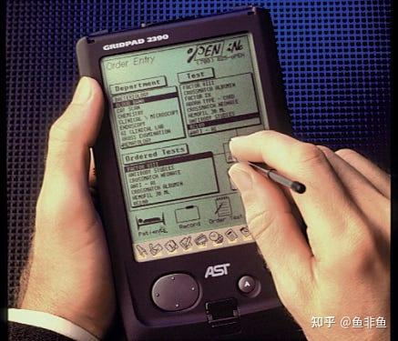

## 二、 做减法的胜利：Palm OS 阵营的崛起与繁荣

Palm Computing 的创始人杰夫·霍金斯（Jeff Hawkins）意识到，早期 PDA 失败的原因在于试图让机器去适应人千变万化的自然笔迹，且塞入了过多复杂的功能。因此，他在开发自家硬件时确立了两个原则：第一，定位上不做独立电脑，只做“PC 的伴侣”，专注管理日程、通讯录、待办事项和备忘录，并通过底座与电脑一键同步；第二，推出名为 Graffiti（涂鸦） 的单笔画手写系统，要求用户按照一套简化后的特定笔画顺序书写字母（例如把字母“A”写成没有横杠的“Λ”）。这种让人去适应机器的妥协，使得手写识别率接近 100%。

1996 年 3 月，并入 USRobotics 旗下的 Palm 推出了划时代的 Pilot 1000和Pilot 5000）。

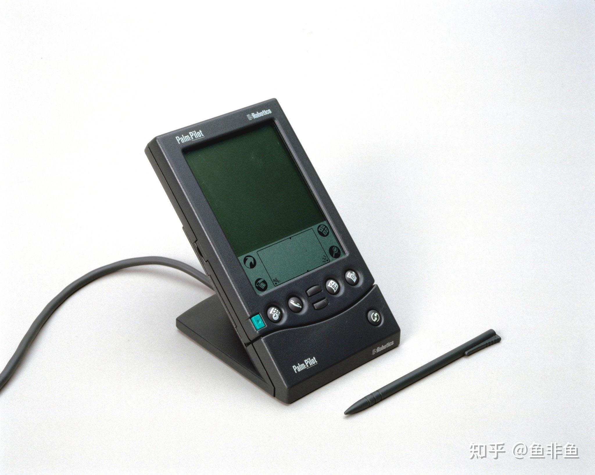

Pilot 1000 的尺寸仅为 120 × 80 × 18 mm，重 160 克，可以轻松放进衬衫口袋。它搭载主频 16 MHz 的摩托罗拉 DragonBall（MC68328）处理器，仅配备 128 KB RAM（Pilot 5000 为 512 KB），采用一块 160 × 160 分辨率的单色无背光液晶屏，运行极度精简的 Palm OS 1.0。屏幕下方设有一块固定的物理 Graffiti 手写区和四个应用快捷键。由于系统开销极小，它在 16 MHz 的处理器上实现了即点即开的流畅度，两节 7 号电池即可维持数周的续航。Pilot 1000 的上市售价仅为 299 美元，不足 Newton 的一半，上市 18 个月内销量即突破 100 万台。

此后，Palm 迅速迭代：1997 年的 PalmPilot 加入背光；1998 年的 Palm III（2 MB 内存，售价 399 美元）加入了红外传输和闪存；1999 年的 Palm V 则换用了厚度仅 11.4 mm、重 113 克的阳极氧化铝机身和内置锂电池，成为当时的商务时尚单品。到 2000 年，Palm 在全球 PDA 市场的占有率高达 74%。

Palm V：

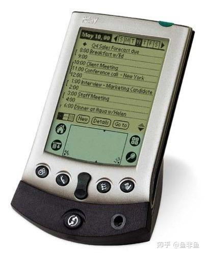

随着 Palm OS 开放授权，两大重要盟友将其推向了新的高度：

一个是霍金斯等原班人马出走后于 1998 年创立的 Handspring。他们在 1999 年推出的 Visor 系列，在背部加入了一个名为 Springboard 的宽大插槽。由于该插槽直接与系统总线相连，用户无需安装驱动，只要插入对应的硬件模块，就能直接把 PDA 变成 MP3 播放器、数码相机、GPS 导航仪甚至是蜂窝电话。这种即插即用的模块化设计极具创新性。

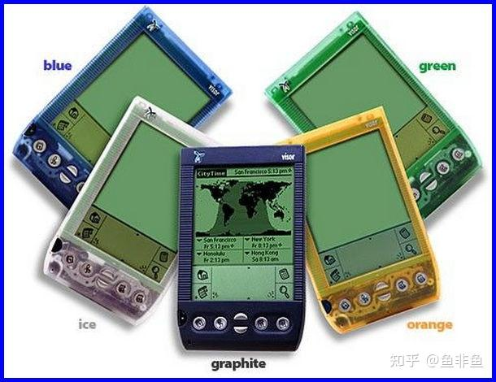

另一个则是 2000 年入局的索尼。索尼认为纯粹的黑白记事本已经无法满足未来需求，于是在其 **CLIÉ** 系列中注入了强大的影音娱乐基因。例如 2002 年推出的CLIÉ PEG-NR70V，三围为 137.6 × 74 × 16.8 mm，重 200 克。

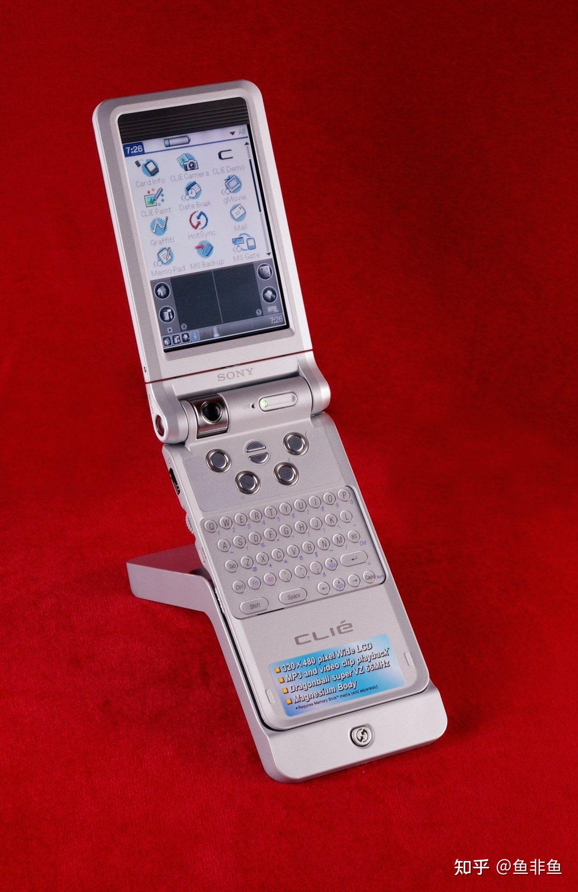

它采用了大胆的翻盖加 180 度旋转屏幕设计，搭载 66 MHz 的 DragonBall Super VZ 处理器和 16 MB 内存，率先将 Palm 的屏幕分辨率从落后的 160 × 160 提升到了细腻的 320 × 480（HVGA）彩色屏，并在机身侧面加入了索尼标志性的 Jog Dial 滚轮、MP3 独立音频解码芯片以及旋转摄像头。索尼 CLIÉ 系列在工业设计和多媒体能力上，代表了 Palm OS 阵营的最高水准。

## 三、 做加法的反击：微软 Pocket PC 的逆袭

面对 Palm 在无键盘 PDA 市场的垄断，微软在 1998 年初推出了基于 Windows CE 2.0 的 Palm-size PC 标准，代表机型包括卡西欧的 Cassiopeia E-10（4 MB 内存，240 × 320 单色屏）以及 1999 年首款彩屏型号 Cassiopeia E-100（131 MHz MIPS 处理器，16 MB 内存，65536 色屏幕）。然而，早期的 Palm-size PC 依然沿用了类似桌面 Windows 的繁琐操作逻辑，机身厚重且耗电量大，市场反响十分冷淡。

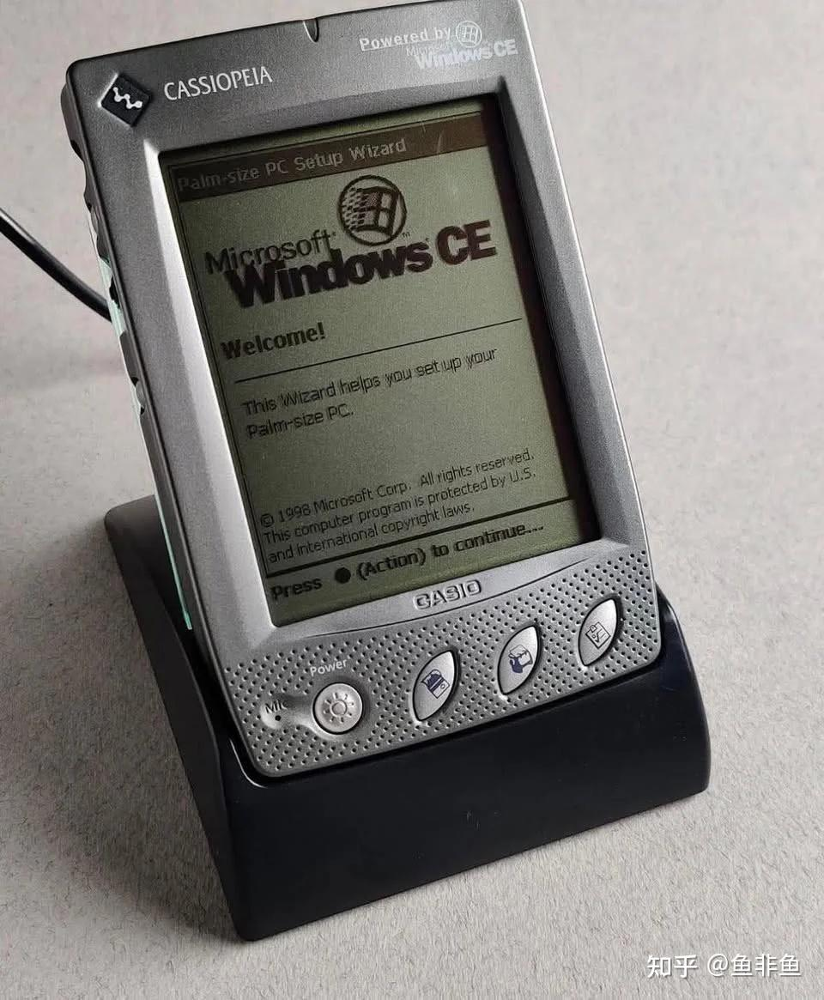

转折点发生在 2000 年 4 月。微软基于全新的 Windows CE 3.0 内核，彻底重构了界面（将开始菜单移至左上角，隐藏了复杂的窗口管理），正式推出了 Pocket PC 平台。

与 Palm“够用就好”的理念完全相反，微软为 Pocket PC 制定的路线是“全能的掌上多媒体电脑”：强制要求采用 240 × 320（QVGA）分辨率屏幕，支持真正的多任务处理，内置移动版 Office、IE 浏览器以及 Windows Media Player，能够直接播放 MP3 和视频。

在首批上市的 Pocket PC 中，康柏（Compaq）于 2000 年 4 月推出的 iPAQ H3630（H3600 系列）成为了彻底改变市场格局的产品。

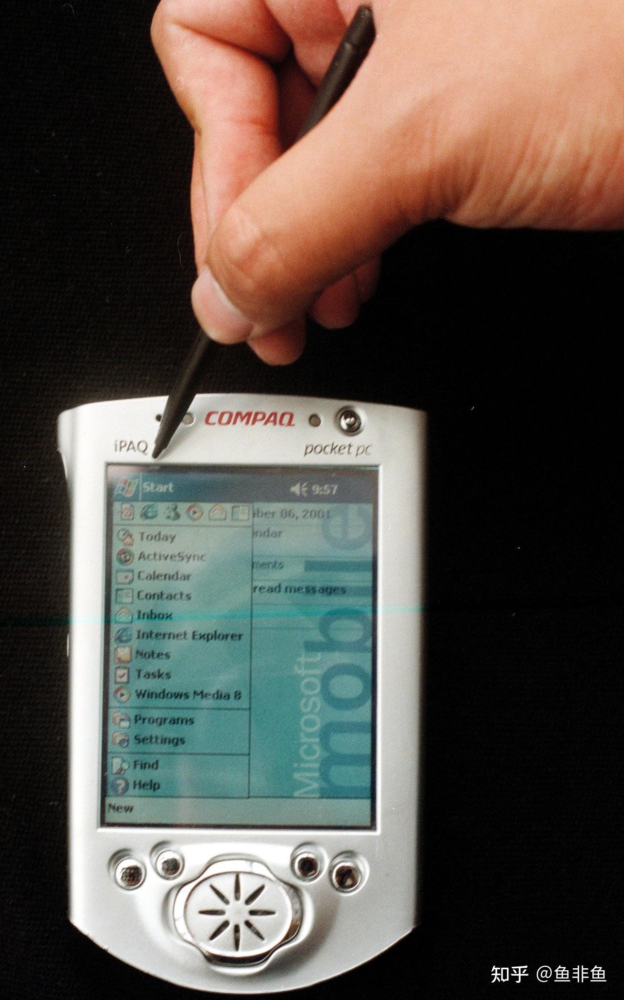

iPAQ H3630 的尺寸为 130 × 83 × 16 mm，重 170 克，上市售价 499 美元。它搭载了性能远超同代产品的 Intel StrongARM SA-1110 处理器，主频高达 206 MHz，配备 32 MB RAM 和 16 MB ROM，采用了一块亮度极高的 4096 色半透反射式 TFT 彩屏。为了保持机身轻薄，H3630 机身不设扩展槽，而是通过套上不同的“扩展背夹（Expansion Pack）”来增加 CF 卡槽、PCMCIA 双卡槽、大容量电池或无线模块。凭借强悍的性能和流线型的银色外观，iPAQ 在高端市场一度供不应求，帮助微软阵营从 2001 年起大幅蚕食 Palm 的市场份额。

2001 年底，微软发布 Pocket PC 2002，并从这一代起强制要求所有设备统一采用 ARM 架构处理器（如 Intel XScale 系列）。由于微软对硬件规格限制极严，各品牌产品逐渐走向同质化，价格战随之爆发。2002 年 11 月，戴尔推出了由台湾纬创代工的 Dell Axim X5。其搭载 300 MHz 的 Intel XScale PXA250 处理器和 32 MB 内存的入门版本，售价直接压低到了 199 美元（高配 400 MHz/64 MB 版本为 299 美元），打破了此前主流 Pocket PC 动辄 500 美元以上的价格体系。

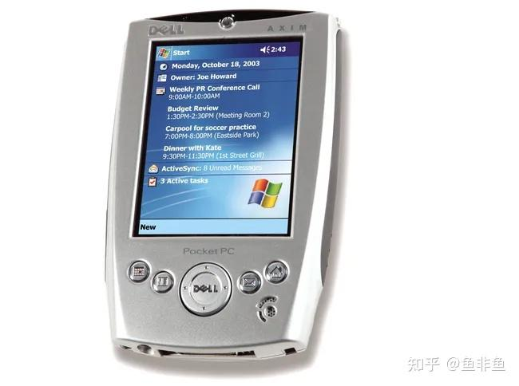

到了 2005 年前后，独立 Pocket PC 的硬件规格达到了顶峰。例如戴尔推出的末代旗舰 Axim X51v，在 119 × 73 × 16.9 mm、重 175 克的机身内，塞入了主频高达 624 MHz 的 Intel PXA270 处理器、64 MB RAM 和 256 MB Flash ROM，配备 3.7 英寸 640 × 480（VGA）高分屏，甚至内置了具备 16 MB 显存的 Intel 2700G 独立多媒体图形加速芯片，支持 Wi-Fi 与蓝牙。同时，系统升级至 Windows Mobile 5.0，终于改为将用户数据存储在非易失性闪存中，解决了此前所有 PDA 一旦电池耗尽就会清空全部数据的缺陷。

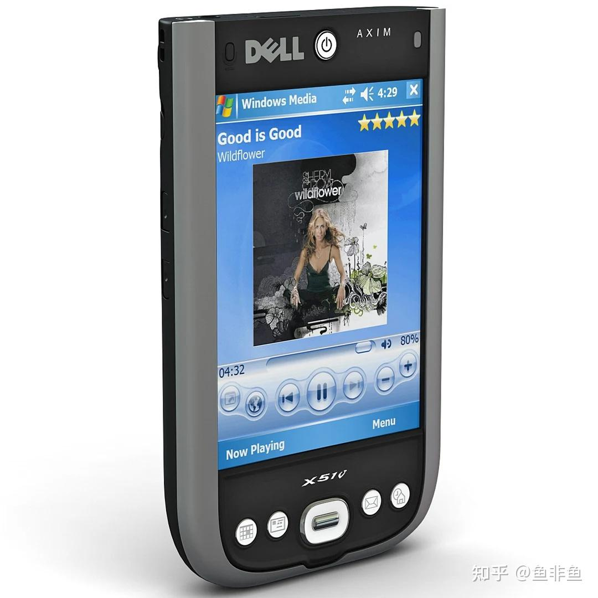

## 四、 亚洲代工的崛起与智能手机的终局

随着 Pocket PC 的硬件高度标准化，欧美传统 PC 大厂的利润空间被严重压缩，东芝、优派（ViewSonic）等品牌在 2003 至 2004 年间纷纷退出。但这种“微软提供系统授权、厂商负责硬件制造”的模式，却极大地利好了台湾的 ODM 代工产业，其中最具代表性的便是 1997 年成立的 HTC（宏达电）。作为康柏 iPAQ 的核心代工厂，2001 年仅 iPAQ 一项业务就占到了 HTC 总营收的 85%。

与此同时，纯 PDA 设备的生存空间开始受到移动通信的强烈冲击。当商务人士出门需要同时携带一台手机和一台 PDA 时，将两者合二为一就成了必然的趋势。

在 Palm 阵营，Handspring 于 2002 年初推出了整合 GSM 手机功能的 Treo 180，并在 2003 年秋季推出了经典的 Treo 600。

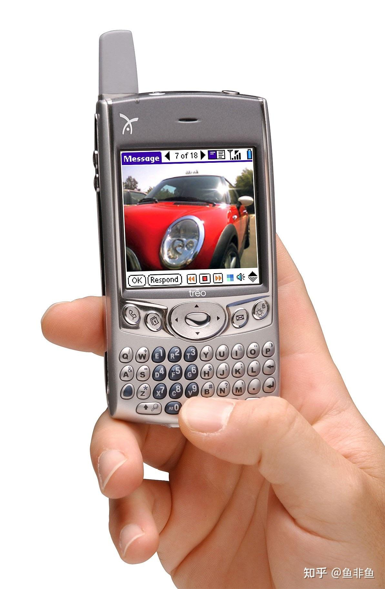

Treo 600 的尺寸为 112 × 60 × 22 mm，重 168 克，搭载 144 MHz 的德州仪器 OMAP 处理器和 32 MB 内存。有趣的是，为了方便单手编写短信和邮件，Treo 放弃了 Graffiti 手写区，在 160 × 160 的小屏幕下方重新装回了一块紧凑的 QWERTY 拇指物理键盘。这一形态后来深刻影响了黑莓（BlackBerry）等商务手机的发展。

而在微软阵营，HTC 则成为了将 Pocket PC 与手机融合的最大推手。通过旗下的多普达（Dopod）品牌以及为欧美运营商（如 O2、T-Mobile）贴牌，HTC 推出了大量运行 Windows Mobile Phone Edition 的设备。其中最成功的是 2004 年底上市的 HTC Magician（国内型号为多普达 818，海外型号为 O2 Xda II mini）。

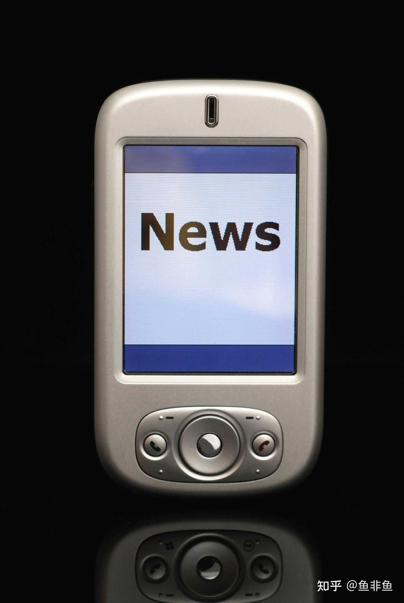

多普达 818 彻底打破了以往 PDA 手机笨重的印象，将三围缩小到了与普通手机无异的 108 × 58 × 18.1 mm，重仅 150 克。它搭载 416 MHz 的 Intel PXA272 处理器，配备 64 MB RAM、2.8 英寸 QVGA 触摸屏和 130 万像素摄像头，支持三频 GSM/GPRS 网络。这款机器在全球范围内的热销，标志着具备完整 PDA 功能的“智能手机”彻底走向成熟，也宣告了不带通讯模块的纯 PDA 设备失去了独立存在的意义。

2007 年，苹果发布了初代 iPhone。它用电容式触摸屏和直接的手指多点触控，取代了统治 PDA 时代十余年的电阻屏与塑料手写笔；用集中化的 App Store 取代了繁琐的桌面同步软件。

此后，缺乏核心通信技术积累的 Palm 几经拆分与转手，最终在 2011 年被惠普放弃；微软也在 2010 年彻底放弃了兼容过往生态的 Windows Mobile，转而推出全新的 Windows Phone。曾经作为商务精英和极客标配的 PDA，并没有真正消亡，它只是彻底融入了每一台现代智能手机的血液之中。

在智能手机彻底接管移动计算之前，以英特尔为首的传统芯片巨头还曾做过最后一次挣扎，试图制造出一种介于智能手机和笔记本之间、专门用于把完整桌面互联网装进口袋的过渡设备——MID（移动联网设备）。下期专栏，我们将聊聊这群生不逢时的探路者。

系列文章：

[移动计算发展史（1）点到点移动的手提电脑](https://zhuanlan.zhihu.com/p/29068038)

[移动计算发展史（2）早期的膝上电脑——折叠电脑](https://zhuanlan.zhihu.com/p/33140952)

[移动计算发展史（3）：“笔记本”时代到来](https://zhuanlan.zhihu.com/p/74294359)

[移动计算发展史（4）：手包与口袋中的Subnotebook](https://zhuanlan.zhihu.com/p/75390176)

[移动计算发展史（5）：早期的平板电脑Tablet PC](https://zhuanlan.zhihu.com/p/493555834)

[移动计算发展史（6）：塞进掌心的全功能电脑——UMPC](https://zhuanlan.zhihu.com/p/2047544728514719993)

[移动计算发展史（7）：从Netbook到Chromebook，上网本终到网上](https://zhuanlan.zhihu.com/p/2047542826511098268)

[移动计算发展史（8）：从Pocket Computer到Palmtop PC——基于键盘的早期手持电脑](https://zhuanlan.zhihu.com/p/2055478371547608968)

[移动计算发展史（9）：Handheld PC——微缩图形桌面与触控笔的早期尝试](https://zhuanlan.zhihu.com/p/2055930510447219969)
