# 个人电脑的先声——小型机

> 来源:https://api.zhihu.com/articles/25415068  
> 日期:2017-02-26 · 赞同:142 · 文章

计算机，或者说电脑，也许是20世纪人类最伟大的发明之一。今天一个城市中产阶层家庭可能拥有十数个以各种形式的计算设备——台式机，笔记本电脑，HTPC，平板电脑，智能手机，电子书，机顶盒/电视棒/智能电视，游戏机，智能手表/手环等等。我们用它们查找信息，阅读，听音乐，看视频，玩游戏，处理个人事务，工作，购物。我们已经没办法想象一个没有它们的世界。

可是，计算机在刚被发明出来时，却远远不是这样。第一台计算机ENIAC的售价是今天的一台智能手机的1万多倍，体积是4000万倍，功耗是40万倍，重量是12万倍，但计算能力却只是后者的2000分之一。更重要的是，早期的计算机功能十分有限，真的就只能够“计算”，而且操作起来十分困难，只支持机器语言，使用者基本都是受过专业培训的高学历人员。研发ENIAC的工程师大概永远无法想象今天的“计算机”可以被揣在口袋里甚至是戴在手腕上，而且大部分时间都被用来休闲和娱乐。

过去70多年的计算机发展史，其实也就是计算机不断小型化和不断贴近生活的历史。

而这段历史的开端，要从小型机开始讲起。

1940-50年代的早期计算机因为使用电子管，体积比较庞大。往往都需要一整个房间来储存，而且价格也比较昂贵，比如ENIAC的造价就高达48.7万美元（合今天的600万美元），而英国的Manchester Mark I（第一台冯诺依曼机）则造价10万英镑（合今天的500万美元），运营和维护都需要大量的费用。即使是后来面世的第一台量产计算机UNIVAC，上市价格也要15.9万美元（合今天的141万美元），只有大型科研机构和高校才能拥有。

下图为1951年推出的UNIVAC I，占地面积仅为ENIAC的三分之一，总共制造了46套，开售价格15.9万美元，后来涨价到125-150万美元。它也是第一台既能够处理数字计算，也能够进行文字处理的通用计算机，使用汇编语言编程，使用电打字机、磁带和示波器作为输入输出设备，每秒钟可以进行1905次运算，并能存储12000位的数据（即12000个二进制字符）。

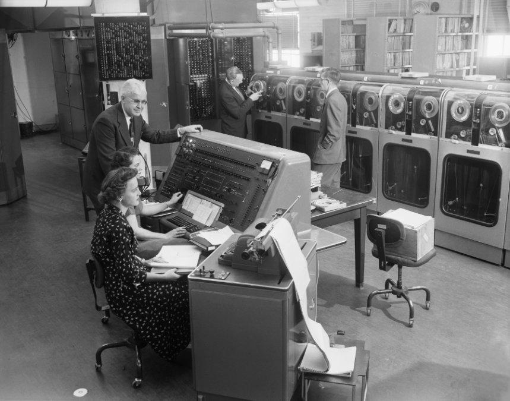

计算机小型化的契机开始于晶体管的使用。1955年，第一台全部使用晶体管的计算机TX-0，由MIT林肯实验室研发问世。

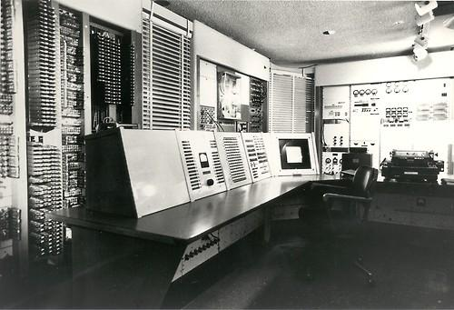

1960年，由林肯实验室前员工创立的DEC公司改进了TX-0的设计，推出了PDP-1，PDP系列后来发展成为历史上最著名的小型机系列之一，而DEC后来也成为了小型机最著名的制造商。

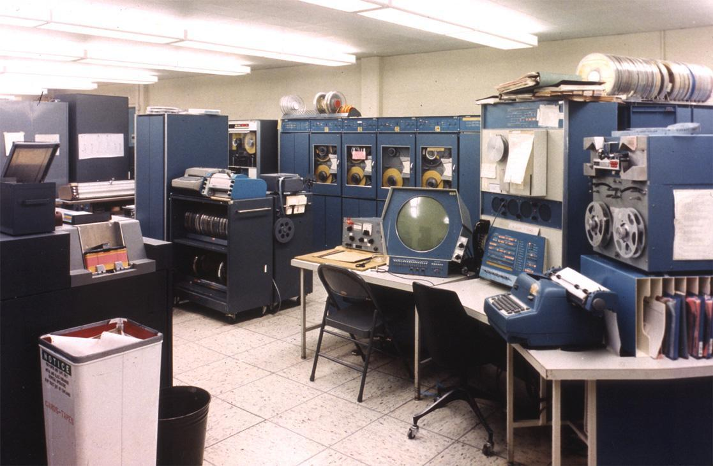

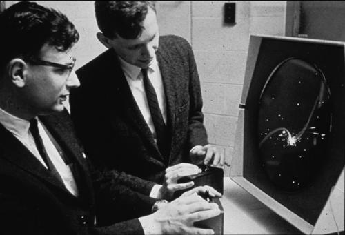

PDP-1上还出现了最早的文字处理软件（之一），Expensive Typewriter。还有许多其他软件也运行在PDP-1这样的以示波器为显示设备的小型机上，像下图这样

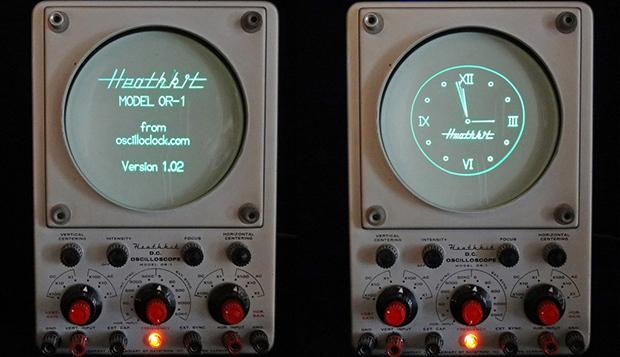

同一时期除了MIT林肯实验室这一派的产品以外，也有CDC（Control Dta）公司推出的小型化计算机——CDC160

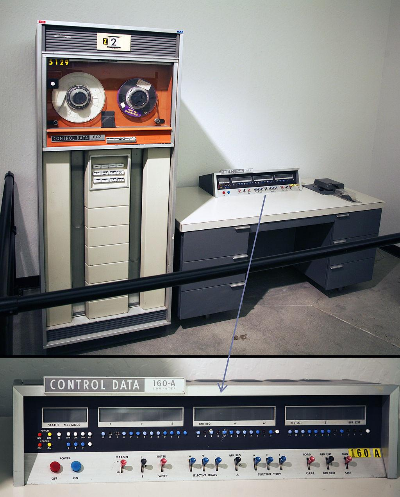

上面这些机器体积仍然比较庞大，价格也仍然比较昂贵，不被认为是真正的小型机。第一台真正的小型机一般认为是同样由DEC推出的LINC（Laboratory INstrument Computer）。相比PDP-1，这台计算机已经可以安置在一个办公桌大小的空间内，售价也从12万美元下降到4万多美元（合今天的32万美元）

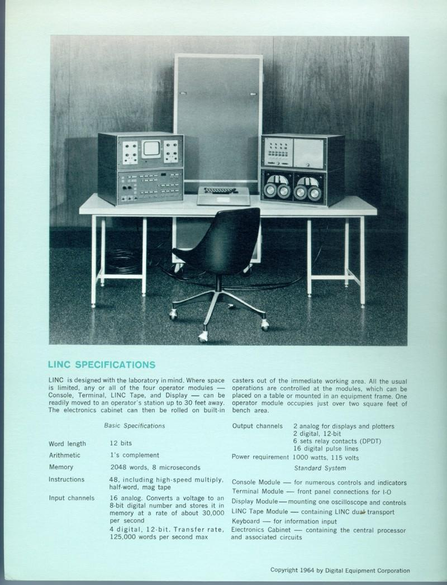

不过，第一台在商业上获得成功的小型机，则是DEC公司在1965年推出的PDP-8。这款小型机上市的售价只要1.85万美元（合今天的14万美元），体积也比之前的计算机更小。它的CPU主频大概是800kHZ左右（PDP-8没有固定的时钟频率）。

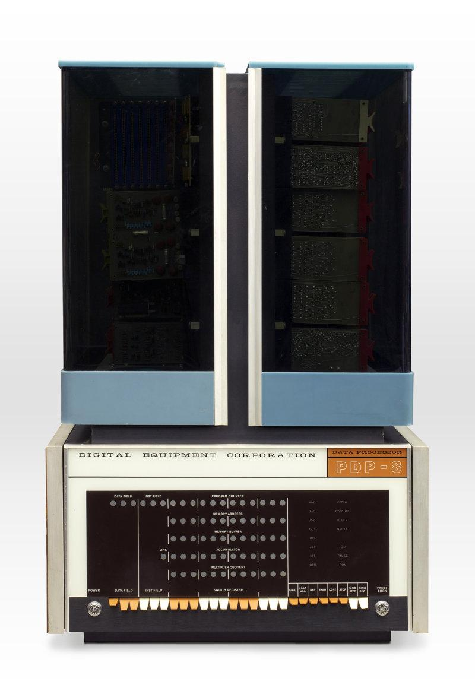

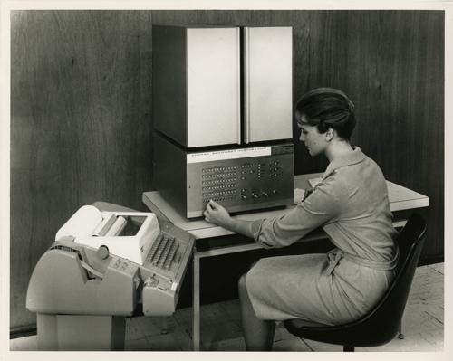

1966年，DEC又推出了仅售1万美元的PDP-8S

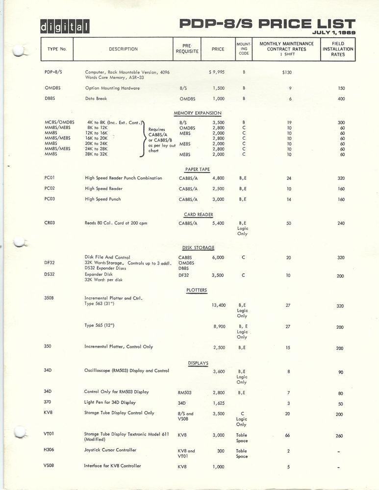

后来的PDP-8E的主机甚至更小，价格也低至8000美元

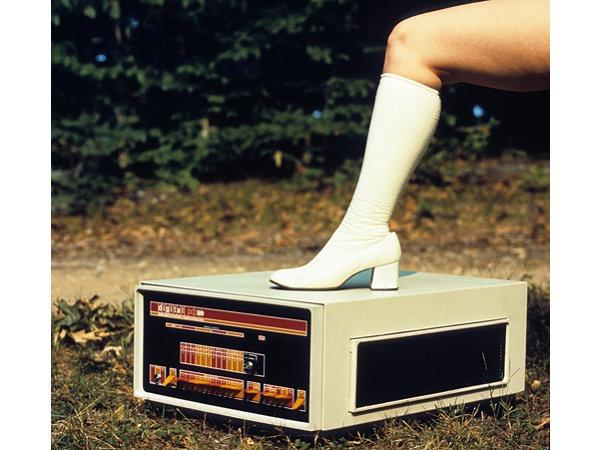

PDP-8的时代也正是计算机存储设备大变革的时代。早期的PDP-8使用打孔纸带作为存储设备，前置面板作为显示设备，中期则使用打孔卡片、磁带，但到后期就开始使用软盘和硬盘作为存储设备，显示终端作为输出设备

PDP-8使用的打孔纸带

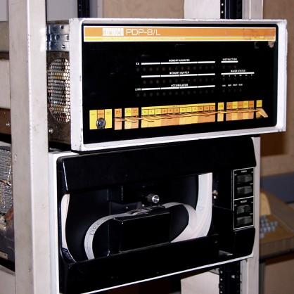

当时使用的打孔纸带。早期的PDP-8程序员就是将使用PAL-8（汇编语言）、FOCAL（解释语言）或Fortran（命令式语言）编写的代码存储在这样的纸带上。

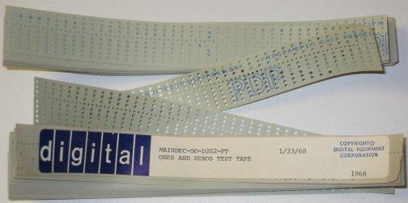

后期的PDP-8显示终端，这时候PDP-8也已经支持像BASIC这样的高级语言，编程变得容易了许多。

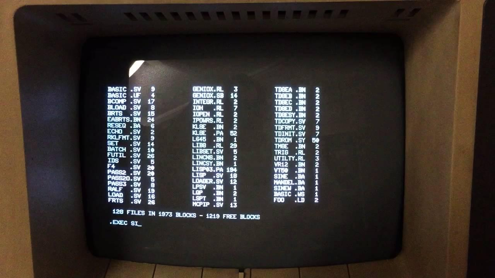

PDP-8使用的软驱

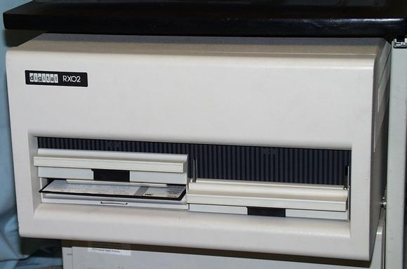

因为价格低廉，硬件和软件的功能也比较完善，PDP-8在商业上获得了前所未有的成功。仅这一个型号就售出了50000多套，而如果算进去各种改进型PDP-8，总销量则高达30万台之多。也是从PDP-8开始，计算机不再仅仅为大型机构的专业人员使用，而开始进入西方发达国家普通的办公室之中。为了方便人们使用，PDP-8上面也涌现了很多软件，比如OS/8操作系统，可以让使用者在显示终端上以命令行的形式操作电脑。后来又有了支持抢占式多任务处理的实时操作系统RTS-8，支持多用户的抢占式多任务处理操作系统COS300，以及支持多用户的分时式多任务处理操作系统TSS-8。

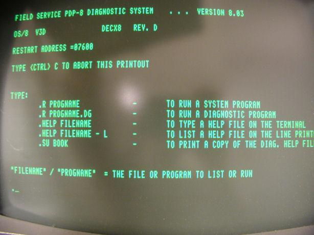

PDP-8上面也有提供像WPS8这样的文字处理程序，这个软件在80年代发展成为DEC旗下的All-in-1办公套件，提供了一整套的办公功能，类似后来的MS Office。

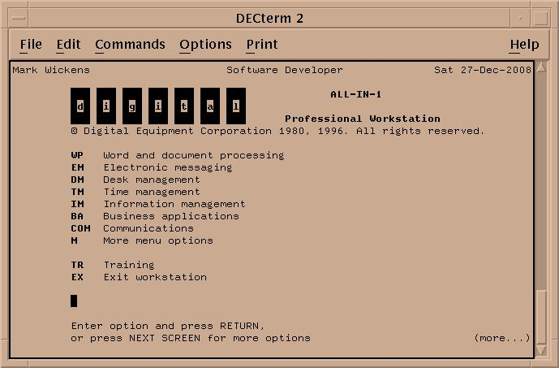

PDP-8的成功当然也引来了很多竞争者。惠普公司在1967年也推出了第一款小型机，HP2116A，后来变成HP2100（后改名为HP1000）系列。跟PDP-8不同，HP2100采用的是16位处理器，处理能力比PDP-8更强，上市售价为2.2万美元。

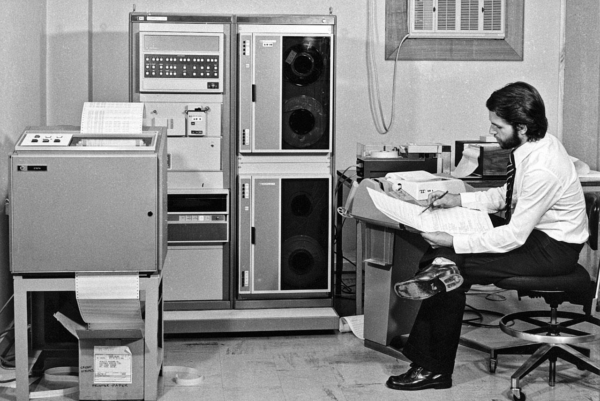

1969年，另一家公司Data General推出了小型机Nova，同样采用16位处理器，但价格则要低廉得多，只要3995美元（合今天的2.6万美元），即使包含RAM扩展（对于Nova来说几乎是必须的），也只要7995美元。Nova十分成功，总共卖了5万多台。

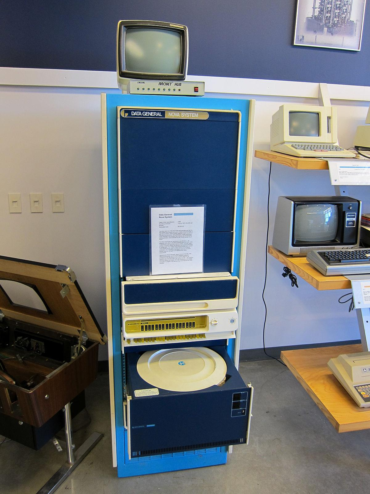

尽管面临很多竞争对手，DEC仍然是小型机市场无可争议的王者。1970年，在继续销售和更新PDP-8产品线的同时，更强大的采用16位处理器的PDP-11又推出了，采用了16位处理器。上市售价仍然为1.8万美元，比Nova要贵不少，但仍然卖出了60万台，是当时最成功的小型机。

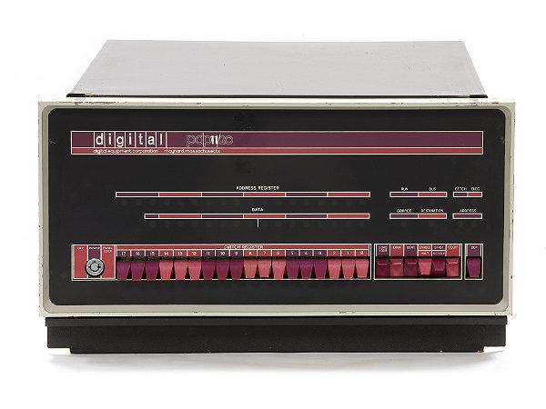

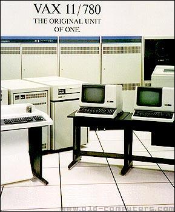

与此同时，成本更低廉的PDP-8系列也仍然在发挥余热。从1977年开始，DEC推出了以DECmate为名的一系列PDP-8兼容机。下图则为系列的第一款产品——VT78，使用了主频为2.2MHZ的Intersil 6100 CPU，将PDP-8的计算能力封装到了VT-52显示终端里。

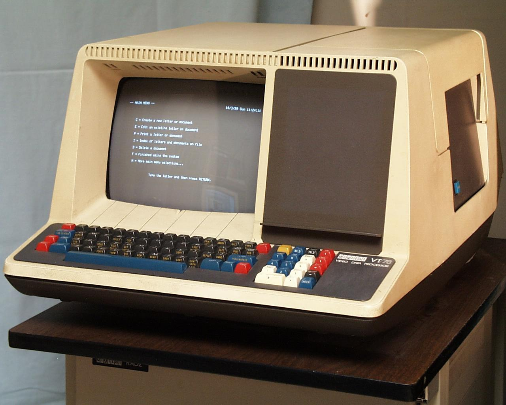

这款计算机体积很紧凑，但售价仍然比较高，需要7995美元，主要还是机构用户。真正将计算机带入大众时代的，则是同一时期出现的最早的微型计算机，也就是下期要说的home computer。
