# 计算机普及序篇——从家用电脑到个人电脑（上）

> 来源:https://api.zhihu.com/articles/26001350  
> 日期:2017-04-05 · 赞同:233 · 文章

接上期：

[个人电脑的先声--小型机 - 知乎专栏](https://zhuanlan.zhihu.com/p/25415068#tipjar)

一、早期的组装个人电脑

虽然小型机的体积和成本都已经降低了不少，计算机开始进入办公室。但对于家庭用户来说，动辄几千美元（合今天几万美元）的小型机还是过于昂贵了，而且即使是最小的小型机，也需要一整个办公桌和柜子来存放，也不适合居家使用。

1960年代，集成电路技术得到了长足的进步，制造比小型机更小的“微型计算机”就变得可行起来。

1971年，英特尔率先推出了8位微处理器4004，将相当于占据了一整个房间的ENIAC的计算能力集成到一个指甲盖大小的芯片中，而且售价也只要60美元（相当于今天的350美元）。同年，Garrett AiResearch和德州仪器也各自推出了微处理器CADC和TMS1000。

Intel 4004芯片：

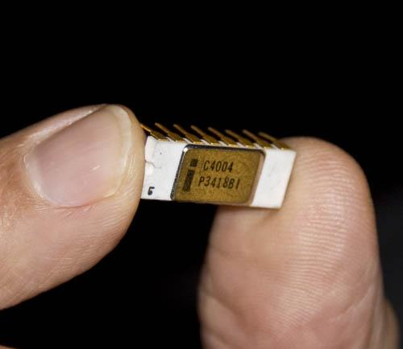

第一个吃螃蟹的，是日本的Sord计算机公司。这家1970年新成立的电子企业看准了微处理器的前景，在1973年就推出了微型计算机SMP80/08，使用前一年推出的Intel 8008处理器。不过这款产品只是一个概念设计，并没有上市。一年以后，随着第一个通用微处理器Intel 8080的面世，重新设计的SMP80/X才真正开启了全球微型计算机的历史。

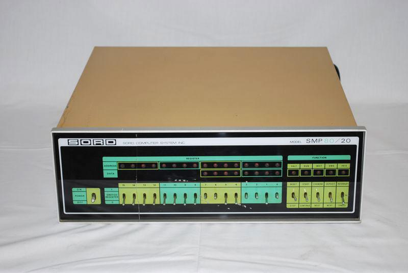

西方的第一款微型计算机则在1975年面世。这台Altair 8800是MITS这家并不出名的公司推出的一款组装型个人电脑，售价只要439美元（合今天的2169美元）。像今天“攒机”一样，消费者买到的是散件，需要根据说明书自己组装起来才能使用。它使用的同样是8080处理器，但因为内存只有可怜的256字节，而且只能通过十几个开关进行输入操作，而显示设备就只是一些LED灯，使用实在不便。但尽管如此，这款产品还是得到了超乎预期的欢迎，一开始生产的几百台很快就卖光了。

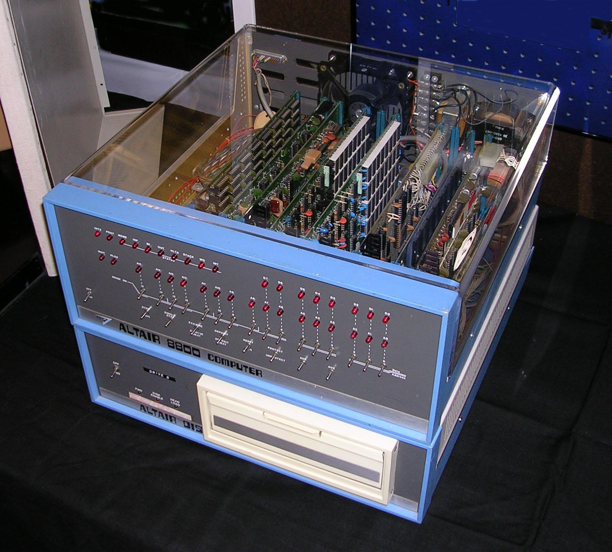

1975年，第一台成品个人电脑由意大利厂商Olivetti推出，名为P6060。这台机器的功能就要强大的多，除了可以外接显示器以外，还内置了软驱，打印机和键盘，功能已经很接近后来的个人电脑。但是这台机器售价高达7950美元（合今天的3.6万美元），跟小型机类似，针对的并不是家用市场。

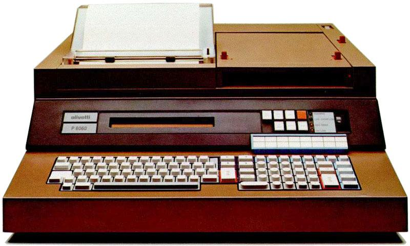

1976年，我们熟悉的苹果电脑也出场了。这台由沃兹尼亚克自行设计，并在车库手工组装的电脑上市售价为666.66美元（合今天的2854美元），一年内共卖出了175台。虽然Apple I只是一块集成了所有需要的芯片的主板，看起来很简陋，采用的处理器是MOS 6502，主频只有1-2MHZ，也没有Altair 8800高，但内存有4KB，而且只要外接键盘和电视机，就是一台具有完整功能的计算机。

Apple I上市时的广告

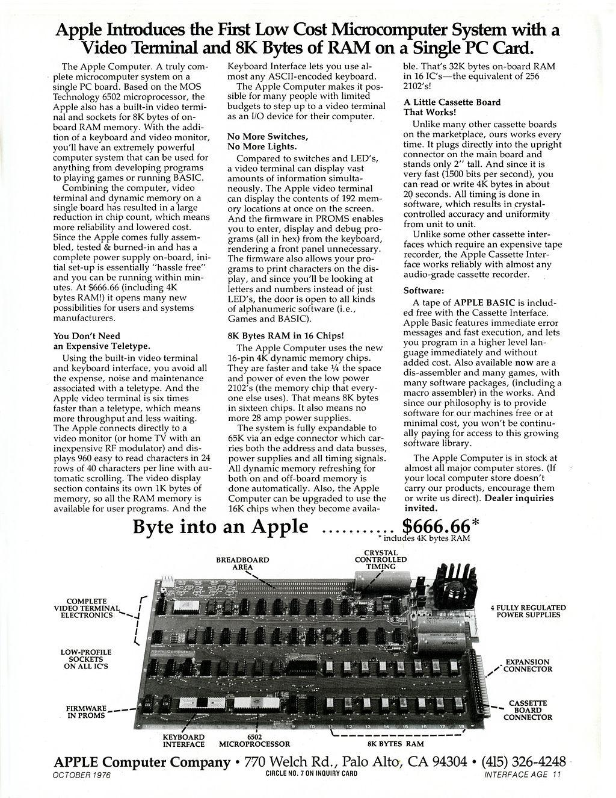

这些早期的小作坊式的电脑虽然又简陋又不够亲民，但在市场上引起了很大的反响。很快，微型计算机市场上就出现了第一批正规军。

二、第一代家用电脑

1977年这一年，就有三款品牌微型计算机上市。它们都是组装好的成品，也有更好的软件和售后支持，买回家就能用。这从此开启了“家用电脑”（home computer）的概念，在当年就让家用电脑市场增长到了十几万台。

第一个上市的是Apple II，也就是从前为中国人熟悉的“苹果2”。仍然是由沃兹尼亚克设计，也仍然采用MOS 6502处理器和4KB内存，但生产则挪到了流水线，产品的卖相和质量都好了不少。跟Apple I一样，Apple II支持射频接口，所以使得消费者不必购买昂贵的显示器，就可以拥有像小型机一样的输出设备，这之后也成为整个“家用电脑”时代的标准。此外，Apple II的可扩展性极强，除了可以通过串行端口和并行端口连接打印机和键盘以外，还可以通过扩展卡槽加装软驱、硬盘、网络设备，甚至是加载其他处理器以运行其他编程语言和操作系统。

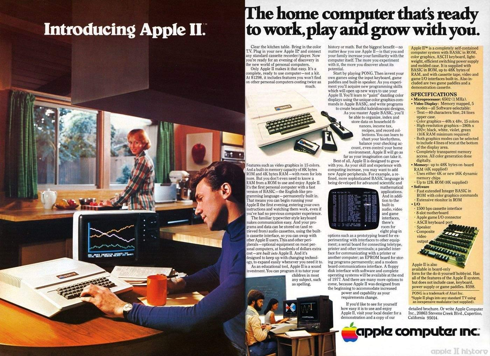

苹果II上市的时候原本采用磁带作为主要的存储媒介，这样一来就可以使用当时已经很普及的家用录音机进行读写操作，而且磁带的价格也比较低廉。但磁带存储的是模拟信号，读取和写入都很慢，容量很小，而且还容易出现错误。因此，1978年，沃兹尼亚克设计了Disk II软驱，因为设计的优越性，价格达到了前所未有的495美元。这款软驱以及后来以VisiCalc为代表的办公软件使得苹果II电脑可以真正像小型机一样成为一个生产力工具，而不仅仅是另一种游戏机。Disk II取得了巨大成功，在这之后，软驱也取代了磁带成为了美国家用电脑的标准。

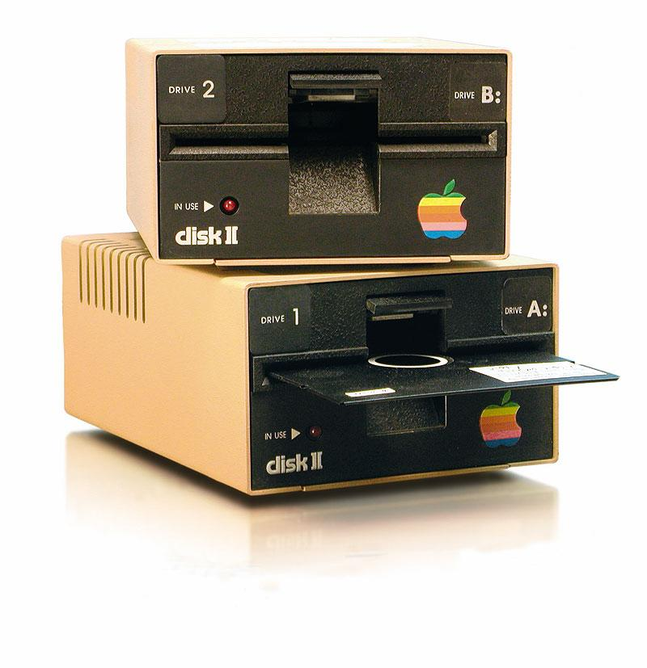

1979年推出的VisiCalc，是苹果II的杀手级应用，后来也推出了针对其他家用电脑的版本。

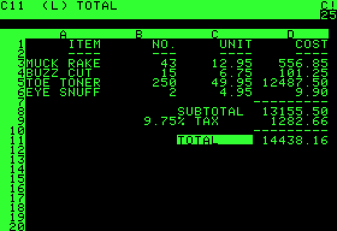

尽管Apple II的设计非常优越，但因为上市售价高达1298美元（合今天5218美元），所以刚开始的几年里卖得并不算太好。不过，之后苹果II系列不断的推出新产品，售价也有所降低，到了80年代，与苹果II同时推出的很多产品都已经退市，苹果II系列就真正成为一款畅销产品。截至1993年停产，Apple II系列总共售出500多万台。除此之外，还存在大量的复制品。

1984年推出的Apple Iic，仅重3.7千克，是便携电脑的先驱。上市售价仍为1298美元，但因为那几年的剧烈通货膨胀，实际只相当于今天的3043美元，比Apple II便宜了不少。图为配备显示器的Apple IIc。

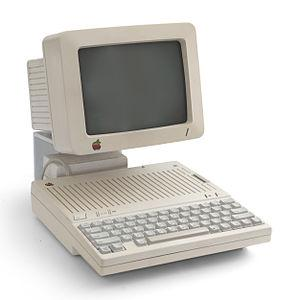

对比下Apple II

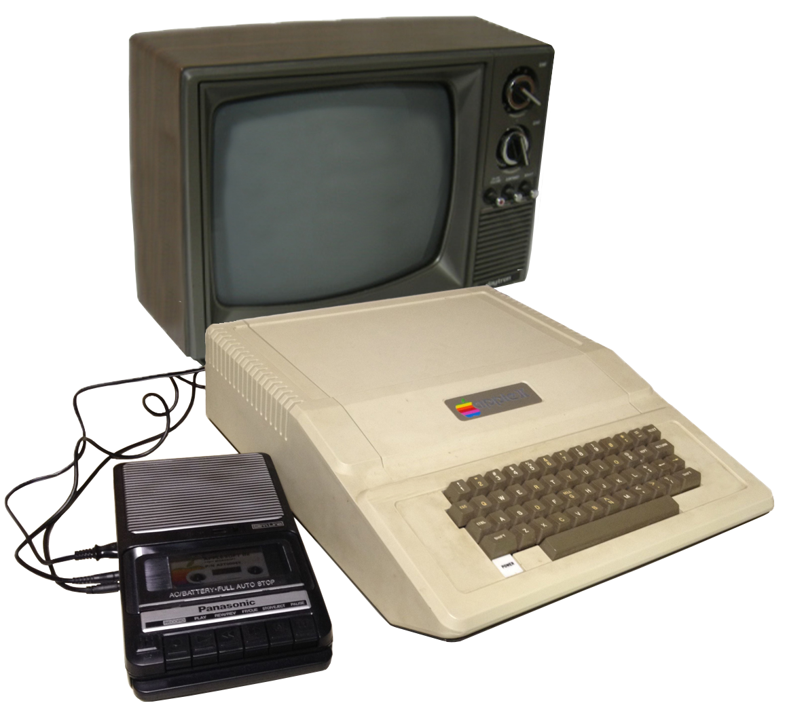

与苹果IIc兼容的中华学习机，1986年推出。

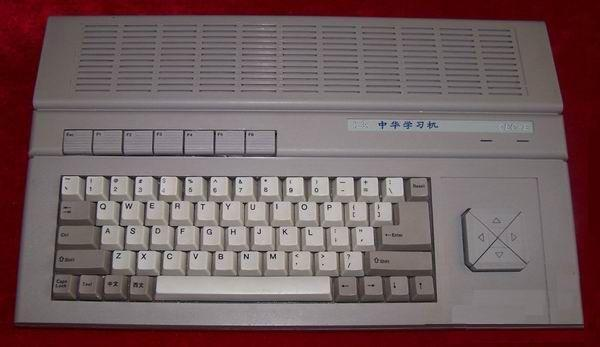

1986年上市的Apple IIGS，上市售价999美元，加强了显示和声音效果。

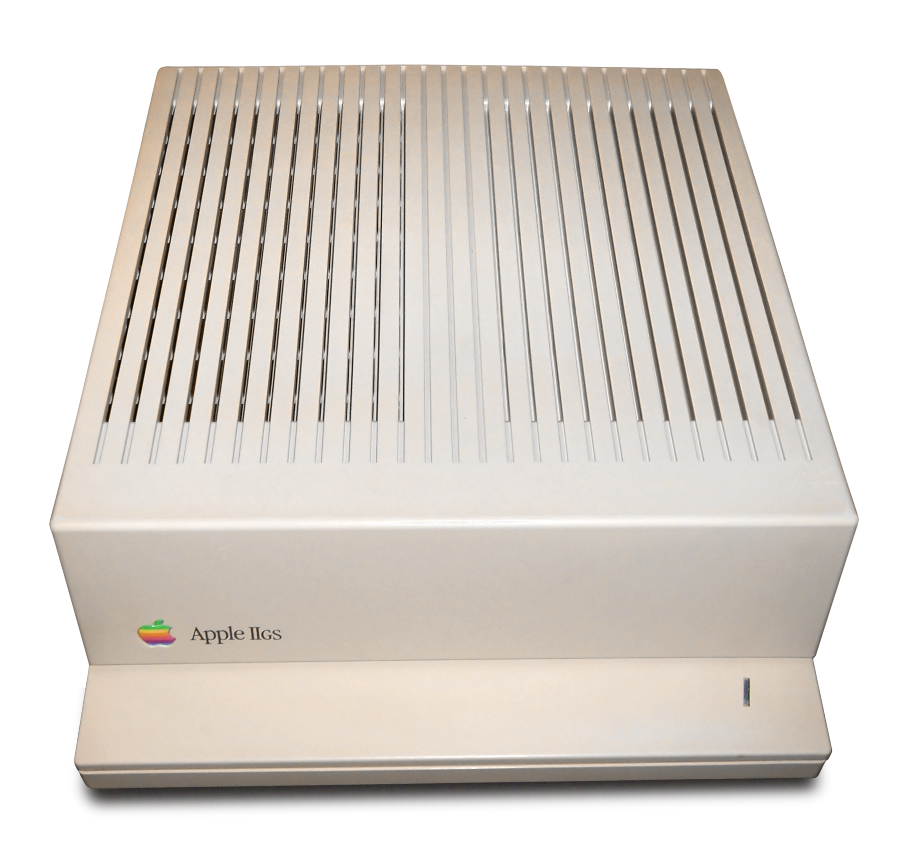

在Apple II推出两个月之后，连锁电子产品专卖店Radioshack也推出了第一款计算机产品，TRS-80。这款家用电脑的性能与Apple II相仿，但售价却只要399美元（合今天的1604美元）。不过，对于一家商品的平均售价只有30美元的零售企业来说，这已经是相当高的价格。在产品立项的时候，曾经受到很多高层的反对。因为售价在第一代家用电脑中最为便宜，TRS-80一直到1980年都是最畅销的家用电脑，到1985年停产，一共卖出了155万台。

包含显示器和磁带存储器的TRS-80也只售599美元

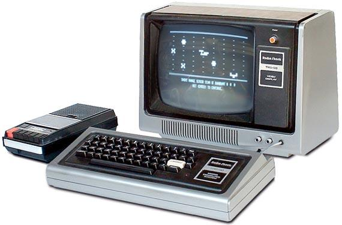

第三个登场的则是Commodore PET。Commodore原本是一家以生产计算器为主的电子厂商，PET全称为Personal Electronic Transactor（个人电子交易器），是Commodore的第一款计算机产品，它跟苹果II一样，采用MOS 6502处理器和4KB内存。售价为799美元（合3212美元），介于Apple II和TRS-80之间。在70年代后期，它的销售情况也是比Apple II好，而不如TRS-80。截止到1982年停产，PET总共卖出了21万台。

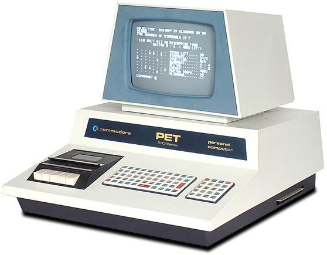

两年后的1979年，游戏厂商雅达利也推出了家用电脑Atari 400和800。在家用电脑的时代，因为办公软件仍然较少，也不那么容易学。充分利用计算机的功能又需要编程知识，是大部分人所没有的。所以就像今天的ipad一样，实际上大部分家用电脑都被主要用来玩游戏，可以看做是多了一些功能的游戏机。因此，刚刚发布了历史上第一款成功的家用主机Atari 2600的雅达利推出家用电脑，也就再正常不过。

图为Atari 400。整个Atari 8位家用电脑系列到1985年停产为止共销售出200万套。

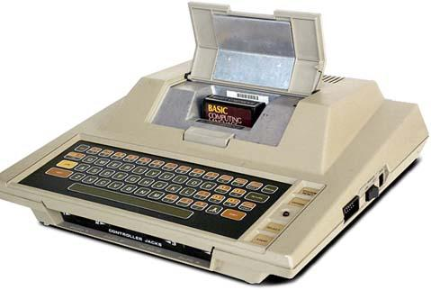

1982年更新的游戏主机Atari 5200，就是基于Atari 400发展而来。

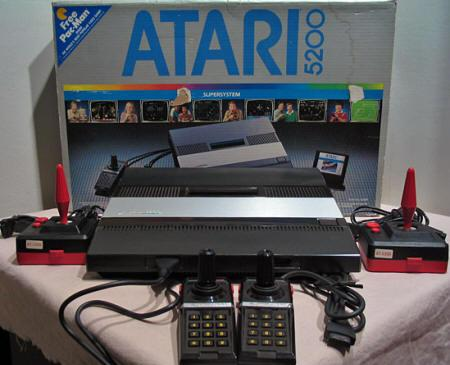

伴随着这些产品的上市，家用电脑的市场规模迅速地从1975年的几千台扩张到了1979年的58万台。

三、竞争白热化

进入80年代，随着市场上竞争产品的增多，家用电脑厂商轻松赚钱的日子一去不复返了。

一年以前，Commodore推出了PET的更新型产品VIC-20，在性能与PET基本保持一致的情况下，通过更加精简化的设计，将制造成本大幅降低。VIC-20的上市售价只有300美元（合今天的792美元），这比之前最便宜的TRS-80还便宜了一半，很快，VIC-20就抢占了大量市场份额。

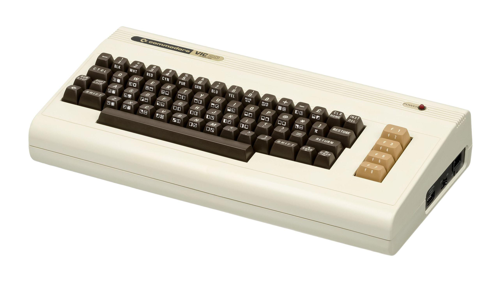

在VIC-20的刺激下，德州仪器也动作了。1979年，这家计算器厂商推出了第一款计算机TI-99，虽然这款产品做工优良，性能也领先于时代，但因为售价高达1150美元，比Apple II还要贵，而且系统不够开放，较难移植软件，销售很惨淡。1981年，德州仪器推出99/4A，基本与99/4保持一样的规格，但售价则只有525美元，甚至，经销商还会再提供100美元的返现，这让制造成本比VIC-20贵了差不多一倍的TI99/4A的实际售价与VIC-20相近，迅速就打开了市场。对此，美国名嘴比尔寇司比评论说“付100块钱给顾客让他们花钱买电脑也太容易了吧”

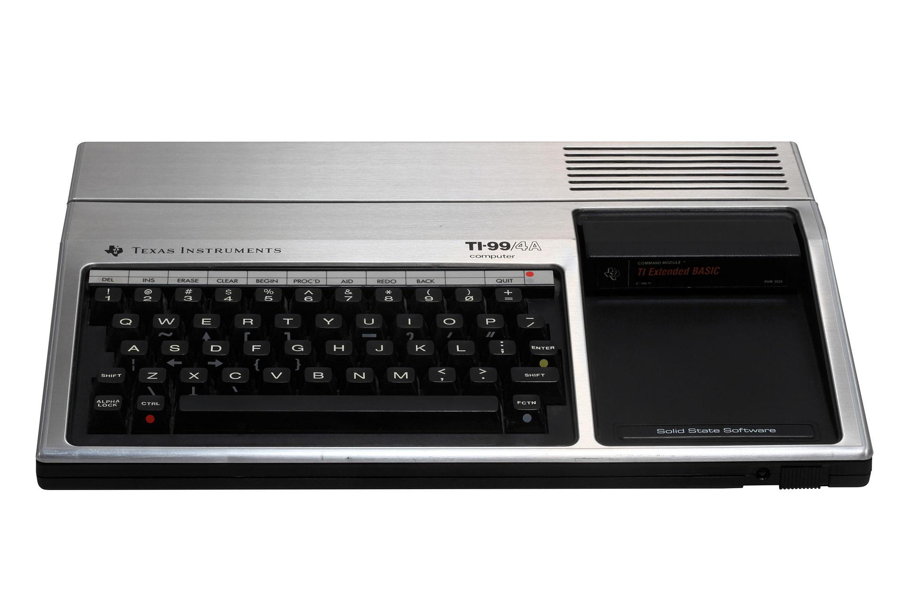

在接下去的两年里，德州仪器和Commodore开始争相对旗下产品持续降价。1982年，TI-99/4A降价到200美元，已经完全不赚钱。1983年，VIC-20降价到130美元。德州仪器就跟着降价到150美元。之后两家甚至都降价到99美元。但这种售价降低到原先十分之一的价格战策略也大大伤害了德州仪器的品牌形象，很多消费者都开始说“What's wrong with it？”。

到停产为止，TI99/4A总共售出280万台，远远高于VIC-20 100万台的成绩。但这并不意味着TI99/4A就赢得了价格战。同样是卖99美元，专门设计了低成本芯片方案的Commodore尚可以做到不赚不亏，但德州仪器就只能希望主机的亏损能通过配件销售和软件销售来弥补。

实际上，德州仪器的管理层最一开始就希望能够借鉴剃须刀靠刀片盈利的商业模式，更多得销售官方的软件。TI99/4A在当时并不以游戏为主打的电脑中，是唯一一个采用像红白机一样的游戏卡盒作为主要存储媒介的产品，因为卡盒远没有磁带和软盘容易被复制。同时德州仪器也不鼓励第三方软件。但这一策略却使得TI99/4A的功能吸引力进一步下降。

这还不算，1982年，Commodore推出了更新一代的Commodore 64（简称C64）。这款家用电脑上市售价也仅有600美元，低于上一代产品PET，但性能却大大增强，CPU换用MOS 6510，而内存则增大到在当时可谓惊人的64KB。作为比较，TI99/4A和Apple II plus的内存是16KB，雅达利400/800的内存是4/8KB，VIC-20的内存是5KB，一年之后上市的Apple IIe才有64KB的内存，但售价却是C64的两倍。

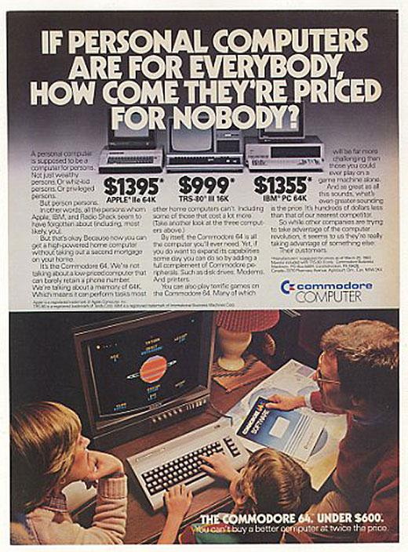

除此之外，C64的影音性能也极为强大，不但显示分辨率高达320x240，而且硬件支援当时只有游戏机和雅达利的家用电脑才有的彩色Sprite（精灵，预定义的图像），这使得C64同时是一款非常优秀的游戏机器。C64也是唯一一个在卡盒（早期的美国游戏发行）、软盘（办公软件，以及后期的美国游戏发行）、磁带（欧洲市场）三种媒介上都发行了大量软件的家用电脑。

C64的游戏图像

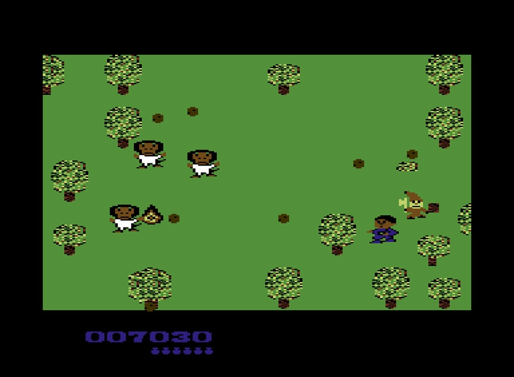

很多C64都会配备两个游戏用的摇杆。

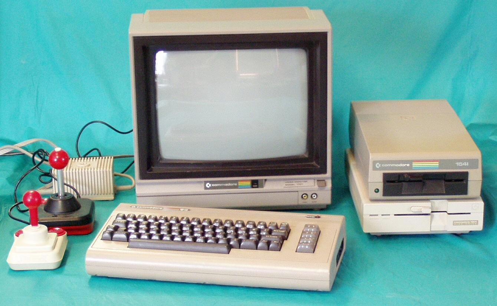

1983年，倚仗成本优势的Commodore将C64的价格降低到仅有300美元。此外，如果顾客在买新的C64的时候将家中的旧电脑拿来，零售店还提供100美元的折扣。当时很多零售店借此政策，以10美元的批发价将英国产的Sinclair 1000家用电脑（即后文会提到的ZX 81）销售给C64的买家，使得C64的零售价格实际上等于210美元。

到1985年，C64售价甚至已经只要150美元（合今天的335美元），但尽管如此，Commodore仍然有丰厚的盈利，因为此时C64的制造成本已经不及50美元。同年Commodre还推出了C64的升级版C128，内存扩大了一倍。

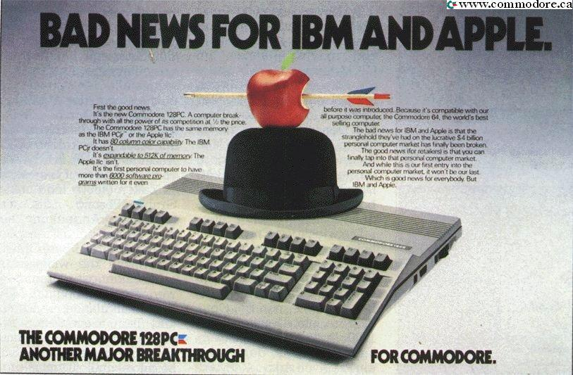

可以说，在这场价格战中，受益最大的是消费者。虽然1980年前后通货膨胀物价上升，但家用电脑的售价持续降低，使得市场规模迅速扩大。1980年，全世界的微型计算机市场规模仍然只有72万台每年，到1983年就达到了492万台。而1986年则进一步上升到900万台，其中250万台是C64。到80年代末，美国的中产阶层家庭已经基本普及了电脑。

到1993年停产为止，C64总共销售了1570万台，也是史上最畅销的单一型号的计算机产品。

但这场价格战之中也有很多输家。家用电脑价格战最凶的1983年，美国的游戏机产业几乎在一瞬间内崩塌。原本大多售价在170美元左右的游戏机主要的价格优势此时荡然无存，人们当然喜欢还能够运行办公软件的家用电脑。

亏损巨大的德州仪器当然也从此退出了家用电脑市场。而像这样仅仅推出了一款产品就告别了计算机市场的厂商还有不少。

Mattel Aquarius，游戏机厂商Mattel的唯一一款家用电脑产品

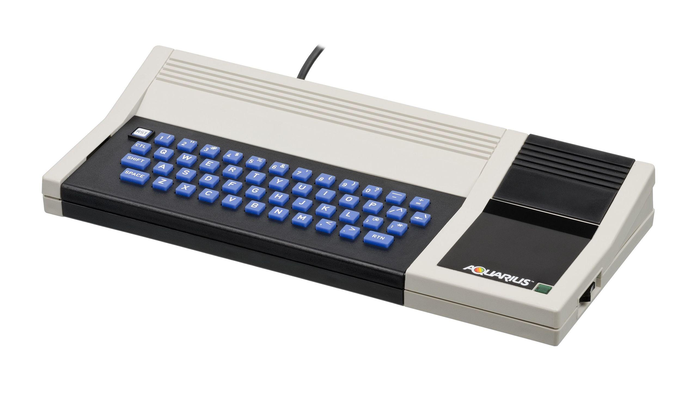

同样由游戏厂商推出的Coleco Adam，是家用主机ColecoVision的扩展版本，概念相当于十年后中国流行的学习机。

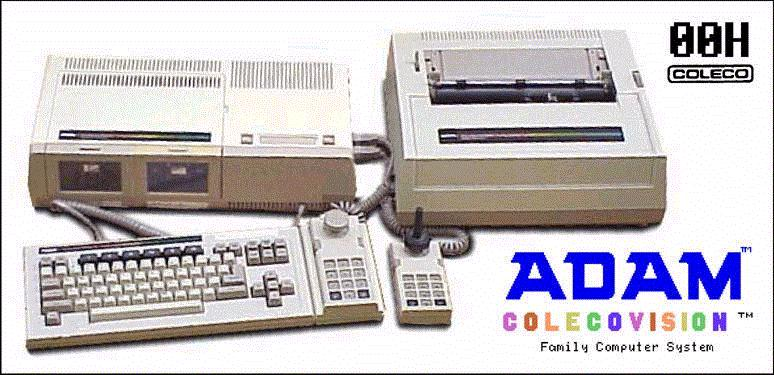

在这场市场混战中，苹果一直通过优良的设计、可扩展性、工艺质量以及高水准的第三方软件独善其身，打个不恰当的比方，Apple II就像是Surface，虽然性能不强，但却具备完善的电脑功能。C64则像是ipad pro，虽然性能强，也可以办公，但主要还是以娱乐功能为主。

因此，apple II一直维持1000美元左右的售价，虽然销量没有C64大，但总利润要高得多。此外，苹果还在1980年推出了进军商用电脑市场的产品，Apple III，售价高达3500美元（合今天的10200美元）

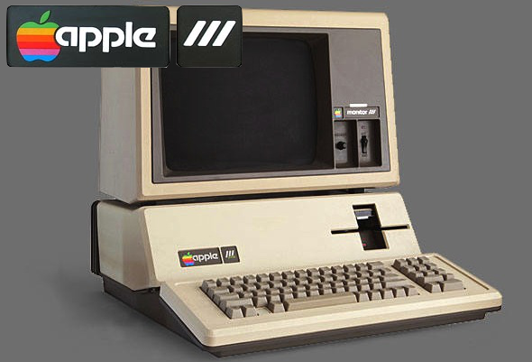

不过，大部分消费者对于这样一款只是Apple II加强版的产品并不买账。真正第一台获得成功的办公用途微型计算机则是1981年以后推出的IBM Personal Computer，也就是PC。借助于IBM在大型计算机领域的名声，加上接近于高端家用电脑的售价——1565美元（合今天的4123美元），PC迅速获得了成功，并最终成为后来所有微型计算机的标准。

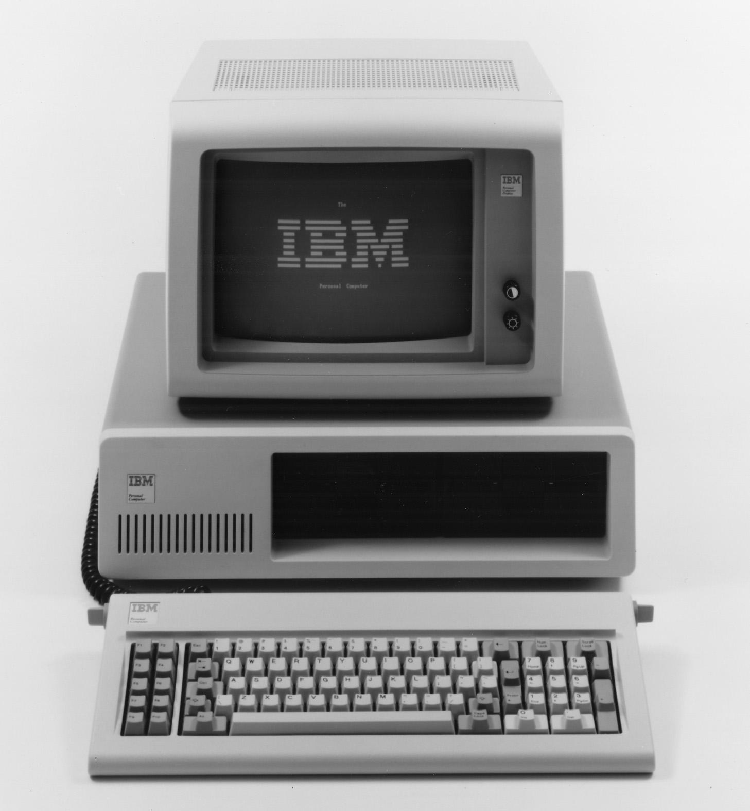

PC的主力市场仍然是办公用户。1984年，IBM还进一步向家庭市场发起了冲击，推出了低成本的PC jr，售价降低到1269美元，与Apple II系列的最新产品类似。不过，像Apple III一样，PC jr也并不成功，原因则不太一样。PC jr差不多有原版PC85%的性能，价格也大概是其85%，但少掉的这15%，却是PC赖以成功的关键——对专业商用软件如Lotus 1-2-3的支持。

电子表格软件Lotus 1-2-3，运行在IBM PC使用的MS DOS操作系统下，是IBM PC的杀手级应用。

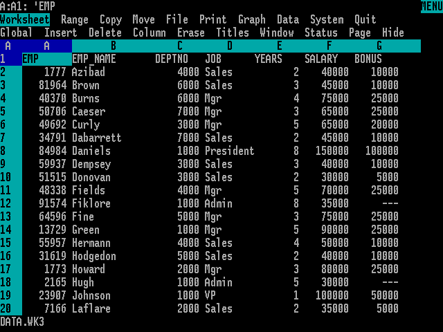

直到80年代中期为止，美国的微型计算机市场大概是这样的情况：**IBM和苹果谁都没有干掉谁，各自在高端市场有很舒服的一块份额，低端市场则完全为C64垄断**。

那么在80年代的最后几年，究竟是其中的哪一家一统天下了呢？

（未完待续）
