# 移动计算发展史（2）早期的膝上电脑——折叠电脑

> 来源:https://api.zhihu.com/articles/33140952  
> 日期:2018-01-22 · 赞同:63 · 文章

接上期：

[移动计算发展史（1）点到点移动的手提电脑](https://zhuanlan.zhihu.com/p/29068038)

在上期文章里，我介绍了80年代手提电脑的发展使得移动办公成为可能。但手提电脑显然有其局限性。首先是体积和重量仍然比较大；其次是没有电池。这使得手提电脑只能在“移动后”进行办公，而不是在“移动中”进行办公。

改变这一情况，是早期的膝上电脑（Laptop）——折叠式电脑（convertible computer）。经过了这一代移动个人电脑的发展，个人电脑的小型化才确定了翻盖的形式（clamshell，或者说flip），并开始具有了电池，最终发展成为后来大行其道的笔记本电脑（notebook）。

**一、折叠电脑的发端**

虽然后来折叠电脑发展为独立的一类移动电脑，但其实一开始的时候，这只是手提电脑的一个分支。在70年代末和80年代初，要把电脑做的更轻巧更便携，有两个思路。

一个是像Xero Notetaker和Osborne 1一样，把电脑做成手提箱的外形，而位于侧面或者底部的键盘则可以与主机分离。这样的设计在当时的技术上难度较低，整合时手提箱的外形也方便手提，但缺点则是在工作状态下，键盘与主机分离，此时可移动性就大大下降。

另一个则是像R2E Portal以及后来的Apple IIc一样，机身与键盘为完全的一体化设计，工作状态和移动状态的外形完全一致，这样一来就不存在工作时移动性便携性下降的问题。但如果要保证完整的个人电脑使用体验，需要提供一个较大的显示屏，此时电脑的外形就不规则，它的可移动性就没那么好。因此后来这种形式主要发展了性能降级的手持电脑和掌上电脑。

1982年4月，一家名为Grid Systems Corporation的公司推出了世界上第一款采用翻盖形式的手提电脑——GRiD Compass 1101（后来也叫GridCase I）。这台研发了3年的电脑在发布时的售价极为昂贵，高达8150美元，而同时期手提电脑领域的领军企业——Osbourne推出的Executive只要2495美元就可以买到。虽然后来销售价格下降到3000美元左右（合今天7610美元，或4.87万人民币），但也仍然不是普通消费者消费得起的，主要的采购方是美国政府，曾经与美国的航天飞机一起上过太空。

但与之对应的是它前所未有的便携性，它的三围尺寸分别是38/28/5.7厘米，仅重5.8千克。而同年手提箱式的Osbourne Executive的三围则为52/33/23厘米，重达12千克。

与手提电脑一样，这款电脑没有电池，需要外接电源使用。它采用8086处理器，早期只有一个自行设计的操作系统，后期也兼容MS-DOS。值得一提的是它的硬件技术很有特色，采用电致发光显示器（ELD）而非当时主流的CRT。它没有内设软驱，但是却使用断电后不丢失数据的磁泡存储器作为内存，相当于兼有RAM和ROM的功能。而且因为当时的单面5.25寸软盘的容量只有160K，而竞争对手如Osbourne Executive的内存为124K，实际上340K的磁泡存储器反而容量是更大的。它的外设则很丰富，有打印机、软驱、硬盘、调制解调器等各种设备。

值得一提的是，创办Grid公司并设计Compass 1101的人，都是施乐PARC研究所的前员工。这家规模并不大的研究所我之前已经几次提到，着实是80年代整个计算机业很多划时代创新的源头。

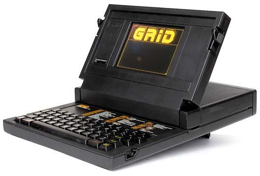

虽然非常轻巧，但GRiD Compass 1101毕竟还是没有电池的。第一台有电池的折叠电脑——Dulmont Magnum，是在1982年才出现。它也很轻巧，三围为32 x 27.5 x 5.5厘米，重4.8千克。采用80186处理器，兼容MS-DOS，同样没有内置软驱，但采用了常规的96KRAM+两个可插拔的128K ROM卡槽的设计。主要的性能短板是显示器只能显示8行字符，而非当时移动电脑主流的24行。不过，它的杀手锏是一块能续航20小时的镍镉电池，这使得电脑的移动办公性能得到了质的飞跃。

比较有趣的是，这台电脑来自于很少在计算机历史中露面的澳洲。虽然它1982年就开始预售，但1983年才在澳洲正式上市，1984年才出现在美国等国际市场，售价是2495美元。它总共卖了1.1万台，并没有特别大的影响。

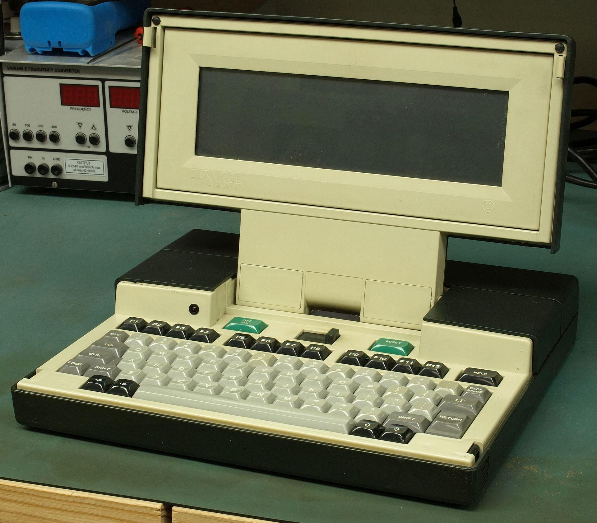

另一款重要的便携电脑，是1983年美国公司Gavilan推出的Gavilan SC。这款电脑同样是折叠式，三围是更小的27/27/7厘米，重量仅4千克，同时也拥有一块镍镉电池，能续航9小时。但它还拥有内置的软驱，因为推出在IBM PC之后，因此有部分PC兼容性。最特别的是在它的屏幕和键盘中间有一块类似今天笔记本电脑上的触摸板的指点设备。它也是第一台被宣传为膝上电脑（Laptop）的产品，强调了它能够在任何地点办公。

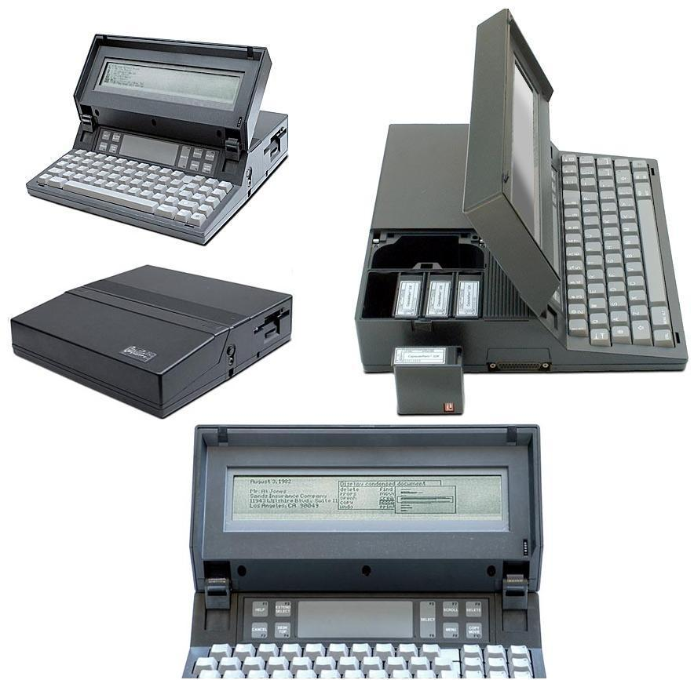

日本人在折叠电脑方面从一开始就不落后。1983年，夏普推出了第一款高度PC兼容的折叠电脑PC-5000 ，同样采用类似的翻盖设计和细长的显示屏。不过，阻碍它成为更重要的历史产品的是——这款电脑并没有电池。

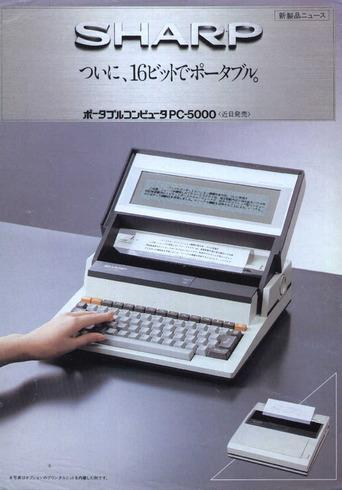

1984年，随着折叠电脑的认可度提高，有更多的这类产品出现。

Zenith公司的ZP-150，含Microsoft Works套件（弱版Office），上市售价是折叠电脑有史以来最低的2000美元，后来进一步降到1200美元（1985年），1000美元（1986年）甚至是700美元（1987年）。它可以使用10节5号碱性电池供电，同时还有一个内置电池用以断电后保存数据，能够保存8天。

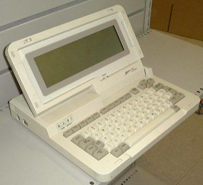

惠普的HP 110，上市售价3000美元，内置了Lotus 1-2-3等办公软件。采用铅酸电池。有16小时的续航能力。

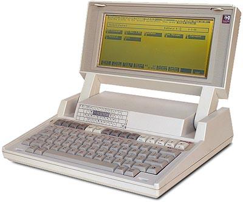

京瓷制造，美国公司Tandy授权在美国Radio Shack店中以Tandy 200名义销售，上市价格就是很有竞争力的999美元（合今天的1.5万人民币）。它使用4节5号电池，可以续航10小时。

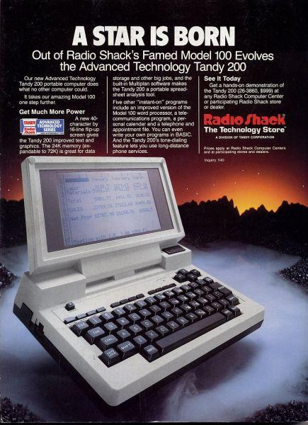

1985年4月，富士通推出F-16π，这是第一款支持日文显示的折叠电脑。它的重量达到了在当时极为惊人的2.9千克，采用镍镉电池，可以续航3小时。富士通寄希望于这款电脑大获成功，也进行了不少宣传。但遗憾的是，因为它采用当时已经落伍的CP / M-86操作系统，销量的表现并不算好。

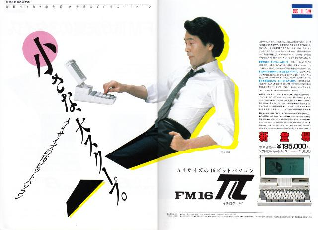

同样是1985年，Bondwell-2在美国面市，这款折叠电脑同样采用CP/M操作系统，而且有可充电的铅酸电池，续航8小时。它的售价极为便宜，只要995美元。

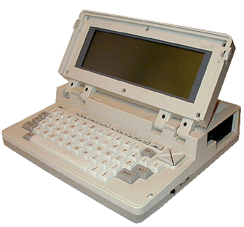

**二、折叠电脑的成熟**

虽然上面推出了这么多产品，但真正让折叠电脑产生巨大影响力的，还是既有内置电池，同时与主流个人电脑兼容的产品的出现。

第一款这样的产品来自日本人。

1985年11月，东芝T-1100面世，它是世界上第一款完全PC兼容的含电池的折叠电脑。它的配置十分主流，采用Intel 80C88处理器，256K内存，内置了3.5寸软驱，显示屏为640x200的LCD液晶显示屏，但是重量则达到了4.1千克。它在美国的上市售价为1895美元，上市当年就卖出了1万台，最终全球销量达到数万，是第一台商业上大获成功的折叠电脑。

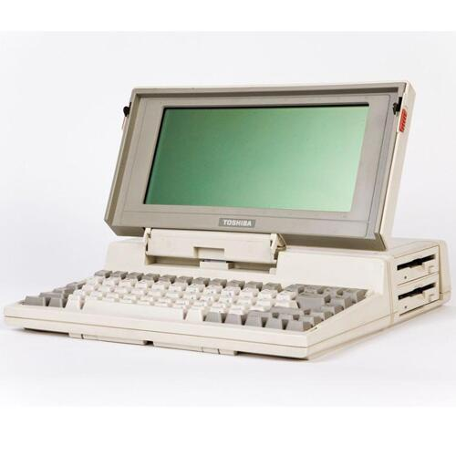

1986年4月，东芝推出了T1100的后继机种T3100，兼容了更新的PC/AT标准。6个月后东芝才在日本推出了增加日文处理功能的J3100。在8、90年代，日本的电子厂商优先为欧美市场开发产品仍然非常普遍。

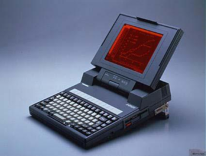

*J3100*

1987年的东芝T-1000则将重量降到了2.9千克。

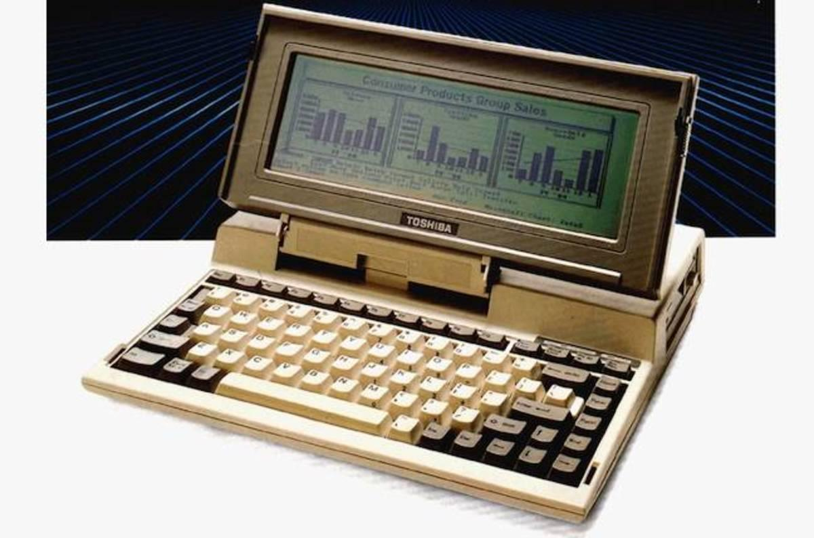

1986年10月，日本计算机市场霸主NEC也推出了第一款折叠电脑——PC-98LT。这款产品的上盖几乎是可以全部打开的，很接近后来的笔记本电脑的设计，屏幕更是比当时主流的膝上电脑大了一倍。310(W) x 285(D) x 68(H) mm的三围，3.8千克的重量同样也很领先。

对于日本市场来说，这款电脑的特别之处是它是第一个支持汉字显示的便携式电脑，23.8万日元的售价也不贵。但比较遗憾的是，因为这款电脑并不与PC-9800系列兼容，因此在日本市场也没有掀起太大的波澜。

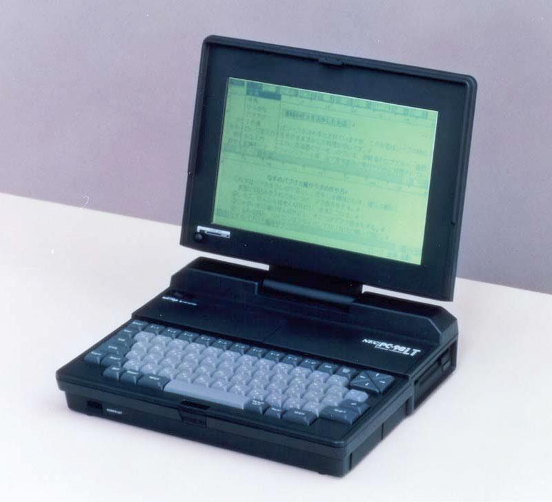

直到两年后，PC-9801LV系列上市，NEC自己才有了兼容PC-9800系列的笔记本电脑。这个系列的第一款产品——PC-9801LV21，于1988年3月上市。遗憾的是，这款产品，比98LT要大了不少，339(W) x 315(D) x 85(H) mm的尺寸已经显得有些臃肿，超过7千克的重量则更难以算作笔记本电脑。

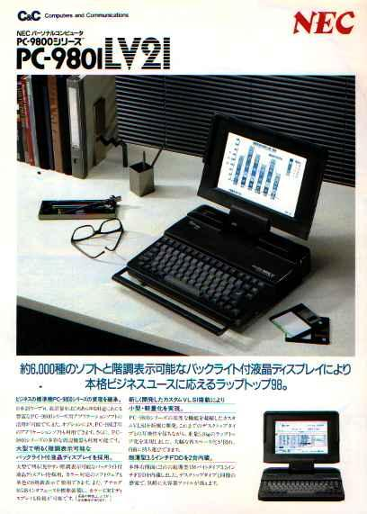

日本市场第一款大获成功的折叠电脑是于1987年11月，由精工爱普生推出的PC-286L。这款电脑的尺寸是345(W) x 335(D) x 79(H) mm，也相当紧凑，但重量就要大得多，不同版本的重量为6.1-9.3千克不等。

尽管如此，爱普生瞄准了当时日本PC市场兼容NEC的PC-9800标准才是王道，这款产品基本就沿用了台式机NEC PC-9801VM2的硬件标准，因此在折叠电脑领域初试牛刀就大获成功。依靠PC-286L的热销，爱普生的PC-286个人电脑系列的市场占有率从1987年9月的4.3%和10月的9.9%暴涨到11月的20.1%，12月就已经卖到断货。

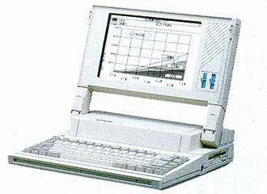

富士通的第一款PC兼容的折叠电脑则是1988年推出的FM R-50LT，重7.5千克。

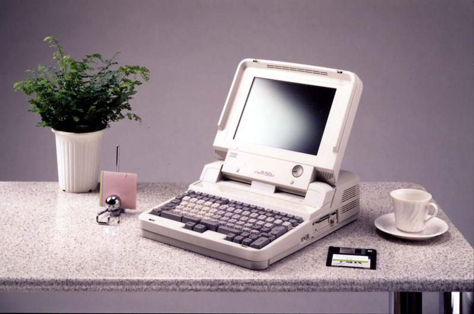

在美国影响最大的折叠电脑产品则是1986年，IBM推出的PC Convertible。就像1984年PC Portable的推出意味着手提电脑市场正式成型一样，这款产品的推出也代表着折叠电脑开始取代手提电脑。

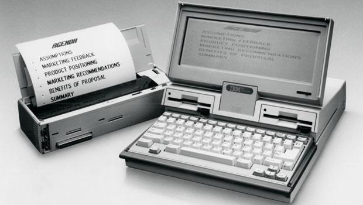

不过在1987-1988年，美国乃至全球的第一大折叠电脑供应商倒是Zenith。当时美国空军有20万台笔记本的需求，而Zenith与日本厂商三洋电子共同设计了一款PC兼容、采用8086芯片的折叠式电脑——SupersPort，最终赢得订单。1988年又换用80386芯片，推出了SupersPort SX。SupersPort系列也开了美国厂商由东亚厂商代工生产的先河。

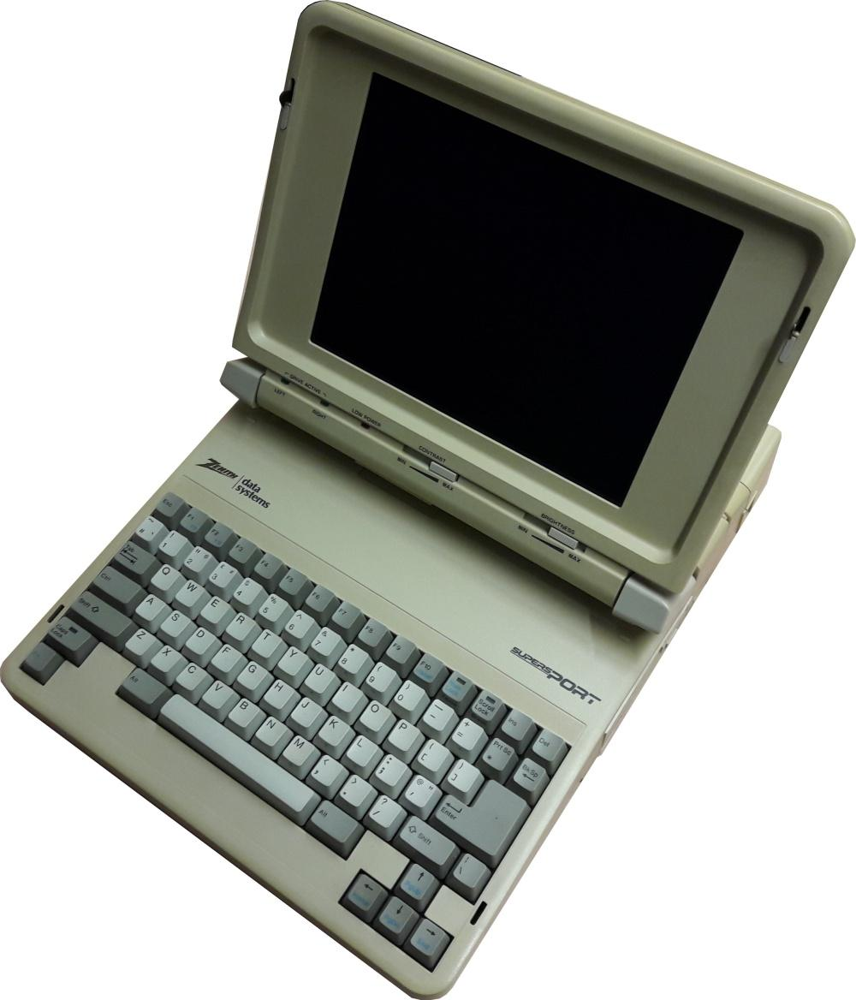

*SupersPort*

1988年，康柏也推出了COMPAQ SLT/286，这款产品比较重，4.6千克，但是第一个支持内置硬盘的折叠电脑。

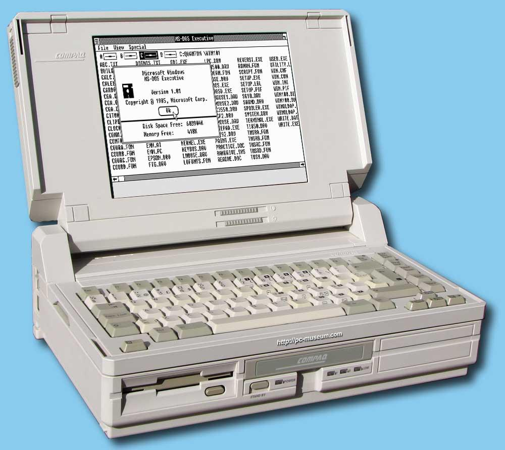

苹果在这个领域的动作就显得有些慢，1989年，苹果才推出了第一款含电池的电脑——Macintosh Portable。这款电脑尽管配置比较高，还内置了比触摸板更好用的轨迹球用以控制光标，但重达7.2千克，同时售价高达7400美元。

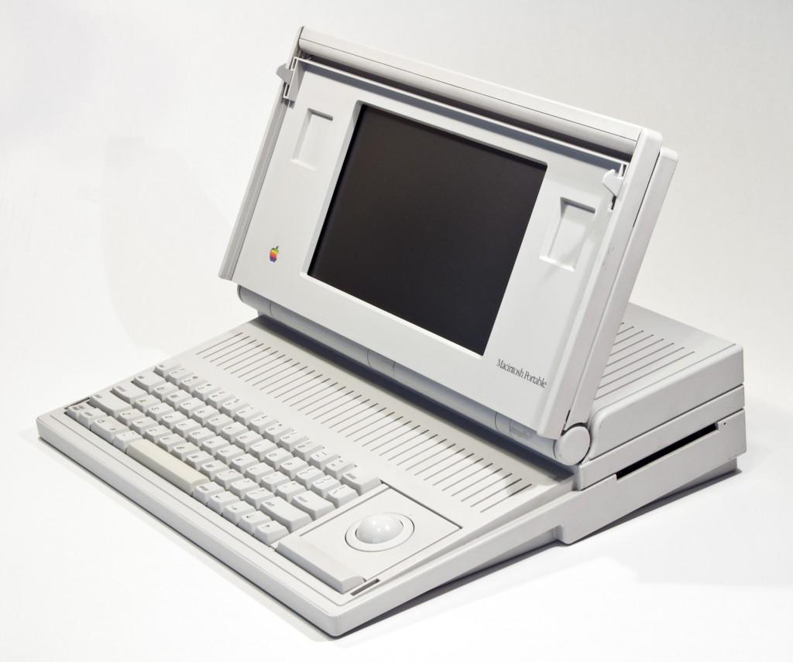

1989年，16位个人电脑除PC和Mac之外的另一个重要选手——Atari ST也推出了折叠电脑产品Atari STacy，它的售价虽然也不便宜，2300美元，但因为内置了MIDI，它在音乐市场十分流行，最终买了3.5万台。

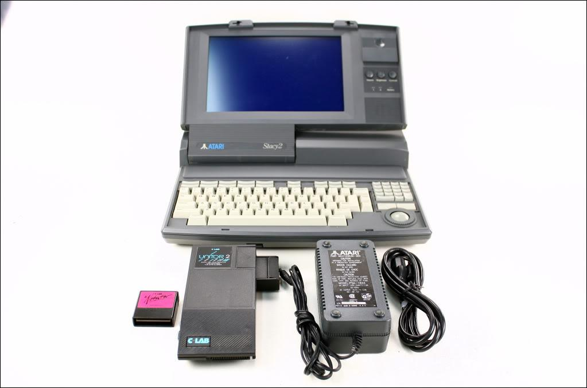

意大利厂商Olivetti同年推出的M111折叠电脑

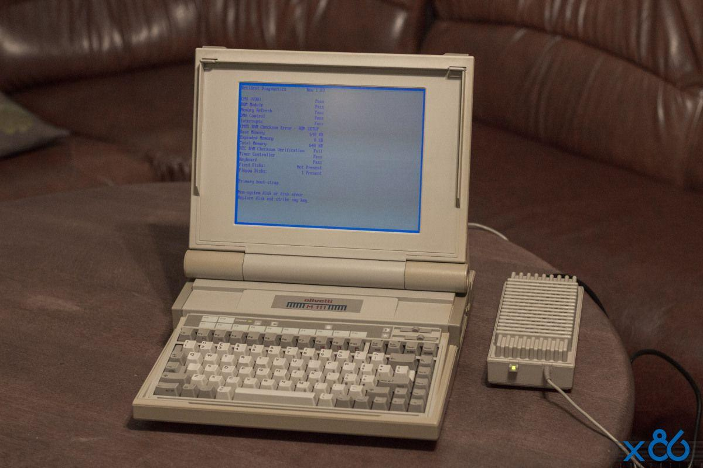

总得来说，虽然80年代后期折叠电脑开始流行，但此时的折叠电脑普遍仍然只有前半部分可以折叠，对体积的利用不够充分，还不能同时提供良好的便携性和显示尺寸及性能。真正的笔记本时代，此时还尚未到来。
