# 移动计算发展史（3）：“笔记本”时代到来

> 来源:https://api.zhihu.com/articles/74294359  
> 日期:2019-07-18 · 赞同:80 · 文章

接上期：

**一、上盖完全可开的先驱**

1980年代中后期，具备电池折叠电脑的发展使得移动计算成为可能。但移动办公真正开始普及，还是要等到真正的笔记本电脑出现以后。

虽然这种比折叠电脑更轻便、而且上盖可以完全打开、在同样的体积下有更大的键盘和显示屏面积的新式电脑真正开始成气候是在80年代末，但其实这类产品早在80年代中期就已经出现。

与此前的可移动电脑和膝上折叠电脑都由美国人开创不同，笔记本电脑却是日本人的创造。实际上，中文中“笔记本电脑“，也来自于日本人对这类电脑的命名。是日本人最早将这类好像A4大小的笔记本的电脑称为“ノートパソコン”（no-to-pa-so-con，即Notebook Personal Computer的简称），以与早期折叠电脑形式的膝上电脑（Laptop）相区别。而这个名字传到中国，又被翻译成我们口中的“笔记本电脑”。

早在1985年，日本小厂商日本信号就推出了Ampere WS-1。这款电脑支持APL这种非常强大、特别是文本处理能力超强的编程语言。并且内置了电池。它的外形已经无限接近今天的笔记本，整个上半部分都可以翻开，流线型的设计也很有特点。三围330(W) x 280(D) x 92(H) mm，以及重量3.6千克，在当年也都是十分领先的水平。

但这款电脑不是PC兼容机，操作系统为自有的Big DOS。而且因为它没有取得FCC认证，没有在美国销售，加上APL语言的命令不用英文而是用数字书写，在全球市场也都难以被普通用户接受，45万日元的售价也相当昂贵，因此总销量不高，影响力不大。

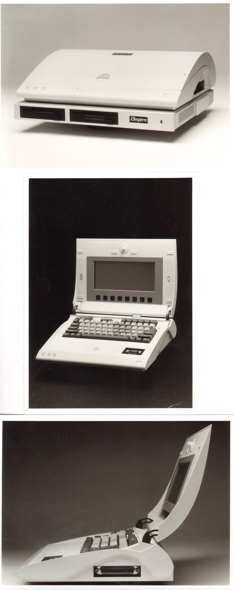

此外，上期专栏中提到的NEC于1986年11月推出的PC-98LT，也是无限接近后来笔记本的一款产品，尤其是它用仅仅3.8千克的重量实现了比当时折叠电脑大一倍的屏幕。

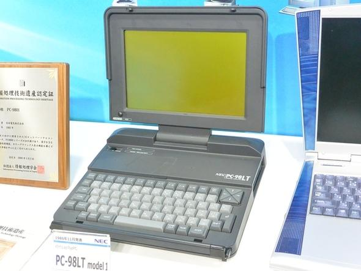

这类“准”笔记本电脑也存在于美国。

1985年底或1986年初，美国第一款上盖可以完全打开的电脑Kaypro 2000上市，重5.4kg。

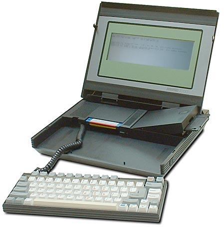

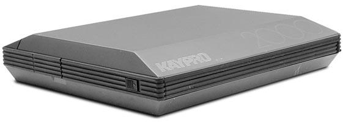

1987年，惠普推出Vectra Portable CS，同样采用全翻盖，显示屏更大——12寸，性能也更强劲，弹出式软驱使用起来更为方便，但重达8千克。

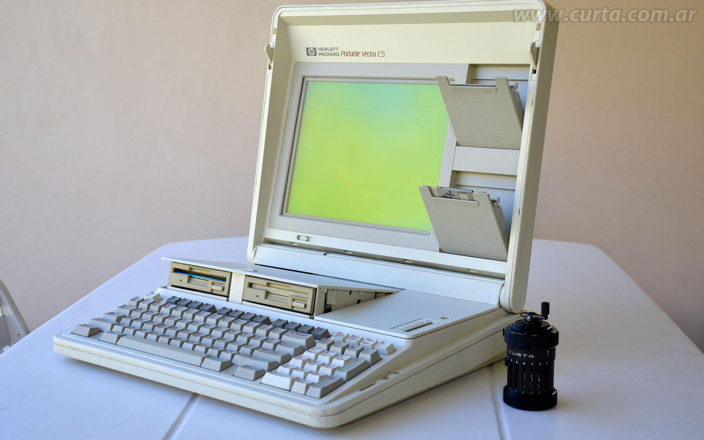

同样性能强大、但很笨重的准笔记本电脑，还有1987年的Zenith ZFL-181-93：

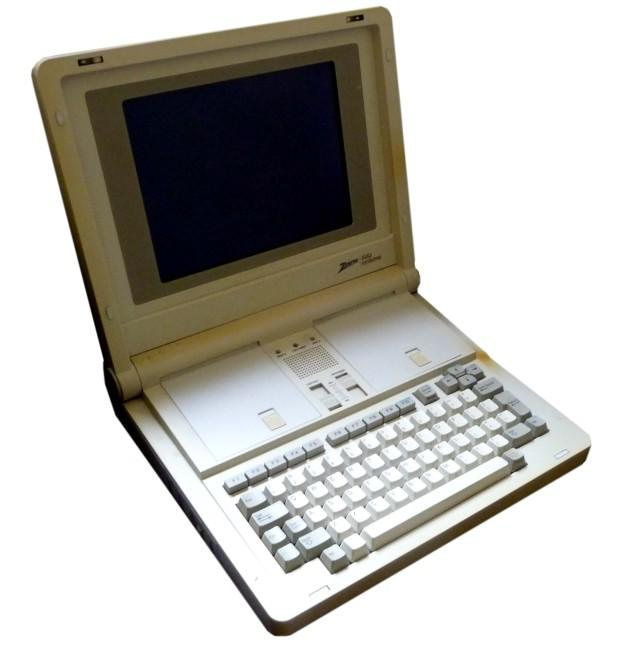

这几款美国产品都不太面向大众消费市场，而针对少数企业开发，因此影响力甚至比NEC的PC-98LT更低，没有留下多少影响力。

**二、真正的“笔记本“尺寸**

经过了三年多的小大小闹以后，真正重量级的产品——NEC Ultralite在1988年10月问世了。这款电脑采用NEC自家设计的芯片V20，性能大概介于8088和80186之间。最关键的是，虽然它不是PC兼容机，不能通用PC机的各种外设设备，但却兼容MS-DOS，这使得大部分为PC的MS-DOS编写的软件就可以在它上面运行。

因为整个上半部分都可以掀起来，Ultralite拥有很高的体积利用效率。同样是配备了10寸左右的显示屏，Ultralite的重量只有2kg。而当时主流的折叠电脑重量多在4-6千克。Ultralite的厚度也只有35mm。应该说，Ultralite无论是轻薄程度程度，还是外形的样式，都完完全全符合今天笔记本的定义，比此前日本信号和NEC的笔记本电脑产品要更紧凑得多。

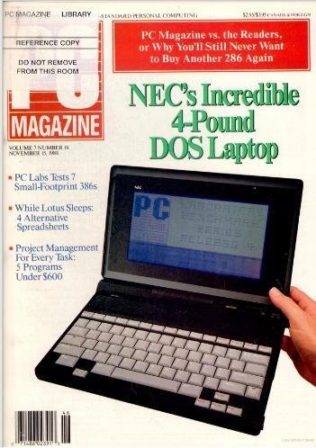

尽管是一款革命性的产品，Ultralite也确实不便宜。上市时售价高达4500美元，比当时主流的折叠电脑贵了一倍。这个售价使得它仍然无法引领笔记本电脑真正开始普及。

第一款在大众市场取得成功的笔记本产品是1989年6月推出的东芝J3100SS。这款电脑完全兼容PC-9800标准，也支持汉字显示，而且仅重2.9千克。上市售价为49.8万日元（合3148美元），卖出了17万台。

相比Ultralite的上半部分完全从边缘处上翻，J3100SS的上盖更像是介于折叠电脑与笔记本之间。但它后来发展成为“Dynabook”系列（Dynabook为硅谷著名计算机科学家Alan Kay在1972年提出的便携电脑概念的名字），是东芝笔记本产品系列的起点，帮助东芝在之后的几年里与康柏并称为笔记本业的两大龙头。

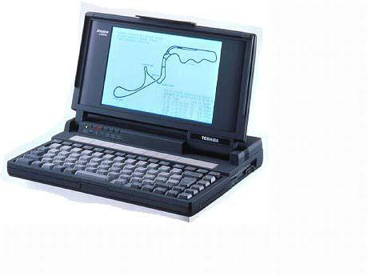

而Note Personal Computer/ノートパソコン/笔记本电脑名称的出现，则是因为1989年10月NEC PC-9801N系列的面市。因为它的长和宽分别为316mm和253mm，厚度也只有44mm，接近一个笔记本的大小。NEC也将这款笔记本电脑称为98NOTE系列，以宣传它的轻薄小巧。这款产品在日本也获得了成功。这个系列后来一直生产到1994年。

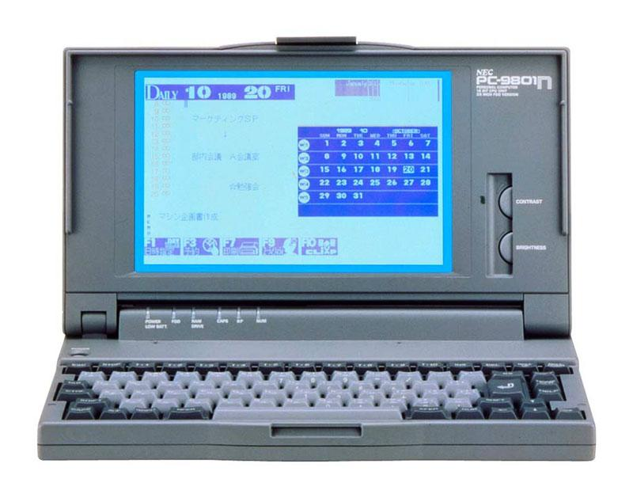

美国人心目中的第一款笔记本电脑当然不能是日本品牌。

以可移动电脑起家的康柏迅速发现了日本的这个新趋势大有可为，很快在1989年10月推出了Compaq LTE。虽然它的性能要落后一点，芯片只是8086，2.8kg的重量也要大一些，甚至显示屏尺寸也要稍小一些，但它的售价仅仅是2400美元，而且完全PC兼容，使得它刚一上市就在美国走红，后来也成为很多美国媒体所谓的第一台笔记本电脑。

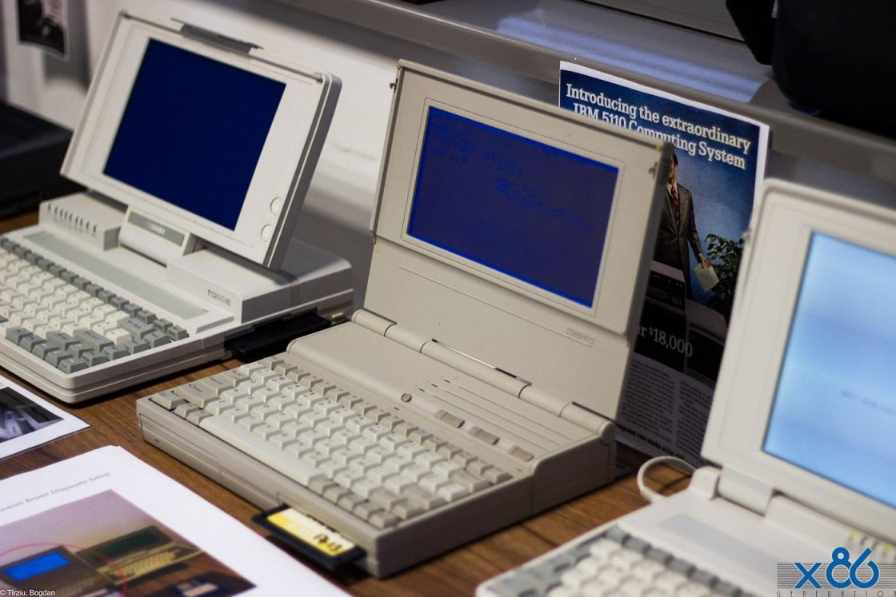

*Compaq LTE/286*

LTE一经推出就成为康柏旗下的拳头产品。后来这个系列一直推出到1997年，是整个90年代笔记本市场的几个重要玩家之一，是帮助康柏爬上PC行业霸主的重要功臣。

还是1989年，另一家日本厂商精工爱普生推出了PC286NOTE Executive，不但是PC兼容机，而且重量仅为2.2千克。

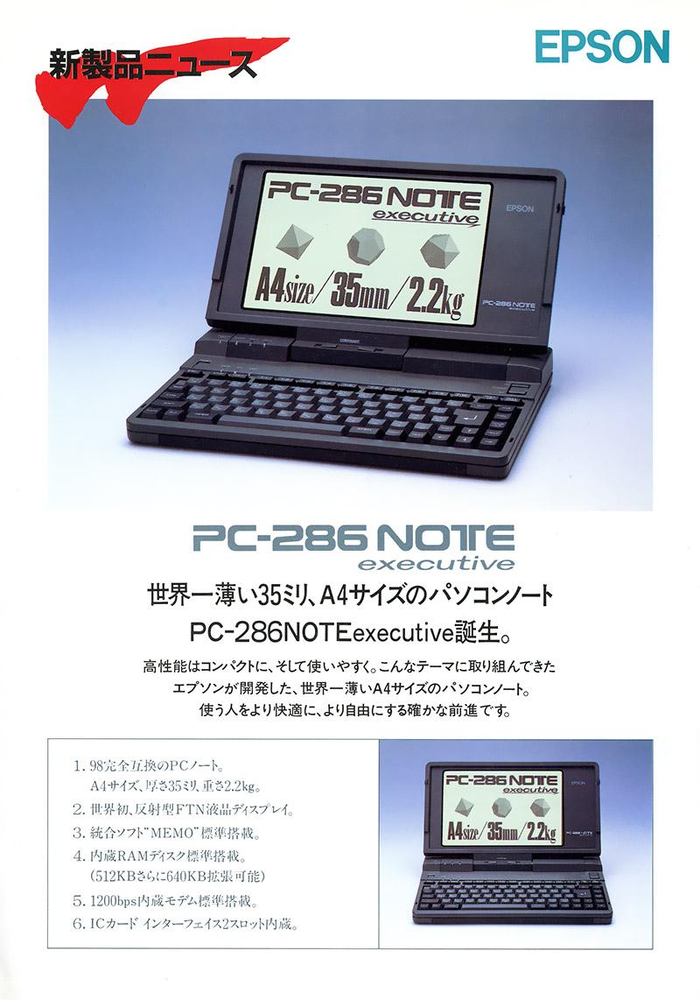

进入90年代后，笔记本产品的成功让更多的一线厂商加入了进来。

还记得那个第一个生产出成品个人电脑的意大利电子厂商Olivetti吗？他们在1991年也推出了一款笔记本产品S-25-C

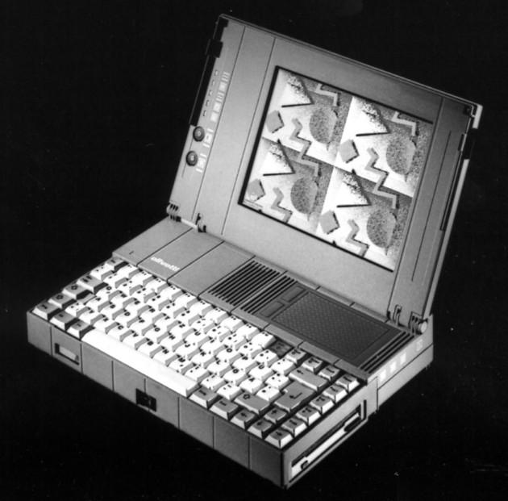

1991年，苹果用Powerbook加入战局。Powerbook甫一面世就有100、140、170三兄弟，2.2kg的重量和46mm的厚度都是主流水准，而长和宽则是11 x 8.5 英寸（28 x 21.6厘米），也即真正的A4尺寸，比此前的竞品都还要小一些。最重要的是Powerbook的定价极富侵略性，100系列起价仅为2500美元，并没有因为是苹果就卖得太贵。

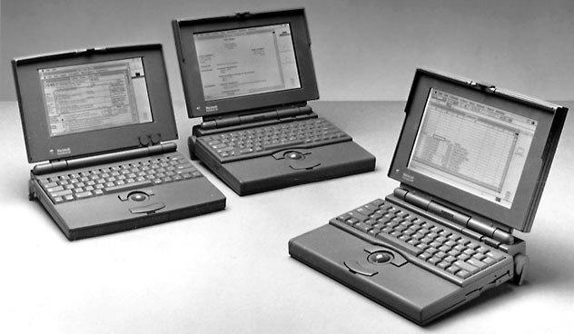

头两年的Powerbook用来代替鼠标的设备是Trackball。相比鼠标和IBM的小红点，它的操控精准度自然是略差了一些。从1994年的Powerbook 500开始，苹果的笔记本开始使用了成为它招牌的触摸板

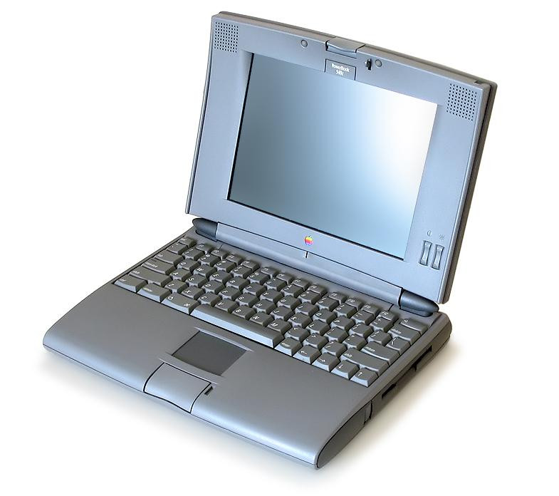

在1991年进入笔记本市场还有另一个美国计算机巨头——戴尔。1991年戴尔发布了笔记本320N

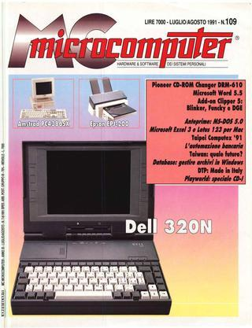

1992年，戴尔推出320SLi仅重1.6千克，但一年后就因为严重的质量问题被召回。

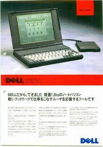

1992年，可能是历史上最出名的笔记本产品线——IBM Thinkpad面世了。

第一款发布的产品，被命名为Thinkpad 700。它重2.95kg，配备80486芯片，80MB硬盘以及一个支持64灰度的9.5寸显示屏，最重要的是，它已经装备了Thinkpad后来多年的杀手锏——小红点TrackPoint，从而使得已经进入Windows时代的笔记本可以摆脱鼠标，实现真正的移动办公。而它的售价也并不算太贵，2750美元，是中产阶层够得着的价位。几个月后IBM又推出了更便宜的Thinkpad 300，CPU换成80386，价格便宜了275美元。

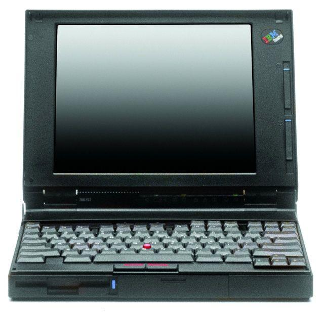

虽然Thinkpad因为摆脱了鼠标，是当年最便携的笔记本电脑，但单看尺寸，同年发售的Gateway HandBook才是真正的王者，尺寸仅有9.6 x 5.7 x 1.6英寸（24.4 x 14.5 x 4.1厘米），重1.4kg。值得说明的是，这款笔记本同样由三洋代工。它采用一款C&T 8680芯片，本身性能接近80286，但并非PC兼容，只能模拟Intel 80186的性能。

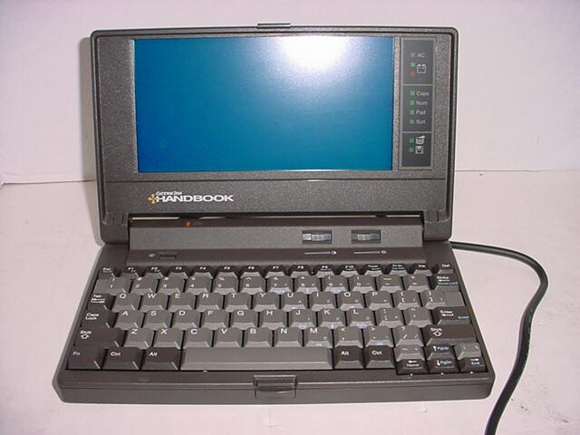

一年以后，Gateway又推出了HandBook 486，除了将CPU升级成真正的80486以外，还增加了EZ-point，一个类似小红点的指点杆，但是是蓝色的。

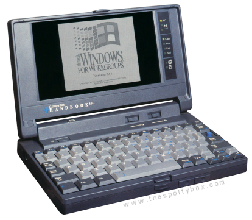

对应的全尺寸笔记本系列则叫ColorBook，采用彩色显示屏。下图为同年推出的ColorBook 486SX-25和HandBook 486SX-25的尺寸对比

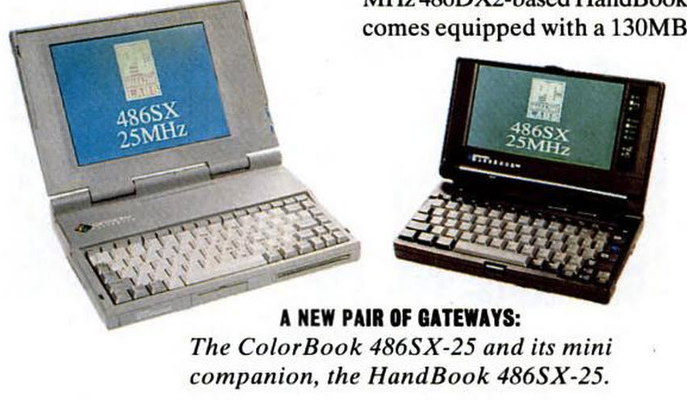

加入战局最晚的是惠普。1993年，惠普第一款笔记本产品——Omnibook 300上市。虽然惠普的产品来得晚了一些，但惠普也努力让它变得更有竞争力。在有9英寸彩色显示屏的情况下，Omnibook 300的三围是11.1 x 6.4 x 1.4英寸 (28.2 x 16.3 x 3.6厘米），而重量更是只有1.3千克，创造了当时业界最轻的记录，已经跟进天的超极本相仿。而且它的起价也只有1515美元——当然这是没有外存储器的版本。40MB硬盘的版本要1950美元。

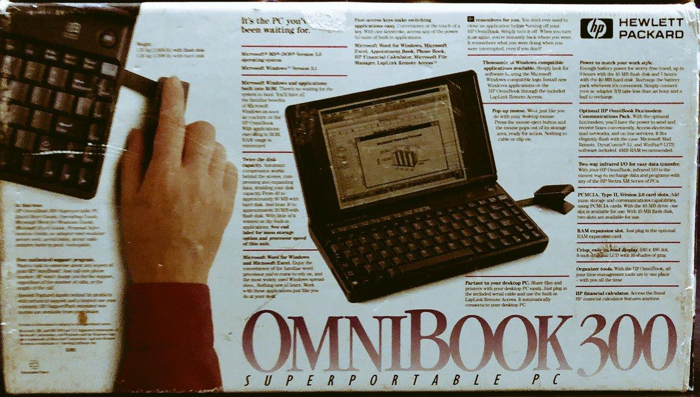

比较特别的是它还有一个装备10MB闪存存储器的高端版本，重量比硬盘轻了不少，电池续航还有所增加，售价2375美元。此外，Omnibook还配备了一只折叠式鼠标，可以从机身中拉出来，也改善了便携性。

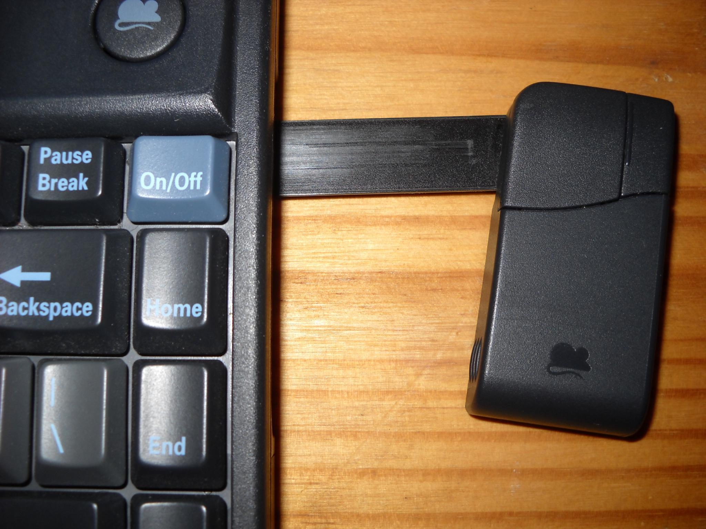

到1994年，惠普也推出了第一款全尺寸笔记本电脑——Omnibook 4000

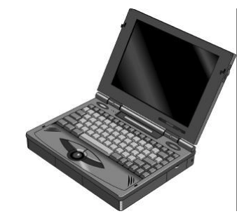

**三、笔记本电脑的发展**

90年代中期，伴随着windows windows 95的推出，对笔记本电脑的显示能力的要求高了很多，影响主要在三个方面：

1. 显示器尺寸增大
2. 显示器从单色变为彩色
3. 存储介质的升级

比如1994年，惠普Omnibook 600推出，相比之前的300/425/430/530等型号，600的三围从282 x 163 x 36mm增加到282 x 185 x 40mm，重量也从1.36千克增长到1.7千克。

1996年，Omnibook系列的产品线从此前的600/5000变为Omni 800/5700，在尺寸和重量基本保持一致的情况下，屏幕尺寸分别从9.5/10.4英寸增大到10.4/12.8英寸。

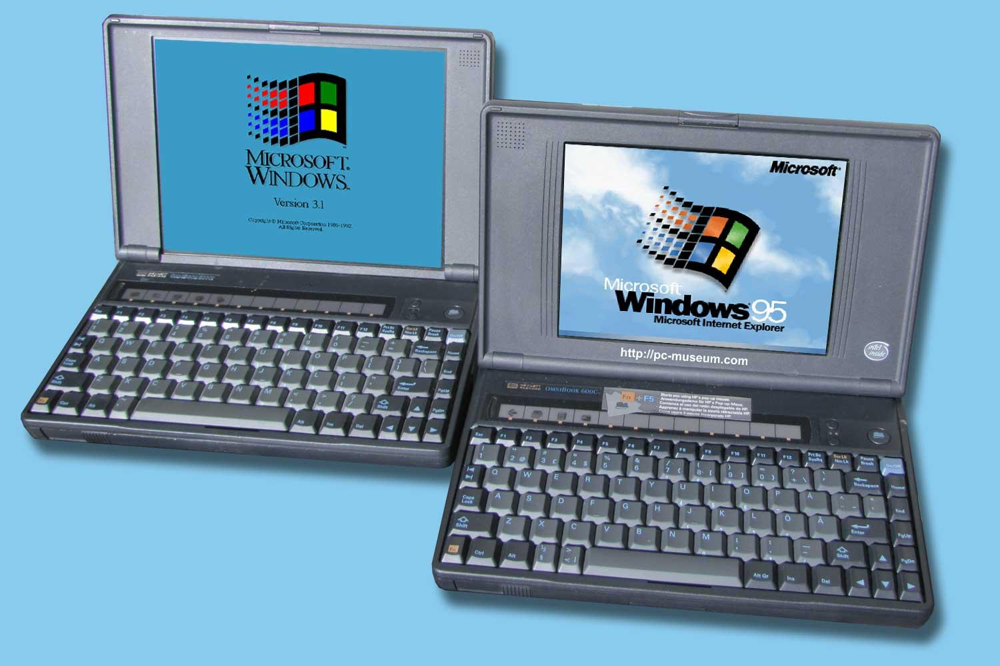

*Omnibook 600和800，左为600*

而到了1997年，Omnibook直接砍掉了从300到800这条subnotebook的产品线。最小的Omnibook 2000也有12.1寸的屏幕，重量达到3.27千克。

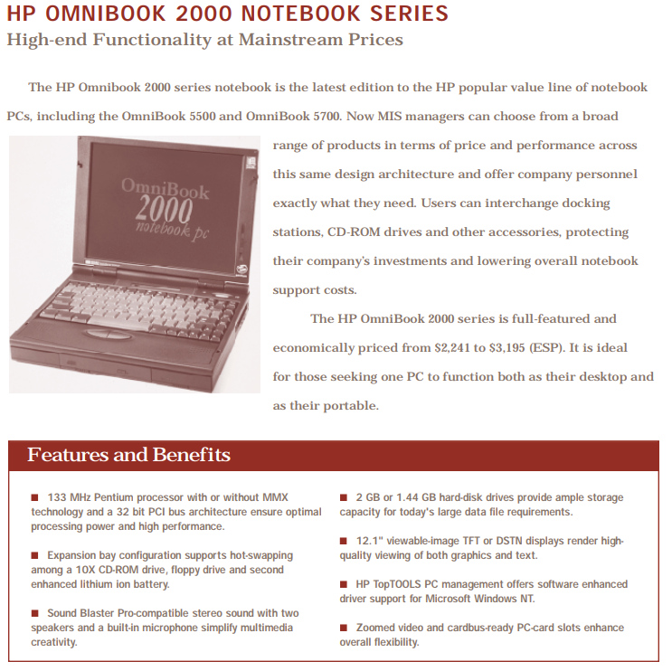

这里再以两个最负盛名的笔记本产品线——IBM Thinkpad和苹果PowerBook为例，说明93-95年笔记本电脑显示屏主流从黑白迅速变为彩色，而95年以后直到00年代初笔记本显示屏迅速增大的趋势。

历代Thinkpad 500系列（Thinkpad的轻薄本系列）的显示屏配置：

- 1993年：500，7.24寸单色
- 1994年：510，7.7寸单色
- 1996年：560，11.3/12.1寸彩色
- 1998年：560x，12.1寸彩色
- 1999年：570，12.1/13.3寸彩色

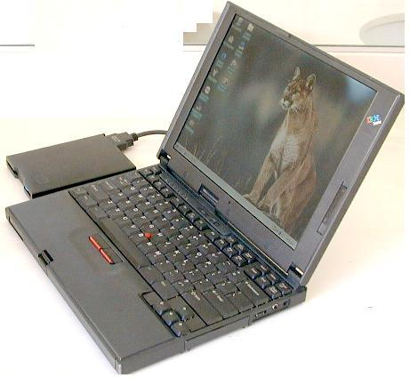

*Thinkpad 560*

历代Thinkpad 700系列（Thinkpad的全尺寸笔记本系列）的显示屏配置：

- 1992年：700T，10寸单色
- 1993年：720，9.5寸单色
- 1993年：720c，10.4寸彩色
- 1995年：760，10.4/12.1寸彩色
- 1997年：765，13.3寸彩色
- 1997年：770，14.1寸彩色

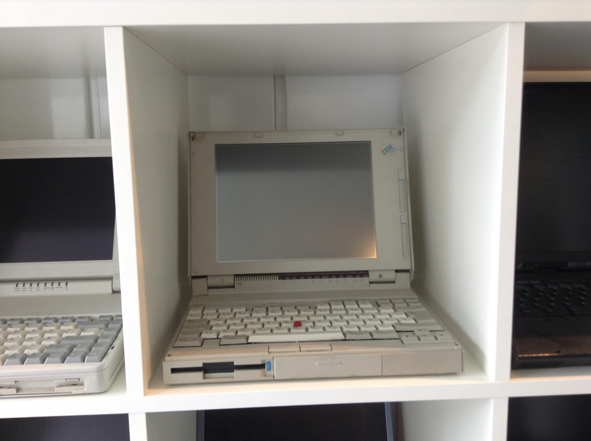

*Thinkpad 720c*

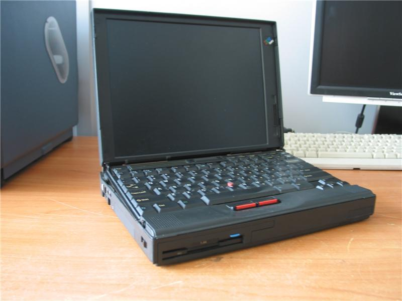

*Thinkpad 760，最大的特色是键盘一段会自动翘起来，更符合人体工学*

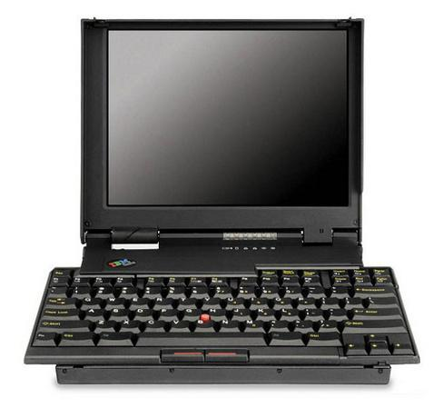

*同样于1995年推出的Thinkpad 701c，采用蝴蝶式弹出键盘是它最大的特色*

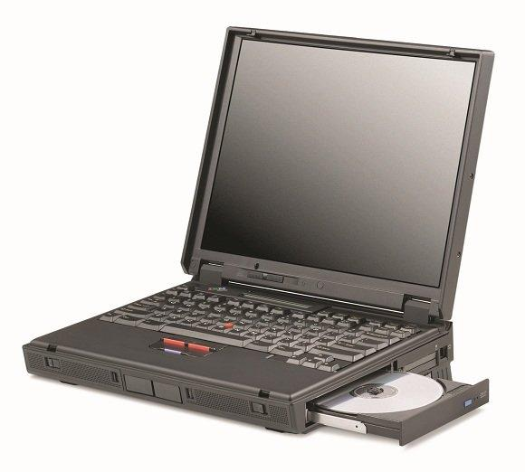

*Thinkpad 770，以光驱为卖点*

历代苹果轻薄本系列的显示屏配置：

- 1992年：Powerbook Duo 230，9.1寸单色
- 1993年：Powerbook Duo 270c，8.4寸彩色
- 1995年：Powerbook Duo 2300c，9.5寸彩色
- 1997年：Powerbook 2400c，10.4寸彩色
- 1999年：iBook，12寸彩色

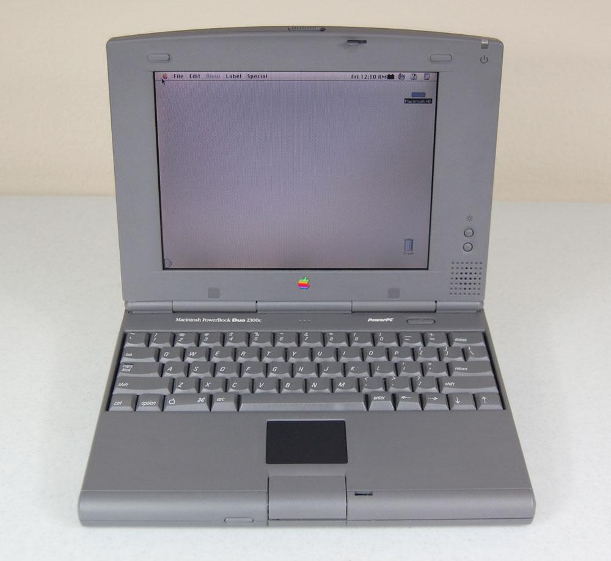

*Powerbook Duo 2300c*

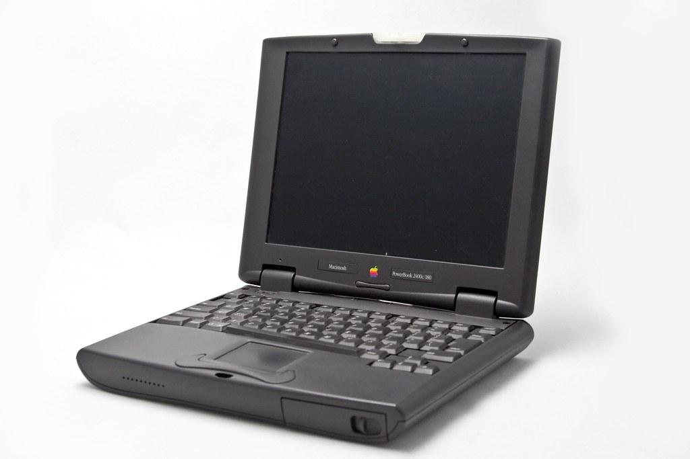

*Powerbook 2400c*

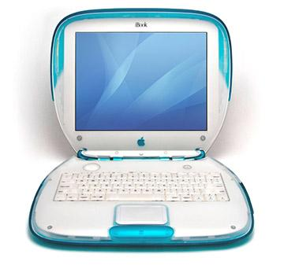

*iBook*

历代Powerbook全尺寸系列的显示屏配置：

- 1991年：100，9寸单色
- 1992年：145，9.8寸单色
- 1992年：180，9.5寸单色
- 1993年：165c，8.9寸彩色
- 1994年：520c，9.5寸彩色
- 1995年：550c，10.4寸彩色
- 1996年：1400，11.3寸彩色
- 1997年：G3 Kanga，12.1寸彩色
- 1998年：G3 Wallstreet I，13.3/14.1寸彩色
- 2001年：G4 Mercury，15.2寸彩色
- 2003年：G4 Rev A，17寸彩色

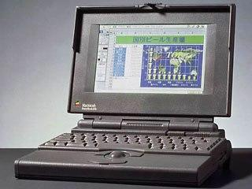

*Powerbook 165c*

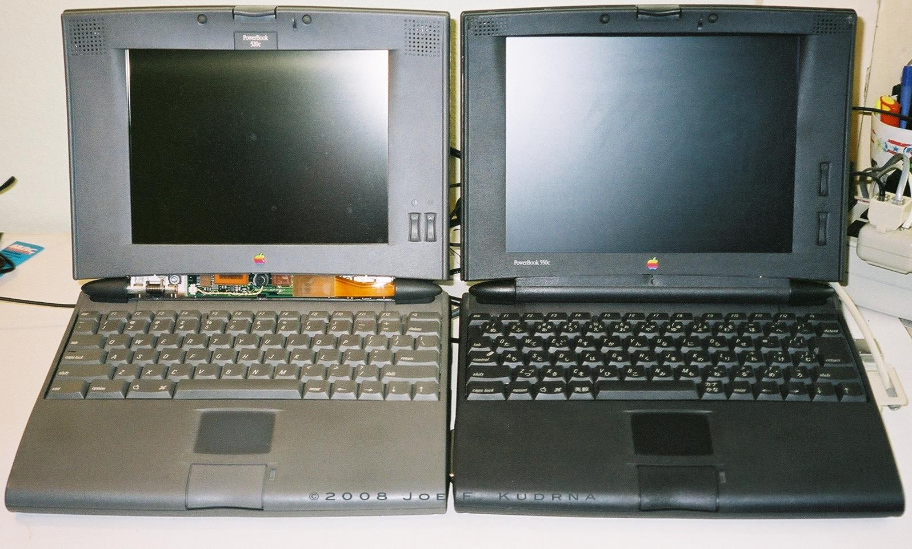

*Powerbook 520c，550c*

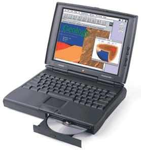

*Powerbook 1400*

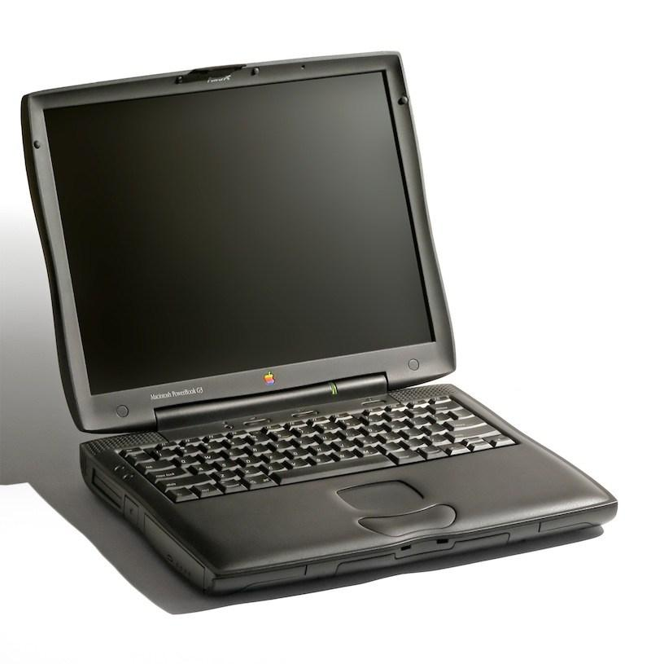

*Powerbook G3 Wallstreet II*

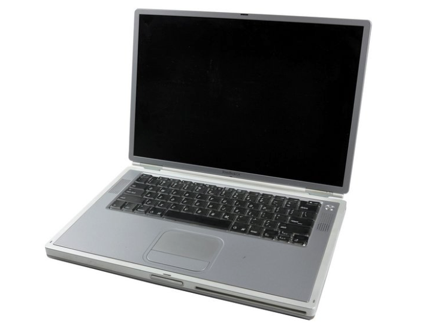

*Powerbook G4 Mercury*

存储介质的升级则主要是1997年以后光驱的出现。

1997年推出的Gateway Solo，售价高达5400美元。卖得这么贵是因为它既是第一台装备奔腾处理器的笔记本电脑，又是第一台装备光驱的笔记本电脑。它同时还有3.5寸软驱和可拆卸硬盘。Gateway宣传它完全可以替代台式机作为唯一一台主力电脑，因此取了Solo的名字。

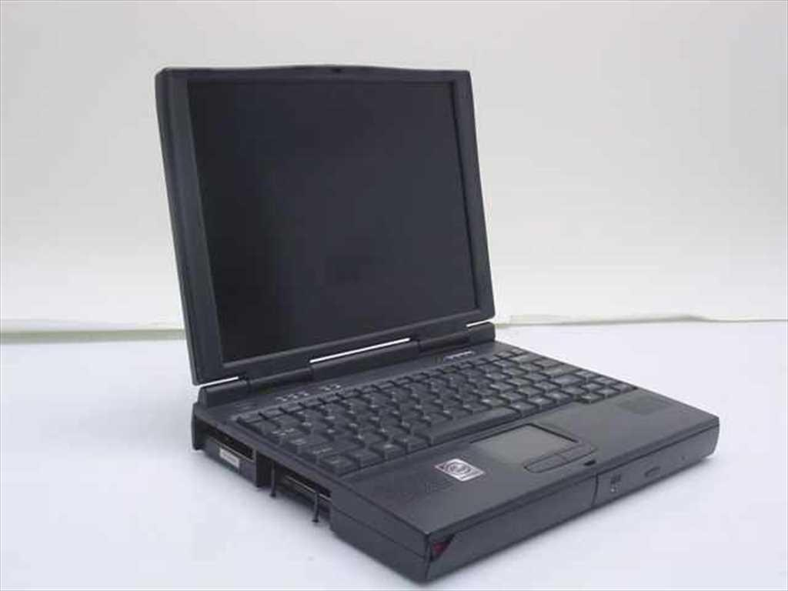

虽然笔记本电脑到此时已经极为成熟，有类似台式机的性能，同时足够轻便。但对于部分有特殊需求的消费者来说，更小的电脑仍然有意义，Subnotebook就在这种背景下腾空出世，下期专栏将会聊聊它们的故事。
